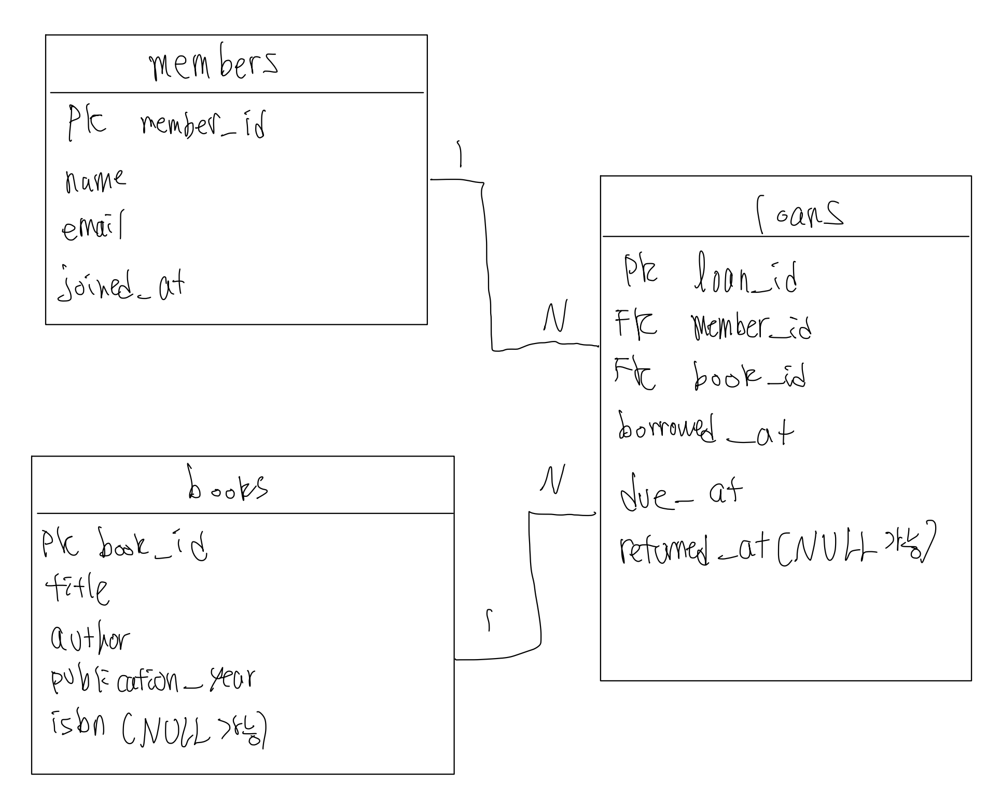
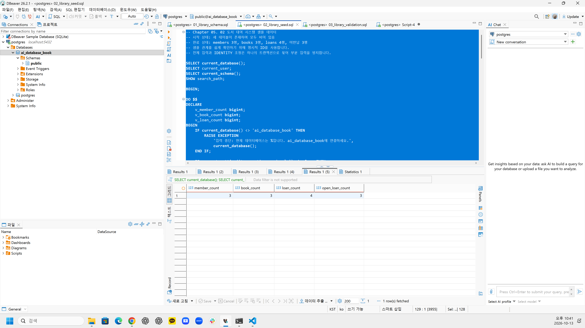
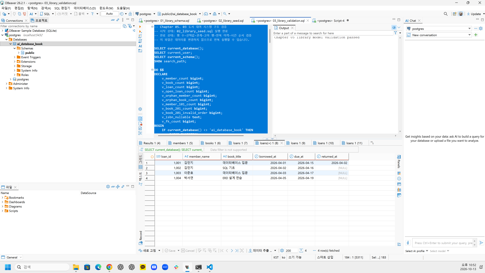
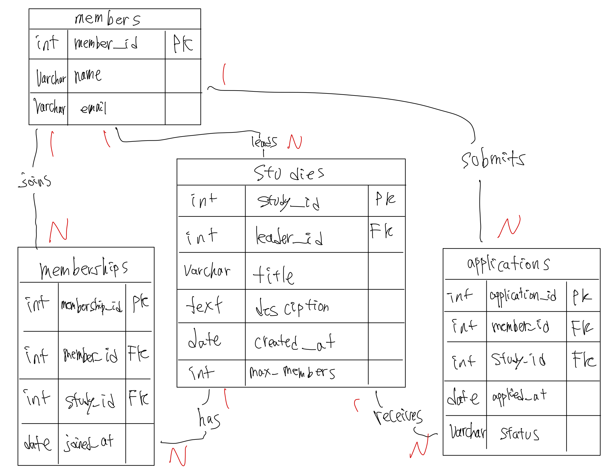

# Chapter 05 확장 실습 답안 템플릿

> **과제:** 요구사항에서 데이터 모델과 ERD 만들기  
> **사용 방법:** 이 파일을 내려받아 본인의 GitHub 저장소에 `chapter05_answer.md`라는 이름으로 저장한 뒤 실습하면서 바로 작성합니다.  
> **제출 방법:** LMS에는 파일을 직접 업로드하지 않고, **본인 GitHub 저장소의 `chapter05_answer.md` 파일 URL**을 제출합니다.

---

## 제출 전 주의

이 파일과 캡처 화면에는 실제 비밀번호, 전체 DB 접속 URL, API Key, 개인정보를 기록하지 않습니다.

```text
GitHub 계정 또는 별칭:yangguebeom
과제 작성일:2026-10-13
사용한 AI 도구:ChatGPT
```

---

# 1. Chapter 05 핵심 개념 복습

본문을 보지 않고 먼저 작성합니다.

```text
요구사항에서 바로 테이블부터 만들면 위험한 이유:관리해야 할 대상과 사건, 데이터 간 관계를 충분히 파악하지 못한 상태에서 테이블을 만들면 필요한 정보가 누락되거나 불필요한 중복이 발생할 수 있다. 또한 아직 확정되지 않은 정책을 제약조건으로 잘못 구현할 위험이 있기 때문이다.

한 행의 의미를 먼저 정해야 하는 이유:테이블의 각 행이 무엇을 나타내는지 명확해야 필요한 속성과 PK를 결정할 수 있다. 예를 들어 회원 한 명과 도서 대여 사건 한 건은 서로 다른 의미를 가지므로 이를 먼저 구분해야 한다.

확정 요구사항과 미확정 정책을 구분해야 하는 이유:명시된 요구사항은 설계에 반영해야 하지만, 확정되지 않은 정책은 임의로 결정해서는 안 된다. 미확정 정책을 잘못 적용하면 정상적인 데이터의 입력이나 관리가 제한될 수 있기 때문이다.

PK와 업무상 고유값 후보의 차이:PK는 테이블에서 각 행을 고유하게 식별하도록 지정한 기본키이며 NULL과 중복을 허용하지 않는다. 반면 업무상 고유값 후보는 이메일이나 ISBN처럼 고유할 가능성이 있는 값이지만, 실제 고유성을 보장해야 하는지는 요구사항을 통해 확인해야 한다.

N:M 관계를 그대로 두지 않고 연결 테이블을 검토하는 이유:관계형 데이터베이스에서 N:M 관계를 두 개의 1:N 관계로 분해하고, 관계에서 발생하는 추가 정보를 저장하기 위해서이다. 특히 도서 대여에서는 대여일과 반납일 같은 사건 정보를 기록해야 하므로 loans 테이블이 필요하다.
```

---

# 2. 도서 대여 요구사항 R-01~R-07 다시 분해

| 요구사항 | 관리 대상 / 사건 | 속성 후보 | 관계 / 규칙 후보 | 미확정 질문 |
| --- | --- | --- | --- | --- |
| R-01 | 회원 | 회원 ID | 도서관은 회원 정보를 관리한다. | 회원 탈퇴 시 기존 대여 이력은 유지하는가? |
| R-02 | 회원 | 이름, 이메일, 가입일 | 회원은 이름, 이메일, 가입일 정보를 가진다. | 이메일은 반드시 고유해야 하는가? |
| R-03 | 도서 | 제목, 저자, 출판연도, ISBN | 도서 정보를 관리하며 출판연도와 ISBN도 저장할 수 있다. | ISBN은 필수인가? 여러 저자를 등록할 수 있는가? |
| R-04 | 회원, 대여 기록 | 회원 ID, 대여 기록 ID | 회원 한 명은 여러 권의 책을 대여할 수 있다. | 동시 대여 가능 권수에 제한이 있는가? |
| R-05 | 도서, 대여 기록 | 도서 ID, 대여 기록 ID | 도서는 시간에 따라 여러 대여 기록을 가질 수 있다. | 같은 도서의 동시 대여를 허용하는가? |
| R-06 | 대여 기록 | 대여일, 반납예정일, 실제반납일 | 각 대여 기록은 대여 관련 날짜 정보를 가진다. | 대여 기간과 반납예정일을 정하는 기준은 무엇인가? |
| R-07 | 대여 기록 | 실제반납일 | 미반납 상태에서는 실제반납일이 비어 있을 수 있다. | 미반납 또는 연체에 대한 별도 제재가 있는가? |

### 본문과 비교한 뒤 수정한 내용

```text
처음에 놓친 부분:회원과 도서의 관계에서 대여라는 사건이 반복해서 발생한다는 점을 충분히 고려하지 못할 수 있다는 것을 확인하였다.

처음에 잘못 분류한 부분:대여일과 반납예정일을 회원이나 도서 자체의 속성으로 분류할 수 있지만, 실제로는 개별 대여 사건의 속성이라는 점을 확인하였다.

수정한 이유:동일한 회원이 동일한 도서를 여러 번 대여할 수 있으므로 각 대여를 독립된 사건으로 관리해야 한다. 따라서 회원과 도서를 직접 연결하기보다는 대여 기록을 별도의 사건 엔터티로 구분하는 것이 적절하다고 판단하였다.
```

---

# 3. 확정 규칙과 미확정 정책 구분

## 3-1. 확정된 규칙

```text
1. 도서관은 회원을 관리하며, 회원은 이름, 이메일, 가입일 정보를 가진다.

2. 도서는 제목과 저자를 관리하며, 출판연도와 ISBN 정보도 저장할 수 있다.

3. 회원 한 명은 여러 권의 도서를 대여할 수 있다.

4. 도서 한 건은 시간에 따라 여러 대여 기록을 가질 수 있으며, 대여 기록은 회원과 도서를 연결한다.

5. 대여 기록에는 대여일, 반납예정일, 실제반납일이 저장되며, 아직 반납하지 않은 경우 실제반납일은 NULL일 수 있다.
```

## 3-2. 미확정 질문

최소 5개를 작성합니다.

```text
Q1. 회원의 이메일은 반드시 고유해야 하는가?

Q2. 이메일의 대소문자는 동일한 것으로 처리해야 하는가?

Q3. ISBN은 반드시 입력해야 하며, ISBN이 없는 도서도 등록할 수 있는가?

Q4. 한 도서에 저자가 여러 명일 경우 어떻게 관리해야 하는가?

Q5. 같은 ISBN을 가진 실물 복본을 여러 권 등록할 수 있는가?

Q6. 회원 한 명이 동시에 대여할 수 있는 도서의 최대 권수는 몇 권인가?

Q7. 동일한 도서를 두 명의 회원이 동시에 대여할 수 있는가?

Q8. 회원이 탈퇴한 후에도 기존 대여 기록을 유지해야 하는가?
```

### 미확정 정책을 바로 `UNIQUE`, `CHECK`, 삭제 규칙으로 구현하면 위험한 이유

```text
아직 결정되지 않은 정책을 제약조건으로 구현하면 실제 운영 요구사항과 충돌할 수 있기 때문이다.

예를 들어 이메일에 UNIQUE를 적용하면 이메일을 공유하는 회원을 등록할 수 없고, ISBN에 UNIQUE를 적용하면 같은 ISBN을 가진 복본 도서를 별도로 등록하는 데 문제가 발생할 수 있다.

또한 회원 삭제 시 대여 기록까지 함께 삭제하도록 설정하면 보존해야 할 이력이 사라질 수 있다.

따라서 요구사항에서 확정되지 않은 정책은 임의로 구현하지 않고, 추가 확인이 필요한 사항으로 남겨 두는 것이 적절하다.
```

---

# 4. 엔터티·속성·사건 후보 구분

| 후보 | 대상 엔터티 / 사건 엔터티 / 속성 | 판단 근거 | 독립 식별 필요? |
| --- | --- | --- | --- |
| 회원 | 대상 엔터티 | 이름, 이메일, 가입일 등을 가지며 대여 활동의 주체가 된다. | 필요 (`member_id`) |
| 도서 | 대상 엔터티 | 제목, 저자, 출판연도, ISBN 등의 정보를 가지며 대여 대상이 된다. | 필요 (`book_id`) |
| 대여 기록 | 사건 엔터티 | 회원이 도서를 대여한 사건이며 시간에 따라 반복 발생한다. | 필요 (`loan_id`) |
| 이메일 | 회원의 속성 | 회원에게 속한 연락처 정보이므로 별도 엔터티로 구분할 필요가 없다. | 불필요 |
| ISBN | 도서의 속성 | 도서 정보를 나타내는 식별자 후보이지만 독립된 사건이나 관리 대상은 아니다. | 불필요 |
| 반납예정일 | 대여 기록의 속성 | 각 대여 사건마다 달라질 수 있는 날짜 정보이다. | 불필요 |

### “명사가 보이면 무조건 테이블”이 아닌 이유

```text
테이블은 독립적으로 관리할 필요가 있는 대상이나 반복적으로 발생하는 사건을 표현하기 위해 생성한다.

이메일, ISBN, 반납예정일도 명사이지만 각각 회원, 도서, 대여 기록에 속한 정보이므로 별도의 테이블이 아니라 속성으로 표현하는 것이 적절하다.

따라서 단순히 명사라는 이유만으로 테이블을 생성하는 것이 아니라 독립적인 식별이 필요한지, 여러 속성을 가지는지, 다른 데이터와 관계를 가지는지 등을 검토해야 한다.
```

---

# 5. 테이블별 한 행의 의미와 키 후보

| 테이블 | 한 행의 의미 | PK 후보 | 업무상 고유값 후보 | FK 후보 |
| --- | --- | --- | --- | --- |
| `members` | 회원 한 명 | `member_id` | `email` (미확정) | 없음 |
| `books` | 대여 대상으로 관리하는 도서 항목 한 건 | `book_id` | `isbn` (미확정) | 없음 |
| `loans` | 특정 회원이 특정 도서를 대여한 사건 한 건 | `loan_id` | 아직 확정되지 않음 | `member_id`, `book_id` |

### `members.email`을 지금 바로 UNIQUE라고 확정하지 않는 이유

```text
요구사항에는 회원이 이메일을 가진다고만 명시되어 있으며, 이메일이 반드시 고유해야 한다는 규칙은 없다.

가족이나 단체가 이메일을 공유할 가능성도 있으므로 추가적인 정책 확인 없이 UNIQUE를 적용하는 것은 적절하지 않다.

따라서 이메일을 업무상 고유값 후보로만 분류하고 고유성 여부는 미확정 정책으로 남겨 둔다.
```

### `books.isbn`을 지금 바로 NOT NULL + UNIQUE라고 확정하지 않는 이유

```text
요구사항에는 도서의 ISBN 정보를 저장할 수 있다고 되어 있지만, 반드시 입력해야 한다거나 중복될 수 없다는 규칙은 명시되지 않았다.

ISBN이 없는 도서가 존재할 수 있으며, 동일한 ISBN을 가진 실물 복본을 여러 권 관리해야 하는 상황도 고려해야 한다.

따라서 ISBN의 필수성과 고유성이 확정되기 전에는 NOT NULL과 UNIQUE를 임의로 적용하지 않는다.
```

---

# 6. 관계를 양방향 문장으로 작성

## 6-1. `members ↔ loans`

```text
회원 한 명은 여러 대여 기록을 가질 수 있다.

대여 기록 한 건은 정확히 한 회원을 참조한다.

카디널리티:members 1 : N loans
선택성에서 확인할 점:대여 기록이 없는 회원도 등록할 수 있는지 확인해야 한다. 또한 대여 기록은 반드시 기존 회원을 참조해야 하는지 확인한다.
```

## 6-2. `books ↔ loans`

```text
도서 한 건은 시간에 따라 여러 대여 기록을 가질 수 있다.

대여 기록 한 건은 정확히 한 도서를 참조한다.

카디널리티:books 1 : N loans
선택성에서 확인할 점:대여된 적이 없는 도서도 등록할 수 있는지 확인해야 한다. 또한 대여 기록은 반드시 기존 도서를 참조해야 하는지 확인한다.
```

## 6-3. `members ↔ books`를 직접 N:M으로 저장하지 않고 `loans`를 두는 이유

```text
회원 한 명은 여러 도서를 대여할 수 있고, 도서 한 건도 시간에 따라 여러 회원에게 대여될 수 있으므로 회원과 도서는 업무적으로 N:M 관계를 가진다.

하지만 이를 직접 연결하면 동일한 회원이 동일한 도서를 여러 번 대여한 이력을 구분하기 어렵다.

따라서 loans 테이블을 만들어 회원과 도서의 관계를 두 개의 1:N 관계로 분해하고 각 대여 사건을 독립적으로 저장한다.
```

### `loans`가 단순 연결표가 아니라 사건 엔터티라고 볼 수 있는 이유

```text
loans는 회원과 도서의 ID를 연결하는 역할뿐 아니라 대여일(borrowed_at), 반납예정일(due_at), 실제반납일(returned_at)이라는 자체 속성을 가진다.

동일한 회원이 같은 도서를 여러 번 대여하더라도 각 대여 시점과 반납 정보가 다르므로 별도의 기록으로 관리해야 한다.

따라서 loans는 단순한 연결 테이블이 아니라 시간에 따라 발생하는 대여 사건을 표현하는 사건 엔터티이다.
```

---

# 7. 도서 대여 ERD 초안

아래 항목이 보이도록 ERD를 작성합니다.

```text
members
books
loans
PK
FK
주요 속성
1:N 관계
```

권장 이미지 경로:

```text
assignments/chapter05/images/step07_library_erd.png
```

Markdown 예시:

```markdown

```


위 ERD는 members, books, loans 세 테이블로 구성하였다. members와 books는 각각 기본키(PK)를 가지며, loans는 자체 기본키와 함께 회원 및 도서를 참조하는 외래키(FK)를 가진다.

members와 loans, books와 loans는 각각 1:N 관계이며, 이를 통해 회원과 도서 사이에서 발생하는 대여 사건을 독립적으로 관리할 수 있다. 또한 미반납 상태와 ISBN 미등록 가능성을 고려하여 returned_at과 isbn은 NULL을 허용하도록 표현하였다.

### ERD를 그린 뒤 수정한 부분

```text
1. 회원과 도서를 직접 N:M 관계로 연결하는 대신 loans 테이블을 두어 두 개의 1:N 관계로 표현하였다.

2. 대여일, 반납예정일, 실제반납일을 도서나 회원의 속성이 아니라 loans 테이블의 속성으로 배치하였다.

3. members와 books에는 각각 PK를 두고, loans에는 자체 PK와 회원 및 도서를 참조하는 FK를 배치하였다.

4. 반납되지 않은 대여 기록도 저장할 수 있도록 returned_at은 NULL을 허용하는 속성으로 표현하였다.

5. 이메일과 ISBN의 고유성은 확정되지 않았으므로 임의로 UNIQUE 제약조건을 추가하지 않았다.
```

---

# 8. PostgreSQL로 도서 대여 모델 구현 확인

## 8-1. 현재 환경 확인

```sql
SELECT current_database();
SELECT current_user;
SELECT current_schema();
SHOW search_path;
SHOW transaction_read_only;
```

```text
현재 DB: ai_database_book
현재 사용자: postgres
현재 스키마: public
search_path: public, "$user"
읽기 전용 여부: off
```

- [x] 현재 DB가 `ai_database_book`이다.
- [x] 실행 범위를 확인했다.
- [x] Auto-commit 상태를 확인했다.

## 8-2. 스키마 생성 SQL 실행

사용 파일:

```text
code/chapter05/01_library_schema.sql
```

실행 전 예상:

```text
생성될 테이블 수: 3개
생성 순서: members → books → loans
각 테이블 예상 행 수: members 0행, books 0행, loans 0행
```

실행 후 실제:

```text
members 존재: 확인
books 존재: 확인
loans 존재: 확인
각 테이블 행 수: members 0행, books 0행, loans 0행
```

### `loans`를 마지막에 만드는 이유

```text
loans 테이블은 member_id와 book_id를 외래키(FK)로 사용하여 각각 members와 books 테이블의 기본키(PK)를 참조한다.

따라서 참조 대상인 부모 테이블 members와 books가 먼저 존재해야 외래키 관계를 설정할 수 있다.

이번 실습에서는 members → books → loans 순서로 테이블을 생성하여 참조 관계를 올바르게 구성하였다.
```

---

# 9. 샘플 데이터 입력과 관계 관찰

사용 파일:

```text
code/chapter05/02_library_seed.sql
```

## 9-1. 실행 전 예상

```text
members 예상 행 수: 3
books 예상 행 수: 3
loans 예상 행 수: 4
미반납 예상 건수: 3
회원 101 대여 예상 건수: 2
도서 201 대여 예상 건수: 2
```

## 9-2. 실제 결과

```text
members 실제 행 수: 3
books 실제 행 수: 3
loans 실제 행 수: 4
미반납 실제 건수: 3
회원 101 대여 실제 건수: 2 (샘플 SQL의 입력 및 검증 결과)
도서 201 대여 실제 건수: 2 (샘플 SQL의 입력 및 검증 결과)
```

### 샘플 데이터에서 확인한 1:N 관계

```text
회원 101은 대여 기록 1001과 1002를 가지며 서로 다른 도서 201과 202를 대여하였다.

또한 도서 201은 대여 기록 1001과 1003에 등장하며, 서로 다른 회원에게 시간 차를 두고 대여되었다.

따라서 회원 한 명이 여러 대여 기록을 가질 수 있고, 도서 한 건도 여러 대여 기록을 가질 수 있음을 확인하였다.

이는 members와 loans, books와 loans가 각각 1:N 관계임을 보여준다.
```

### `returned_at = NULL`이 의미하는 것

```text
returned_at은 실제 반납일을 저장하는 속성이다.

해당 값이 NULL이면 아직 반납이 완료되지 않아 실제 반납일이 기록되지 않았음을 의미한다.

이번 샘플 데이터에서는 전체 대여 기록 4건 중 3건의 returned_at이 NULL이므로 미반납 대여가 3건임을 확인하였다.
```

### 증거 화면

권장 경로:

```text
assignments/chapter05/images/step09_seed_result.png
```



02_library_seed.sql을 실행한 결과 members 3행, books 3행, loans 4행이 저장되었고, 이 중 미반납 대여는 3건으로 나타났다. 이를 통해 샘플 데이터가 예상한 행 수와 일치함을 확인하였다.

---

# 10. 검증 SQL 실행

사용 파일:

```text
code/chapter05/03_library_validation.sql
```

## 10-1. 결과 기록

```text
members = 3
books = 3
loans = 4
미반납 건수 = 3
회원 101 대여 이력 = 2
도서 201 대여 이력 = 2
회원 참조 고아 행 = 0
도서 참조 고아 행 = 0
loans FK 개수 = 2
검증 최종 메시지 = Chapter 05 library model validation passed
```

### 단순히 테이블 3개가 생성되었다고 설계 검증이 끝난 것이 아닌 이유

```text
테이블이 정상적으로 생성되었다는 사실만으로는 데이터가 요구사항에 맞게 저장되고 테이블 사이의 관계가 올바르게 작동하는지 확인할 수 없다.

따라서 실제 샘플 데이터를 입력하여 회원과 도서의 대여 관계, 외래키 참조 무결성, 미반납 상태 표현, 동일한 도서의 반복 대여 이력 등을 검증해야 한다.

이번 실습에서는 회원 3명, 도서 3권, 대여 기록 4건이 정상적으로 저장되었으며 회원 및 도서 참조 고아 행이 모두 0건임을 확인하였다.

또한 loans 테이블에 외래키가 2개 존재하고, 최종 검증 통과 메시지가 출력되어 현재 데이터 모델이 주어진 샘플 데이터와 검증 조건을 만족함을 확인하였다.
```

### 증거 화면

권장 경로:

```text
assignments/chapter05/images/step10_validation.png
```



03_library_validation.sql을 실행한 결과, 회원과 도서 및 대여 기록이 정상적으로 연결되어 있음을 확인하였다. 총 4건의 대여 기록이 조회되었으며, Output 창에 `Chapter 05 library model validation passed` 메시지가 출력되어 검증이 성공적으로 완료되었음을 확인하였다.

---

# 11. 작은 시나리오로 모델 검증

아래 시나리오를 현재 모델이 표현할 수 있는지 판단합니다.

| 시나리오 | 표현 가능? | 이유 | 추가 확인할 정책 |
| --- | --- | --- | --- |
| 회원 A가 서로 다른 책 2권을 대여 | 가능 | loans에 동일한 member_id를 가진 대여 기록을 여러 건 저장할 수 있다. | 회원별 동시 대여 권수 제한 |
| 같은 책을 시간 차를 두고 다시 대여 | 가능 | 동일한 book_id를 사용하는 별도의 대여 기록을 생성할 수 있다. | 재대여 가능 시점과 조건 |
| 아직 반납하지 않은 대여 | 가능 | returned_at에 NULL을 저장하여 미반납 상태를 나타낼 수 있다. | 연체 기준 및 처리 방법 |
| 회원은 있지만 대여 기록이 없음 | 가능 | members에 등록된 회원이 반드시 loans에 존재해야 하는 것은 아니다. | 미대여 회원의 관리 정책 |
| ISBN이 없는 도서 | 가능 | books.isbn은 NULL을 허용하므로 ISBN 없이 도서를 등록할 수 있다. | ISBN 없는 도서의 식별 방법 |
| 같은 ISBN의 실물 복본 2권 | 제한적 가능 | isbn에 UNIQUE가 없으므로 같은 ISBN의 행을 여러 건 저장할 수 있지만, 복본을 구별하는 별도 구조는 없다. | 복본의 식별 및 재고 관리 방법 |
| 한 도서에 저자 2명 | 제한적 | author가 단일 문자열이므로 저자 여러 명을 구조적으로 구분하거나 관리하기 어렵다. | 저자별 관리 및 다중 저자 관계 |
| 같은 도서를 두 명이 동시에 대여 | 구조상 저장 가능 | 현재 모델에는 동일한 도서의 동시 활성 대여를 제한하는 제약조건이 없다. | 동일한 도서의 동시 대여 허용 여부 |

### 현재 Chapter 05 모델의 한계 3가지

```text
1. 동일한 ISBN의 실물 복본을 체계적으로 관리하기 어렵다.
현재 books 테이블은 간소화된 도서 항목을 표현하며, 도서의 서지 정보와 개별 실물 복본을 별도 엔터티로 구분하지 않는다. 따라서 동일한 ISBN을 가진 복본의 관리 정책을 추가로 검토해야 한다.

2. 한 도서의 여러 저자를 독립적으로 관리하기 어렵다.
현재 books 테이블에는 author 속성이 하나의 문자열로 저장되므로 여러 저자의 정보를 개별적으로 식별하거나 저자와 도서 사이의 N:M 관계를 표현하기 어렵다. 여러 저자를 별도로 관리해야 한다면 저자 엔터티와 연결 테이블을 검토해야 한다.

3. 동일한 도서의 동시 대여를 제한하는 정책이 구현되지 않았다.
현재 loans 테이블에서는 동일한 book_id를 사용하는 미반납 대여 기록이 여러 건 저장될 수 있다. 따라서 실제 운영에서 동시 대여를 제한해야 하는지 정책을 확인하고, 필요하다면 추가 제약조건을 검토해야 한다.
```

---

# 12. Chapter 01~04 개인 서비스 요구사항 작성

지금까지 선택한 개인 서비스 아이디어를 사용합니다.

```text
서비스 이름: 스터디 모임 관리 서비스

서비스 목적:
사용자가 다양한 스터디 모임을 개설하고 참여할 수 있도록 하며, 스터디의 구성원, 신청 기록, 일정, 출석, 공지사항 및 활동 기록 등을 체계적으로 관리하는 데이터베이스 기반 서비스를 구현하는 것이다.
```

## 12-1. 요구사항

최소 8개를 작성합니다.

```text
P05-R01. 서비스는 회원을 관리하며, 각 회원은 고유한 회원 ID와 프로필 정보를 가진다.

P05-R02. 회원은 여러 스터디를 개설할 수 있으며, 각 스터디는 스터디 ID, 이름, 설명, 개설일, 최대 인원 등의 정보를 가진다.

P05-R03. 각 스터디에는 한 명의 스터디장이 존재하며, 스터디장은 회원 중 한 명이다.

P05-R04. 회원은 여러 스터디에 참여할 수 있고, 하나의 스터디에도 여러 회원이 참여할 수 있다. 따라서 회원과 스터디의 참여 관계를 별도로 관리한다.

P05-R05. 회원은 스터디 참여를 신청할 수 있으며, 각 신청 기록에는 신청자, 대상 스터디, 신청일, 승인 또는 거절 등의 처리 상태를 저장한다. 스터디장이 신청을 승인하거나 거절할 수 있다.

P05-R06. 스터디는 여러 일정을 가질 수 있으며, 각 일정에는 일정 ID, 대상 스터디, 제목, 시작일시, 종료일시 등의 정보를 저장한다.

P05-R07. 스터디 구성원의 출석 정보를 관리하며, 각 출석 기록은 해당 구성원과 스터디 일정에 연결된다. 출석 여부는 스터디장이 기록한다.

P05-R08. 스터디별 공지사항을 관리하며, 각 공지사항에는 작성자, 대상 스터디, 제목, 내용, 작성일시 등의 정보를 저장한다.

P05-R09. 스터디별 활동 게시글과 댓글을 관리하며, 각 게시글과 댓글은 작성자 및 관련 게시글 또는 스터디와 연결된다.

P05-R10. 스터디마다 최대 참여 인원을 설정하며, 스터디장을 포함한 구성원 수가 최대 인원을 초과하지 않도록 관리한다.

P05-R11. 스터디 참여 신청이 취소되거나 거절되더라도 해당 신청 기록은 보존하며, 회원의 재신청을 허용한다.

P05-R12. 스터디장이 탈퇴하려는 경우에는 다른 구성원에게 스터디장 권한을 양도한 후 탈퇴할 수 있도록 관리한다.
```
> 위 요구사항은 기존 스터디 모임 관리 서비스의 주요 관리 대상과 업무 규칙을 중심으로 작성하였다. 향후 ERD 설계 과정에서 필요한 엔터티, 속성, 관계를 도출할 예정이다.


> 화면 기능보다 **저장해야 할 사실, 반복 사건, 상태와 관계**를 중심으로 작성합니다.

## 12-2. 미확정 질문

최소 3개를 작성합니다.

```text
P05-Q01. 회원의 이메일이나 닉네임은 반드시 고유해야 하는가?

P05-Q02. 한 회원이 동시에 개설하거나 참여할 수 있는 스터디 수에 제한이 있는가?

P05-Q03. 스터디가 삭제되거나 종료된 이후에도 기존 일정, 출석, 신청 기록 및 활동 기록을 유지해야 하는가?

P05-Q04. 스터디에 참여하지 않은 회원도 공지사항이나 게시글을 열람할 수 있는가?

P05-Q05. 스터디장이 권한을 양도할 때 새로운 스터디장의 별도 수락 절차가 필요한가?
```

---

# 13. 개인 서비스 모델 초안

## 13-1. 엔터티·사건 후보표

| 후보 | 대상 / 사건 | 한 행의 의미 | 주요 속성 | PK 후보 | 업무 식별자 후보 |
| --- | --- | --- | --- | --- | --- |
| `members` | 대상 엔터티 | 서비스에 등록된 회원 한 명 | member_id, name, email | member_id | email (고유성 미확정) |
| `studies` | 대상 엔터티 | 개설된 스터디 모임 한 개 | study_id, leader_id, title, description, created_at, max_members | study_id | study_id 외 별도 후보 미확정 |
| `memberships` | 관계 엔터티 | 특정 회원이 특정 스터디에 참여하는 관계 한 건 | membership_id, member_id, study_id, joined_at | membership_id | (member_id, study_id) 조합 후보 |
| `applications` | 사건 엔터티 | 특정 회원이 특정 스터디에 참여를 신청한 사건 한 건 | application_id, member_id, study_id, applied_at, status | application_id | 별도 업무 식별자 미확정 |

## 13-2. 관계 문장

최소 3쌍을 양방향으로 작성합니다.

```text
관계 1: members ↔ studies

회원 한 명은 여러 스터디를 개설할 수 있다.
스터디 한 개는 정확히 한 명의 회원을 스터디장으로 가진다.

카디널리티: members 1 : N studies
FK 후보: studies.leader_id → members.member_id


관계 2: members ↔ memberships

회원 한 명은 여러 스터디 참여 관계를 가질 수 있다.
스터디 참여 관계 한 건은 정확히 한 명의 회원을 참조한다.

카디널리티: members 1 : N memberships
FK 후보: memberships.member_id → members.member_id


관계 3: studies ↔ memberships

스터디 한 개는 여러 회원의 참여 관계를 가질 수 있다.
스터디 참여 관계 한 건은 정확히 한 개의 스터디를 참조한다.

카디널리티: studies 1 : N memberships
FK 후보: memberships.study_id → studies.study_id


관계 4: members ↔ applications

회원 한 명은 여러 스터디 참여 신청 기록을 가질 수 있다.
참여 신청 기록 한 건은 정확히 한 명의 신청 회원을 참조한다.

카디널리티: members 1 : N applications
FK 후보: applications.member_id → members.member_id


관계 5: studies ↔ applications

스터디 한 개는 여러 참여 신청 기록을 가질 수 있다.
참여 신청 기록 한 건은 정확히 한 개의 스터디를 참조한다.

카디널리티: studies 1 : N applications
FK 후보: applications.study_id → studies.study_id
```

## 13-3. N:M 관계 검토

```text
N:M 관계 후보:
회원(members) ↔ 스터디(studies)

회원 한 명은 여러 스터디에 참여할 수 있고,
스터디 한 개에도 여러 회원이 참여할 수 있으므로 N:M 관계이다.

연결 테이블 후보:
memberships

연결 테이블 한 행의 의미:
특정 회원 한 명이 특정 스터디 한 개에 참여하는 관계 한 건을 의미한다.

연결 테이블 자체에 필요한 사건 속성:
membership_id: 참여 관계 식별자
member_id: 참여 회원 ID
study_id: 참여 스터디 ID
joined_at: 스터디 참여일

회원과 스터디의 N:M 관계를 memberships를 통해
두 개의 1:N 관계로 표현한다.

참여 신청은 실제 참여 관계와 구분하여 applications에 기록한다.
신청일 및 승인·거절 등의 상태를 별도로 저장하기 위함이다.
```

---

# 14. 개인 서비스 ERD 초안

ERD에 최소 다음을 표시합니다.

```text
테이블 3개 이상
각 테이블 PK
주요 속성
필요한 FK
관계선
카디널리티
```

권장 이미지 경로:

```text
assignments/chapter05/images/step14_my_erd.png
```




회원은 여러 스터디를 개설하거나 참여할 수 있으며, 스터디도 여러 회원의 참여 관계를 가질 수 있다.

회원과 스터디의 N:M 관계는 memberships 테이블을 통해 두 개의 1:N 관계로 분해하였다.

또한 참여 신청 기록을 applications 테이블로 분리하여 신청 사건과 실제 참여 관계를 구분하였다.

### ERD의 각 테이블이 어떤 요구사항에서 나왔는지 설명

| 테이블 | 근거 요구사항 ID | 한 행의 의미 |
| --- | --- | --- |
| `members` | P05-R01 | 서비스에 등록된 회원 한 명 |
| `studies` | P05-R02, P05-R03, P05-R10, P05-R12 | 개설된 스터디 모임 한 개 |
| `memberships` | P05-R04, P05-R10, P05-R12 | 회원 한 명과 스터디 한 개의 참여 관계 한 건 |
| `applications` | P05-R05, P05-R11 | 회원이 스터디에 참여를 신청한 사건 한 건 |

---

# 15. 요구사항 추적표

| 요구사항 ID | 데이터 모델 반영 위치 | 검증 방법 | 상태 |
| --- | --- | --- | --- |
| P05-R01 | members 테이블 | 회원 정보를 2건 이상 구분하여 저장할 수 있는지 확인 | 반영 |
| P05-R02 | studies 테이블 및 leader_id | 한 회원이 여러 스터디를 개설할 수 있는지 확인 | 반영 |
| P05-R03 | studies.leader_id → members.member_id | 각 스터디가 한 명의 회원을 스터디장으로 참조하는지 확인 | 확인필요 |
| P05-R04 | memberships 테이블 | 한 회원의 여러 스터디 참여와 한 스터디의 여러 회원 참여를 확인 | 반영 |
| P05-R05 | applications 테이블 | 회원별 참여 신청과 승인·거절 상태를 저장할 수 있는지 확인 | 확인필요 |
| P05-R06 | schedules 테이블 추가 필요 | 스터디별 여러 일정을 저장할 수 있는지 확인 | 미반영 |
| P05-R07 | attendance 테이블 추가 필요 | 구성원과 일정별 출석 기록을 저장할 수 있는지 확인 | 미반영 |
| P05-R08 | notices 테이블 추가 필요 | 스터디별 공지사항과 작성자를 저장할 수 있는지 확인 | 미반영 |

### ERD 그림만으로 요구사항 누락을 발견하기 어려운 이유

```text
ERD는 테이블의 속성과 테이블 간 관계를 시각적으로 보여주지만, 모든 요구사항이 실제로 반영되었는지를 직접 알려주지는 않는다.

예를 들어 이번 ERD에서는 회원, 스터디, 참여 관계, 신청 기록을 표현하였지만 일정, 출석, 공지사항을 저장할 테이블은 아직 포함하지 않았다.

또한 스터디의 최대 인원 제한이나 신청 승인 절차처럼 단순한 관계선만으로 표현하기 어려운 업무 규칙도 존재한다.

따라서 요구사항 ID별로 데이터 모델의 반영 위치와 검증 방법을 연결하는 추적표가 필요하다.

이를 통해 누락된 요구사항과 추가 확인이 필요한 설계 요소를 발견하고, 이후 모델을 보완할 수 있다.
```

---

# 16. 개인 서비스 작은 데이터 시나리오 검증

가상 데이터만 사용합니다.

```text
사용자/대상 A:
회원 101 - 김민수

사용자/대상 B:
회원 102 - 이서연

대상 X:
스터디 201 - 데이터베이스 스터디
스터디장: 김민수(101)

대상 Y:
스터디 202 - 프로그래밍 스터디
스터디장: 김민수(101)

사건 1:
회원 101이 스터디 201과 202를 개설한다.

사건 2:
회원 101이 스터디 201에 참여하고,
회원 102는 스터디 201에 참여 신청을 한다.

사건 3:
회원 102의 참여 신청이 승인되어
스터디 201의 구성원으로 등록된다.

사건 4:
회원 102가 스터디 201에서 탈퇴한 후
동일한 스터디에 다시 참여 신청한다.
```

### 이 시나리오를 현재 ERD로 저장할 수 있는가?

```text
사건 1:
저장할 수 있다. studies 테이블의 leader_id를 통해
회원 101이 여러 스터디를 개설한 관계를 나타낼 수 있다.

사건 2:
저장할 수 있다. memberships 테이블에 회원 101과
스터디 201의 참여 관계를 기록할 수 있다.
또한 applications 테이블에 회원 102의 참여 신청을
별도의 사건으로 저장할 수 있다.

사건 3:
부분적으로 저장할 수 있다.
applications.status에 승인 상태를 기록하고,
memberships에 회원 102와 스터디 201의
참여 관계를 추가할 수 있다.
다만 승인 시 자동으로 구성원을 등록하는
업무 절차는 ERD만으로 구현되지 않는다.

사건 4:
부분적으로 저장할 수 있다.
applications에 새로운 신청 기록을 추가하여
재신청 사건을 구분할 수 있다.
다만 memberships에는 탈퇴일이나 참여 상태가 없으므로
과거 참여 이력을 보존하면서 재가입을 관리하는 방식은
추가 설계가 필요하다.

추가로 회원 102가 아무 스터디에도 참여하지 않은 상태도
members에만 회원 정보를 저장하는 방식으로 표현할 수 있다.
```

### 저장하기 어려운 상황 또는 모호한 부분

```text
1. memberships 테이블에는 탈퇴일과 참여 상태가 없어
   구성원의 탈퇴 및 재가입 이력을 명확하게 구분하기 어렵다.

2. applications 테이블에 신청 상태를 저장할 수 있지만,
   승인 후 memberships에 참여 관계를 생성하는
   구체적인 처리 절차는 아직 구현되지 않았다.

3. 동일한 회원이 동일한 스터디에 반복해서 신청하는 경우,
   이전 신청 기록과 새로운 신청 기록을 구분할 수 있지만
   신청 횟수 및 중복 신청 제한 정책은 추가 확인이 필요하다.

4. 스터디별 최대 참여 인원은 max_members로 저장할 수 있지만,
   실제 참여 인원이 이를 초과하지 않도록 하는 규칙은
   현재 ERD만으로 보장되지 않는다.
```

### 시나리오 검증 후 수정한 ERD 내용

```text
시나리오 검증을 통해 memberships에 참여 상태와
탈퇴일을 추가하는 방안을 검토하였다.

추가 속성 후보:
- membership_status: 현재 참여 상태
- left_at: 스터디 탈퇴일

이를 통해 탈퇴와 재가입 상황을 더 명확히 관리할 수 있다.

다만 탈퇴 후 기존 참여 기록을 갱신할지,
새로운 참여 기록을 생성할지는 아직 확정되지 않았으므로
이번 ERD 초안에는 즉시 반영하지 않고
추가 설계가 필요한 사항으로 남겨 두었다.
```

---

# 17. AI를 설계자가 아니라 리뷰어로 활용

## 17-1. AI에게 전달한 핵심 자료

```text
요구사항:
스터디 모임 관리 서비스에서 회원 관리, 스터디 개설,
구성원 참여, 신청 및 승인, 일정, 출석, 공지사항 등을
관리해야 한다.

미확정 질문:
회원 이메일의 고유성, 스터디 참여 수 제한,
탈퇴 후 참여 기록 보존 방식, 삭제 정책 등은
추가 확인이 필요하다.

테이블별 한 행 의미:
members: 회원 한 명
studies: 스터디 모임 한 개
memberships: 회원과 스터디의 참여 관계 한 건
applications: 회원의 스터디 참여 신청 사건 한 건

관계 문장:
회원 한 명은 여러 스터디를 개설할 수 있다.
스터디 한 개는 한 명의 스터디장을 가진다.

회원 한 명은 여러 참여 관계를 가질 수 있다.
스터디 한 개는 여러 회원의 참여 관계를 가진다.

회원 한 명은 여러 참여 신청 기록을 가질 수 있다.
스터디 한 개는 여러 참여 신청 기록을 가질 수 있다.

ERD 설명:
4개의 핵심 테이블을 구성하고,
각 테이블의 PK, 필요한 FK, 주요 속성과
총 5개의 1:N 관계를 표시하였다.

회원과 스터디의 N:M 참여 관계는
memberships 연결 테이블을 통해 표현하였다.
```

## 17-2. AI 검토 요청

실제로 사용한 프롬프트 또는 핵심 내용을 기록합니다.

```text
스터디 모임 관리 서비스의 요구사항을 바탕으로
작성한 ERD를 검토해 달라고 요청하였다.

특히 테이블 4개의 구성, PK와 FK의 적절성,
관계선 5개의 방향과 1:N 카디널리티,
주요 속성과 요구사항의 일치 여부를 확인하도록 하였다.

또한 잘못된 설계나 추가 검토가 필요한 정책이 있는지
검토하고, 기존 요구사항에 없는 정책은 임의로
확정하지 않도록 하였다.
```

## 17-3. AI 제안 검토

| AI 제안 또는 질문 | 수용 / 수정 / 보류 / 거절 | 실제 근거 요구사항 | 나의 판단 이유 |
| --- | --- | --- | --- |
| 모든 관계선에 1:N 카디널리티 표시 | 수용 | P05-R02, P05-R04, P05-R05 | 관계의 방향을 명확하게 표현하기 위해 실제 ERD에 반영하였다. |
| 스터디장이 해당 스터디의 구성원인지 확인 | 보류 | P05-R03, P05-R04 | 스터디장과 참여 관계의 정합성을 추가로 검증해야 한다. 현재 FK만으로는 이를 보장하지 못한다. |
| applications의 신청 상태 관리 검토 | 수용 | P05-R05, P05-R11 | 신청과 승인·거절 기록을 관리해야 하므로 status 속성을 유지하였다. 구체적인 상태값 제약은 추후 검토한다. |
| memberships의 중복 참여 및 재가입 이력 관리 검토 | 보류 | P05-R04, P05-R11 | 탈퇴 후 재가입 기록을 관리하는 방식이 확정되지 않았으므로 UNIQUE나 추가 제약조건을 임의로 적용하지 않았다. |
| 일정·출석·공지사항 관련 테이블 추가 검토 | 보류 | P05-R06, P05-R07, P05-R08 | 현재 ERD는 핵심 4개 테이블로 구성한 초안이므로 추가 엔터티의 필요성을 요구사항 추적표에 기록하였다. |

### AI가 요구사항에 없는 정책을 임의로 확정한 부분이 있었나요?

```text
이번 검토에서는 요구사항에서 확정되지 않은 정책을
추가 검토 대상으로 구분하였다.

회원 이메일의 UNIQUE 적용 여부,
회원의 중복 참여 제한,
탈퇴 후 재가입 이력 관리 방식 등은
AI의 제안만으로 확정하지 않았다.

따라서 해당 정책들은 추가 확인이 필요한 사항으로
유지하였다.
```

### AI 검토를 받고도 채택하지 않은 제안 하나와 그 이유

```text
memberships 테이블에서 동일한 회원과 스터디의
조합에 UNIQUE 제약조건을 적용하는 방안은
이번 설계에서 채택하지 않았다.

동일한 회원이 스터디에서 탈퇴한 후 재가입할 수 있으며,
과거 참여 이력을 어떻게 관리할지 아직 확정되지 않았기 때문이다.

따라서 회원과 스터디의 참여 관계를 나타내는
별도의 membership_id를 PK로 유지하고,
중복 참여 제약조건은 추후 정책 확인 후 결정하기로 하였다.
```

---

# 18. 선택 — PostgreSQL DDL 초안

> 이 단계는 완성된 구현이 아니라 **현재 데이터 모델을 SQL 구조로 옮겨 보는 연습**입니다. Chapter 06에서 정규화와 제약조건을 더 엄격하게 검토합니다.

```sql
-- 개인 서비스 DDL 초안

CREATE TABLE members (
    member_id INTEGER GENERATED BY DEFAULT AS IDENTITY PRIMARY KEY,
    name VARCHAR(50) NOT NULL,
    email VARCHAR(100)
);

CREATE TABLE studies (
    study_id INTEGER GENERATED BY DEFAULT AS IDENTITY PRIMARY KEY,
    leader_id INTEGER NOT NULL REFERENCES members(member_id),
    title VARCHAR(200) NOT NULL,
    description TEXT,
    created_at DATE,
    max_members INTEGER
);

CREATE TABLE memberships (
    membership_id INTEGER GENERATED BY DEFAULT AS IDENTITY PRIMARY KEY,
    member_id INTEGER NOT NULL REFERENCES members(member_id),
    study_id INTEGER NOT NULL REFERENCES studies(study_id),
    joined_at DATE
);

CREATE TABLE applications (
    application_id INTEGER GENERATED BY DEFAULT AS IDENTITY PRIMARY KEY,
    member_id INTEGER NOT NULL REFERENCES members(member_id),
    study_id INTEGER NOT NULL REFERENCES studies(study_id),
    applied_at DATE,
    status VARCHAR(30)
);
```

### 아직 구현하지 않은 미확정 정책

```text
1. 회원 이메일의 고유성이 확정되지 않았으므로
   email에 UNIQUE 제약조건을 적용하지 않았다.

2. 스터디 탈퇴 및 재가입 이력 관리 방식이
   확정되지 않았으므로 memberships의 중복 참여
   제한과 삭제 정책을 구현하지 않았다.

3. 신청 상태의 허용값과 최대 인원 제한을
   처리하는 정책이 확정되지 않았으므로
   관련 CHECK 제약조건과 추가 검증 규칙을
   구현하지 않았다.
```

---

# 19. 최종 성찰

아래 문장은 반드시 본인의 말로 작성합니다.

```text
   1. 요구사항에서 바로 테이블을 만들지 않고 중간 설계 과정을 거쳐야 하는 이유는
   관리할 대상과 사건, 데이터 간 관계를 먼저 파악해야
   필요한 정보를 빠뜨리지 않고 불필요한 중복을 줄일 수 있기 때문이다.

2. 테이블의 한 행 의미가 중요한 이유는
   각 행이 무엇을 나타내는지 명확해야 적절한 속성과
   기본키를 결정하고 데이터를 일관성 있게 관리할 수 있기 때문이다.

3. 미확정 정책을 그대로 남겨 두는 것이 좋은 설계 활동일 수 있는 이유는
   확정되지 않은 규칙을 임의로 적용하면 실제 요구사항과 충돌할 수 있으므로
   추가 확인이 필요한 사항을 구분하는 것이 더 적절하기 때문이다.

4. N:M 관계에서 연결 엔터티가 필요한 이유는
   여러 대상 사이의 관계를 두 개의 1:N 관계로 표현하고,
   참여일이나 신청일처럼 관계에서 발생하는 정보도
   별도로 저장할 수 있기 때문이다.

5. AI가 ERD를 만들어 주더라도 사람이 반드시 확인해야 하는 것은
   실제 요구사항과 ERD가 일치하는지, PK와 FK가 적절한지,
   AI가 확정되지 않은 정책을 임의로 추가하지 않았는지이다.
```

---

# 20. 제출 체크리스트

- [x] `chapter05_answer.md`를 본인 저장소에 만들었다.
- [x] R-01~R-07을 직접 재분해했다.
- [x] 확정 규칙과 미확정 질문을 구분했다.
- [x] `members/books/loans`의 한 행 의미를 설명했다.
- [x] 관계를 양방향 문장으로 작성했다.
- [x] 도서 대여 ERD를 작성했다.
- [x] `01_library_schema.sql`을 실행했다.
- [x] `02_library_seed.sql`을 실행했다.
- [x] `03_library_validation.sql` 결과를 확인했다.
- [x] 작은 시나리오로 모델의 한계를 확인했다.
- [x] 개인 서비스 요구사항을 8개 이상 작성했다.
- [x] 개인 서비스 미확정 질문을 3개 이상 작성했다.
- [x] 개인 서비스 ERD를 작성했다.
- [x] 요구사항 추적표를 작성했다.
- [x] 개인 서비스 작은 데이터 시나리오를 검증했다.
- [x] AI 제안을 수용/수정/보류/거절로 판단했다.
- [x] 핵심 캡처 또는 ERD 이미지 3~4장 이내로 정리했다.
- [x] 이미지가 GitHub 웹 화면에서 실제로 보인다.
- [x] 답안 파일을 commit/push했다.

---

# 21. LMS 제출 URL

아래 형식의 **본인 GitHub 파일 URL**을 LMS에 제출합니다.

```text
https://github.com/<본인-GitHub-ID>/<본인-저장소>/blob/main/assignments/chapter05/chapter05_answer.md
```

내 제출 URL:

```text
https://github.com/yangguebeom/snu-database-2026-2/blob/main/assignments/chapter05/chapter05_answer.md
```

> 저장소 메인 URL, 교수자 템플릿 URL, Raw URL이 아니라 **작성 완료된 본인 `chapter05_answer.md` 파일 화면 URL**을 제출합니다.
