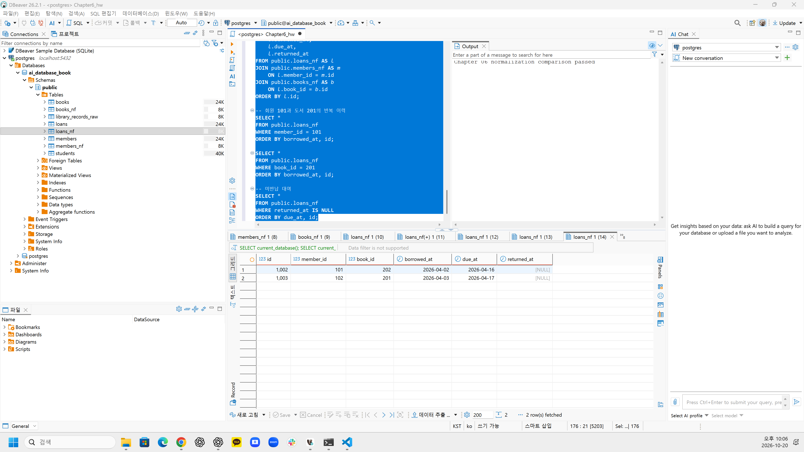
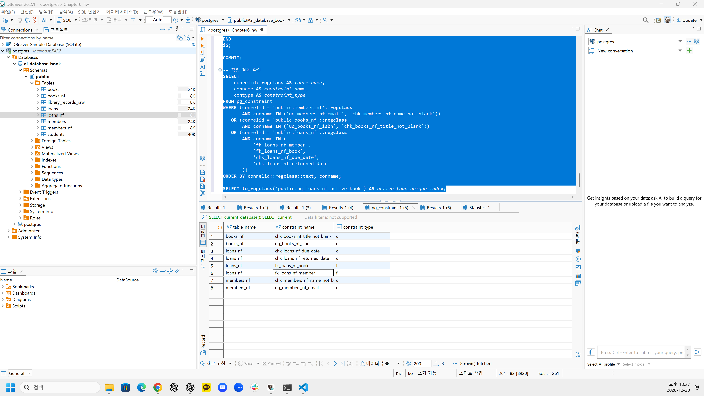
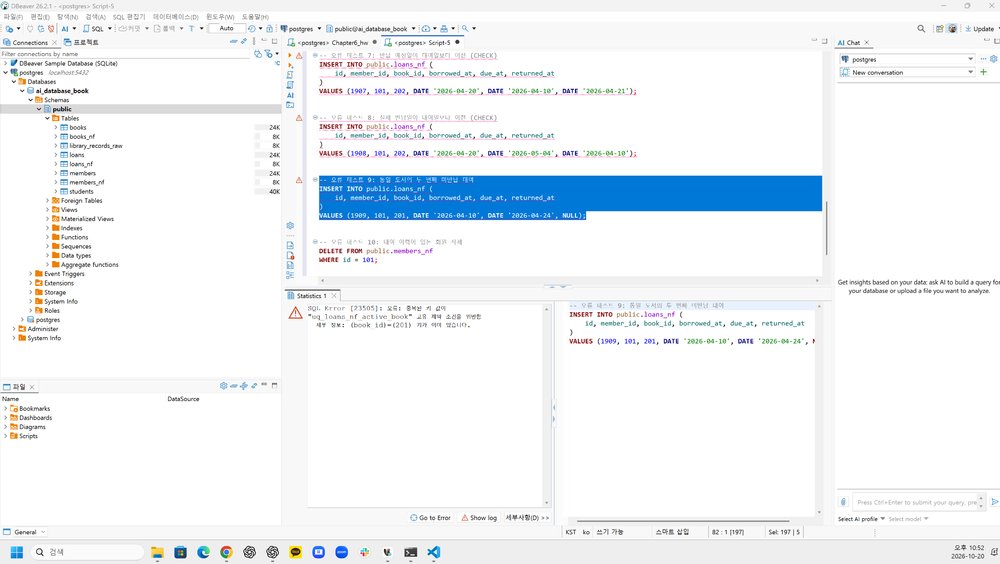
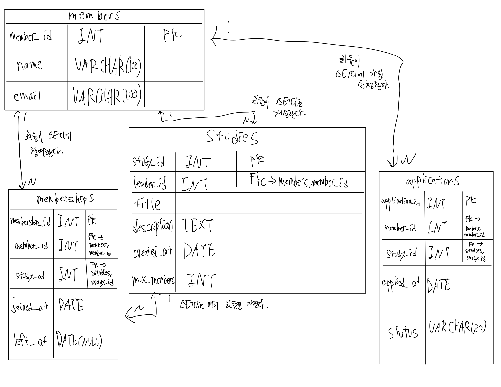

# Chapter 06 확장 실습 답안 템플릿

> **과제:** 정규화와 데이터 무결성으로 좋은 테이블 만들기  
> **사용 방법:** 이 파일을 내려받아 본인의 GitHub 저장소에 `chapter06_answer.md`라는 이름으로 저장한 뒤 실습하면서 바로 작성합니다.  
> **제출 방법:** LMS에는 파일을 직접 업로드하지 않고, **본인 GitHub 저장소의 `chapter06_answer.md` 파일 URL**을 제출합니다.

---

## 제출 전 주의

이 파일과 캡처 화면에는 실제 비밀번호, 전체 DB 접속 URL, API Key, 개인정보를 기록하지 않습니다.

```text
GitHub 계정 또는 별칭:yangguebeom
과제 작성일:2026-10-20
사용한 AI 도구:ChatGPT
```

---

# 1. 실습 환경과 시작 상태 확인

다음을 실행합니다.

```sql
SELECT current_database();
SELECT current_user;
SELECT current_schema();
SHOW search_path;
SHOW transaction_read_only;
```

| 확인 항목 | 실제 결과 | 의미 |
| --- | --- | --- |
| `current_database()` | `ai_database_book` | 현재 실습에 사용하는 데이터베이스 |
| `current_user` | `postgres` | 현재 데이터베이스 접속 사용자 |
| `current_schema()` | `public` | 현재 기본 스키마 |
| `search_path` | `public, "$user"` | SQL 실행 시 스키마를 탐색하는 순서 |
| `transaction_read_only` | `off` | 현재 트랜잭션이 읽기 전용이 아님 |

- [x] 현재 DB가 `ai_database_book`이다.
- [x] 변경 가능한 연결인지 확인했다.
- [x] Auto-commit 상태를 확인했다.
- [x] Chapter 06 번호형 SQL 파일을 사용한다.

---

# 2. 정규화 전 큰 테이블의 문제 찾기

본문의 `library_records_raw` 구조를 기준으로 생각합니다.

```text
library_records_raw 한 행
→ 대여 사건 한 건이지만 회원·도서의 현재 사실까지 함께 저장된 구조
```

## 2-1. 위험한 중복과 의미 있는 반복 구분

| 반복되는 값/상황 | 위험한 중복 / 의미 있는 반복 | 판단 이유 |
| --- | --- | --- |
| 회원 이메일이 여러 대여 행에 반복 | 위험한 중복 | 동일 회원의 현재 이메일이 여러 행에 저장되어 변경 시 일부 행만 수정하면 불일치가 발생할 수 있다. |
| 도서 제목이 여러 대여 행에 반복 | 위험한 중복 | 동일 도서의 현재 제목이 여러 대여 기록에 복사되어 수정 이상이 발생할 수 있다. |
| `loans_nf.member_id = 101` 반복 | 의미 있는 반복 | 회원 101이 여러 대여 사건에 참여했다는 관계를 표현하며, 각 대여 기록에서 회원을 참조하는 데 필요하다. |
| 사건 당시 가격 같은 이력값 반복 | 의미 있는 반복 | 현재 가격과 달리 사건 발생 당시의 사실을 보존하는 값이므로 반복 자체가 문제가 되지 않는다. |

## 2-2. 이상 현상 설명

### 삽입 이상

```text
아직 한 번도 대여되지 않은 새 도서를 등록하려 할 때 생기는 문제:
`library_records_raw`는 대여 기록을 중심으로 구성되어 있어
대여 이력이 없는 새 도서를 독립적으로 등록하기 어렵다.
도서 정보를 저장하려면 대여 관련 값을 함께 입력해야 하거나,
대여 정보가 없는 행을 별도로 만들어야 하는 문제가 발생한다.
```

### 수정 이상

```text
회원 이메일이 변경될 때 생기는 문제:
김민지 회원의 이메일은 대여 기록 1001과 1002에 중복 저장되어 있다.
이메일이 변경되면 두 행을 모두 수정해야 하며,
한 행만 수정하면 동일 회원의 이메일이 서로 달라지는
데이터 불일치가 발생한다.
```

### 삭제 이상

```text
마지막 대여 기록을 삭제할 때 생길 수 있는 문제:
어떤 도서의 마지막 대여 기록을 삭제하면
해당 행에 함께 저장된 도서 제목과 저자 정보까지
사라질 수 있다. 대여 이력만 삭제하려 했지만
보존해야 할 도서 정보까지 잃게 되는 문제가 발생한다.
```

### 왜 이것이 SQL 문법 문제가 아니라 구조 문제인가요?

```text
SQL 명령어 자체는 정상적으로 실행될 수 있지만,
서로 다른 성격의 회원, 도서, 대여 정보를 하나의 테이블에
함께 저장하는 구조 때문에 문제가 발생한다.

따라서 SQL 문법을 수정하는 것이 아니라,
정규화를 통해 회원 정보는 회원 테이블에,
도서 정보는 도서 테이블에, 대여 사건은 대여 테이블에
분리하여 관리해야 한다.
```

---

# 3. 1NF·2NF·3NF 핵심 질문 복습

정규형 이름만 외우지 말고 **왜 분리하는지** 설명합니다.

## 3-1. 제1정규형(1NF)

```text
한 셀에 쉼표로 여러 독립 값을 넣거나 book1/book2/book3처럼 반복 열을 만들면 왜 문제가 되는가:
한 셀에 여러 독립 값을 저장하면 개별 값을 검색하거나 수정하기 어렵고,
값의 개수가 증가할 때 데이터 관리가 복잡해진다.
또한 book1, book2, book3처럼 반복 열을 만들면 새로운 도서가
추가될 때마다 열을 추가해야 할 수 있다.
따라서 하나의 셀에는 하나의 원자적 값을 저장하고,
반복되는 관계는 별도 행이나 테이블로 관리해야 한다.
```

내 서비스에서 비슷한 위험이 있는 예:

```text
스터디 모임 관리 서비스에서 studies 테이블의 한 열에
참여 회원 ID를 '101, 102, 103'처럼 저장하면
각 회원의 참여 여부를 검색하거나 관리하기 어렵다.
따라서 회원과 스터디의 N:M 관계는 memberships 테이블로
분리하고, 각 행에 회원 한 명의 스터디 참여 관계를 저장한다.
```

## 3-2. 제2정규형(2NF)

다음 관계를 설명합니다.

```text
(student_id, course_id) → grade
student_id → student_name
course_id → course_name
```

```text
복합키 전체가 아니라 일부에만 의존하는 열을 분리해야 하는 이유:
(student_id, course_id)를 복합키로 사용하는 경우,
grade는 학생과 과목의 조합에 의해 결정되지만
student_name은 student_id에만,
course_name은 course_id에만 의존한다.

이처럼 복합키 일부에만 의존하는 속성을 함께 저장하면
학생이나 과목 정보가 여러 행에 중복되어 수정 이상이 발생할 수 있다.
따라서 학생 정보는 students, 과목 정보는 courses,
수강 및 성적 정보는 enrollments 테이블로 분리하는 것이 적절하다.
```

## 3-3. 제3정규형(3NF)

```text
member_id → zip_code
zip_code → city
```

```text
일반 열이 다른 일반 열을 결정하는 구조를 검토해야 하는 이유:
member_id가 zip_code를 결정하고,
zip_code가 city를 결정하는 업무 규칙이 성립한다면
member_id → zip_code → city의 이행적 종속이 발생한다.

이러한 구조에서는 같은 우편번호에 대응하는 도시 정보가
여러 회원 행에 반복되어 수정 이상이 발생할 수 있다.
따라서 city가 회원 자체의 독립적인 속성이 아니라
우편번호에 의해 결정되는 사실이라면
별도 테이블로 분리하는 것을 검토해야 한다.
```

### 정규화는 값이 반복되기만 하면 무조건 분리하는 것인가요?

```text
아니다. 값이 반복된다는 이유만으로 테이블을 분리하지 않는다.
반복되는 값이 동일한 사실의 불필요한 복사본인지,
아니면 각 사건이나 관계를 표현하는 의미 있는 반복인지 판단해야 한다.

예를 들어 memberships 테이블에서 같은 member_id가
여러 행에 등장하는 것은 한 회원이 여러 스터디에 참여한다는
관계를 표현하므로 의미 있는 반복이다.

따라서 실제 함수 종속 관계와 업무 규칙,
데이터의 의미와 변경 시점을 검토하여 정규화 여부를 결정해야 한다.
```

---

# 4. 각 열의 '사실의 주인' 찾기

| 열 | 어떤 사실을 설명하는가 | 주인 테이블 | 이유 |
| --- | --- | --- | --- |
| `member_name` | 회원의 현재 이름 | `members_nf` | 회원 자체의 속성으로, 대여 기록과 독립적으로 관리해야 한다. |
| `member_email` | 회원의 현재 이메일 | `members_nf` | 이메일 변경 시 회원 정보 한 곳만 수정하도록 관리한다. |
| `book_title` | 도서의 현재 제목 | `books_nf` | 도서 자체의 속성이므로 대여 기록과 분리하여 관리한다. |
| `author` | 도서의 저자 | `books_nf` | 대여 사건이 아닌 도서 자체를 설명하는 정보이다. |
| `borrowed_at` | 도서를 대여한 날짜 | `loans_nf` | 특정 대여 사건이 발생한 시점을 나타낸다. |
| `due_at` | 해당 대여의 반납 예정일 | `loans_nf` | 대여 사건마다 반납 예정일이 달라질 수 있다. |
| `returned_at` | 실제 반납 날짜 | `loans_nf` | 개별 대여 사건의 반납 여부와 시점을 나타낸다. |
| `member_id` | 대여한 회원의 식별자 | `loans_nf` (FK) | 대여 사건이 어떤 회원과 연결되는지 나타낸다. |
| `book_id` | 대여한 도서의 식별자 | `loans_nf` (FK) | 대여 사건이 어떤 도서와 연결되는지 나타낸다. |

정규화 후 한 행의 의미:

```text
members_nf 한 행 = 회원 한 명의 현재 정보
books_nf 한 행 = 대여 대상으로 관리하는 도서 항목 한 건의 정보
loans_nf 한 행 = 특정 회원이 특정 도서를 대여한 사건 한 건
```

### 현재 사실과 사건 당시 이력을 구분하는 기준

```text
현재 사실은 회원이나 도서 자체의 상태를 나타내며,
시간에 따라 변경될 수 있는 정보이다.

사건 당시 이력은 대여가 발생했을 때의 날짜나
실제 반납일처럼 특정 사건에 속하는 정보이다.

예를 들어 회원 이메일은 현재 회원 정보이므로
members_nf에서 관리하지만, 대여일은 과거 대여 사건의
정보이므로 loans_nf에 보존해야 한다.

따라서 값이 누구를 설명하는지와 변경 이유 및 시점을
기준으로 각 속성의 주인 테이블을 결정한다.
```

---

# 5. PostgreSQL로 정규화 전·후 구조 재현

Public 저장소의 다음 파일을 순서대로 사용합니다.

```text
code/chapter06/01_normalization_schema.sql
code/chapter06/02_normalization_seed.sql
code/chapter06/03_normalization_compare.sql
```

## 5-1. `01_normalization_schema.sql`

실행 전 예상:

```text
생성될 테이블 수: 4개
각 테이블 예상 행 수: 모두 0행
```

실행 후:

```text
실제로 생성된 테이블:
library_records_raw, members_nf, books_nf, loans_nf
각 테이블 실제 행 수:
모두 0행
```

## 5-2. `02_normalization_seed.sql`

실행 전 예상 기준:

```text
raw = 3
members = 2
books = 2
loans = 3
미반납 = 2
회원 101 대여 = 2
도서 201 대여 = 2
```

실제 결과:

```text
raw: 3
members: 2
books: 2
loans: 3
미반납: 2
회원 101 대여: 2
도서 201 대여: 2
```

예상과 다른 값이 있다면 이유:

```text
예상과 실제 결과가 모두 일치하였다.
정규화 전후 데이터의 행 수와 대여 이력 건수가
SQL 내부 검증을 통과하여 기준 데이터가 정상적으로 입력되었다.
```

## 5-3. `03_normalization_compare.sql`

```text
검증 메시지:Chapter 06 normalization comparison passed
PASS / FAIL:PASS
```

다음 항목을 확인합니다.

```text
회원 고아 참조:0
도서 고아 참조:0
날짜 순서 오류:0
활성 대여 중복:0
```

### 정규화 후에도 JOIN으로 원래 업무 정보를 다시 볼 수 있는 이유

```text
정규화를 통해 회원, 도서, 대여 정보를 별도 테이블로
분리하였지만, loans_nf의 member_id와 book_id를 이용하면
각각 members_nf와 books_nf의 데이터를 연결할 수 있다.

따라서 JOIN을 사용하면 중복 저장을 줄이면서도
원래 대여 기록에 포함된 회원 정보, 도서 정보,
대여 날짜 등을 다시 조회할 수 있다.
```

### 증거 화면

권장 경로:

```text
assignments/chapter06/images/step05_normalization.png
```

`여기에 정규화 전후 및 검증 결과 화면을 삽입하세요.`


**그림 1. 정규화 전후 데이터 검증 결과**

정규화 전후 비교 SQL을 실행한 결과,
`Chapter 06 normalization comparison passed` 메시지가 출력되었다.
회원 및 도서 고아 참조, 날짜 순서 오류, 활성 대여 중복이
모두 0건임을 검증하였으며, 미반납 대여 2건도 확인하였다.

---

# 6. Chapter 06에서 확정한 C-01~C-08 정책 해석

| ID | 확정 규칙 | 구현 방법 | 왜 필요한가 | Chapter 05에서는 왜 미확정이었나 |
| --- | --- | --- | --- | --- |
| C-01 | 이메일 문자열 중복 금지 | `UNIQUE` | 서로 다른 회원이 동일한 이메일을 등록하는 것을 방지하여 회원 정보의 고유성을 유지한다. | 이메일의 중복 허용 여부와 고유성 정책을 확정하지 않았기 때문이다. |
| C-02 | ISBN 필수·중복 금지 | `NOT NULL + UNIQUE` | ISBN이 누락되거나 동일한 ISBN이 여러 도서 항목에 등록되는 것을 방지한다. | ISBN을 필수 식별 정보로 사용할지와 중복 허용 여부가 미확정이었기 때문이다. |
| C-03 | 이름·제목 공백 금지 | `CHECK` | 회원 이름이나 도서 제목이 공백으로만 저장되는 것을 방지한다. | 이름과 제목에 허용할 입력값의 구체적인 기준을 정하지 않았기 때문이다. |
| C-04 | `due_at >= borrowed_at` | `CHECK` | 반납 예정일이 대여일보다 이전인 비정상적인 날짜 입력을 방지한다. | 날짜 간 선후 관계를 DB 제약조건으로 구현할지 결정하지 않았기 때문이다. |
| C-05 | `returned_at`은 NULL 또는 대여일 이상 | `CHECK` | 반납하지 않은 상태는 NULL로 허용하되, 실제 반납일이 대여일보다 이전인 오류를 방지한다. | 미반납 상태의 표현과 반납일의 허용 범위를 확정하지 않았기 때문이다. |
| C-06 | 존재하는 회원·도서만 참조 | `FOREIGN KEY` | 존재하지 않는 회원이나 도서를 참조하는 대여 기록이 생성되지 않도록 한다. | 참조 관계에 대한 구체적인 무결성 적용 방식을 확정하지 않았기 때문이다. |
| C-07 | 대여 이력이 있는 부모 삭제 금지 | `ON DELETE RESTRICT` | 대여 이력이 존재하는 회원이나 도서를 삭제하여 기록의 참조 관계가 손상되는 것을 방지한다. | 회원과 도서 삭제 시 이력 보존 및 참조 관계 처리 정책을 확정하지 않았기 때문이다. |
| C-08 | 도서당 미반납 대여 최대 한 건 | 부분 고유 인덱스 | 동일 도서에 대해 미반납 대여가 중복 등록되는 것을 방지하면서 과거 대여 이력은 유지한다. | 같은 도서의 중복 활성 대여를 어떻게 제한할지 결정하지 않았기 때문이다. |

### 확정되지 않은 정책을 제약조건으로 먼저 만들면 위험한 이유

```text
확정되지 않은 정책을 제약조건으로 먼저 구현하면
실제로 허용되어야 하는 데이터까지 DBMS가 거부할 수 있다.

예를 들어 이메일 중복 허용 여부가 정해지지 않았는데
UNIQUE를 적용하면 동일 이메일을 사용하는 회원 등록이
업무상 허용되는 경우에도 저장할 수 없게 된다.

또한 삭제 정책이 확정되지 않은 상태에서
ON DELETE CASCADE를 적용하면 보존해야 할 이력이
함께 삭제될 위험이 있다.

따라서 업무 요구사항과 운영 정책을 먼저 확인한 뒤,
확정된 규칙만 제약조건으로 구현해야 한다.
```

---

# 7. 기존 데이터 검사 후 무결성 규칙 적용

실행 파일:

```text
code/chapter06/04_add_integrity_rules.sql
```

## 7-1. 규칙을 추가하기 전에 기존 데이터를 먼저 검사해야 하는 이유

```text
기존 데이터에 NULL, 중복값, 잘못된 날짜, 존재하지 않는
회원이나 도서에 대한 참조 등이 포함되어 있을 수 있기 때문이다.

이러한 데이터를 검사하지 않고 제약조건을 추가하면
기존 데이터가 새 규칙을 위반하여 ALTER TABLE 실행이
실패할 수 있다.

따라서 제약조건을 적용하기 전에 위반 데이터를 확인하고,
잘못된 값을 수정하거나 중복 데이터를 정리해야 한다.
이때 데이터의 수정 또는 삭제 여부는 업무 규칙에 따라
판단해야 한다.
```

## 7-2. 실행 결과

```text
명명된 제약조건 개수: 8개
NOT NULL 적용 열 개수: 10개
부분 고유 인덱스 존재 여부: 존재 (uq_loans_nf_active_book)
COMMIT 성공 여부: 성공
```

### 메타데이터를 확인하는 이유

```text
SQL 실행 시 오류가 발생하지 않았더라도 제약조건이
실제 데이터베이스에 정상적으로 등록되었는지
확인할 필요가 있기 때문이다.

PostgreSQL의 pg_constraint와 pg_attribute 등
시스템 메타데이터를 조회하면 제약조건의 종류와 개수,
NOT NULL 적용 여부를 확인할 수 있다.

또한 부분 고유 인덱스의 존재 여부도 확인하여
의도한 데이터 무결성 규칙이 정상적으로 적용되었는지
검증할 수 있다.
```

### 증거 화면

권장 경로:

```text
assignments/chapter06/images/step07_constraints.png
```

`여기에 제약조건/인덱스 적용 확인 화면을 삽입하세요.`

**그림 2. 무결성 제약조건 적용 및 검증 결과**

`04_add_integrity_rules.sql`을 실행한 결과, 명명된 제약조건
8개와 NOT NULL 적용 열 10개가 정상적으로 확인되었다.
또한 별도 조회를 통해 부분 고유 인덱스
`uq_loans_nf_active_book`의 존재를 확인하였으며,
트랜잭션이 정상적으로 COMMIT되었다.

---

# 8. 정상·경계·실패 테스트

실행 파일:

```text
code/chapter06/05_integrity_tests.sql
```

> **중요:** 오류 테스트는 한 번에 하나씩 실행하고, 각 테스트가 끝난 뒤 기준 데이터가 유지되는지 확인합니다.

## 8-1. 허용되어야 하는 경계값

최소 3개를 실행·관찰합니다.

| 테스트 | 예상 | 실제 | 왜 허용되어야 하는가 |
| --- | --- | --- | --- |
| `due_at = borrowed_at` | 성공 | 성공 | 반납 예정일이 대여일과 같은 경우도 C-04의 `>=` 조건을 만족하므로 허용된다. |
| `returned_at = borrowed_at` | 성공 | 성공 | 대여 당일 반납도 가능하므로 C-05의 `>=` 조건을 만족한다. |
| `returned_at = NULL` | 성공 | 기존 미반납 기록 2건 확인 | 아직 반납하지 않은 상태를 NULL로 표현하며 C-05에서 허용한다. |
| `published_year = NULL` | 성공 | 성공 | 출판연도는 필수값으로 지정되지 않았으므로 NULL을 허용한다. |
| 공백이 아닌 한 글자 이름 | 성공 | 성공 | 이름이 한 글자여도 공백만 있는 값이 아니므로 CHECK 조건을 만족한다. |

## 8-2. 실패해야 하는 오류값

최소 6개를 실행합니다.

| 오류 테스트 | 기대 규칙 | 실제 결과 | 오류 메시지 핵심 | 실패해야 하는 이유 |
| --- | --- | --- | --- | --- |
| 필수값 NULL | `NOT NULL` | 실패(정상 차단) | `23502`, name NULL 위반 | 회원 이름은 필수값이므로 NULL을 허용하면 안 된다. |
| ISBN NULL | `NOT NULL` | 실패(정상 차단) | `23502`, isbn NULL 위반 | ISBN은 필수 식별 정보로 지정되어 있다. |
| 이메일 중복 | `UNIQUE` | 실패(정상 차단) | `23505`, `uq_members_nf_email` | 동일 이메일의 중복 등록을 방지해야 한다. |
| ISBN 중복 | `UNIQUE` | 실패(정상 차단) | `23505`, `uq_books_nf_isbn` | 동일 ISBN의 중복 등록을 방지해야 한다. |
| 공백 이름/제목 | `CHECK` | 모두 실패(정상 차단) | `23514`, `chk_members_nf_name_not_blank`, `chk_books_nf_title_not_blank` | 공백만 있는 이름이나 제목은 유효한 정보가 아니다. |
| 존재하지 않는 회원 | `FOREIGN KEY` | 실패(정상 차단) | `23503`, `fk_loans_nf_member` | 존재하지 않는 회원의 대여 기록이 생성되면 안 된다. |
| 존재하지 않는 도서 | `FOREIGN KEY` | 실패(정상 차단) | `23503`, `fk_loans_nf_book` | 존재하지 않는 도서의 대여 기록이 생성되면 안 된다. |
| 날짜 순서 위반 | `CHECK` | 두 테스트 모두 실패(정상 차단) | `23514`, `chk_loans_nf_due_date`, `chk_loans_nf_returned_date` | 반납 예정일과 실제 반납일이 대여일보다 이전이면 안 된다. |
| 두 번째 미반납 대여 | 부분 고유 인덱스 | 실패(정상 차단) | `23505`, `uq_loans_nf_active_book` | 동일 도서의 미반납 대여는 동시에 최대 한 건만 허용한다. |
| 참조 중 부모 삭제 | `RESTRICT/FK` | 실패(정상 차단) | `23001`, `fk_loans_nf_member` | 대여 이력이 있는 회원을 삭제하면 기존 참조 관계가 손상된다. |

## 8-3. 테스트 후 기준 상태 재검증

```text
raw: 3
members: 2
books: 2
loans: 3
미반납: 2
회원 고아 참조: 0
도서 고아 참조: 0
활성 대여 중복: 0
```

### 실패 테스트 후 기준 데이터가 유지되어야 하는 이유

```text
무결성 제약조건은 잘못된 데이터의 저장을 차단하는 동시에
기존 정상 데이터의 일관성을 유지해야 하기 때문이다.

이번 실습에서는 12개의 실패 테스트에서 예상한 오류가 발생했고,
테스트 이후에도 회원 2명, 도서 2건, 대여 3건이 유지되었다.

또한 회원과 도서의 고아 참조 및 활성 대여 중복이
모두 0건으로 확인되었다.

따라서 잘못된 입력은 거부하면서 기존 정상 데이터는
보존하는 무결성 제약조건의 역할을 확인할 수 있었다.
```

### 증거 화면

권장 경로:

```text
assignments/chapter06/images/step08_integrity_error.png
```

`여기에 대표 실패 테스트와 오류 메시지 화면을 삽입하세요.`

**그림 3. 부분 고유 인덱스를 통한 미반납 대여 중복 차단**

동일한 도서에 두 번째 미반납 대여를 입력한 결과,
`uq_loans_nf_active_book` 인덱스의 고유성 위반 오류가
발생하였다. 이를 통해 동일 도서에 대해 미반납 대여가
동시에 두 건 이상 등록되지 않도록 하는 무결성 규칙이
정상적으로 작동함을 확인하였다.

---

# 9. 정규화와 무결성 제약조건 역할 비교

| 질문 | 나의 설명 |
| --- | --- |
| 정규화가 해결하는 문제 | 회원, 도서, 대여 정보를 각 사실의 주인 테이블로 분리하여 불필요한 중복을 줄이고 삽입·수정·삭제 이상을 방지한다. |
| `NOT NULL`이 해결하는 문제 | 회원 이름이나 ISBN처럼 필수로 입력해야 하는 값이 NULL로 저장되는 것을 방지한다. |
| `UNIQUE`가 해결하는 문제 | 회원 이메일이나 도서 ISBN처럼 중복되어서는 안 되는 값이 여러 행에 저장되는 것을 방지한다. |
| `CHECK`가 해결하는 문제 | 공백만 있는 이름·제목이나 대여일보다 이전인 반납 예정일 등 업무 규칙에 맞지 않는 값을 방지한다. |
| `FOREIGN KEY`가 해결하는 문제 | 대여 기록이 존재하지 않는 회원이나 도서를 참조하는 것을 방지하여 참조 무결성을 유지한다. |
| 부분 고유 인덱스가 해결하는 문제 | 같은 도서의 미반납 대여가 동시에 두 건 이상 존재하지 않도록 제한하면서 과거 대여 이력은 여러 건 허용한다. |

### 정규화만 잘하면 잘못된 데이터가 모두 차단되나요?

```text
아니다. 정규화는 데이터의 불필요한 중복을 줄이고
각 사실의 주인 테이블을 분리하여 삽입·수정·삭제 이상을
줄이는 과정이다.

그러나 정규화된 테이블에서도 필수값 누락,
이메일 중복, 잘못된 날짜, 존재하지 않는 데이터 참조 등
잘못된 데이터가 입력될 수 있다.

따라서 정규화만으로는 충분하지 않으며,
NOT NULL, UNIQUE, CHECK, FOREIGN KEY 등의
제약조건을 함께 적용해야 데이터 무결성을 유지할 수 있다.
```

### 제약조건만 많이 넣으면 나쁜 구조가 좋은 구조가 되나요?

```text
아니다. 제약조건은 확정된 업무 규칙을 위반하는 데이터의
저장을 방지하지만, 잘못된 테이블 구조를 자동으로
개선하지는 못한다.

예를 들어 회원 정보와 도서 정보를 대여 기록마다
중복 저장하는 구조에 제약조건을 추가하더라도
불필요한 중복과 수정 이상의 위험이 남아 있을 수 있다.

따라서 먼저 정규화를 통해 각 사실의 주인을 구분하고
테이블 구조를 개선해야 한다.

이후 확정된 업무 규칙에 따라 필요한 제약조건을
적용하는 것이 적절하다.
```

---

# 10. Chapter 05 개인 ERD 개선

Chapter 05에서 만든 개인 서비스 ERD를 다시 엽니다.

## 10-1. 수정 전 점검

- [ ] 같은 현재 사실을 여러 테이블에 복사한 부분이 있는가?
- [ ] 한 셀에 여러 독립 값을 넣으려 한 부분이 있는가?
- [x] 사건과 현재 상태가 한 테이블에 섞였는가?
- [ ] 복합키 일부에만 의존하는 속성이 있는가?
- [ ] 일반 열이 다른 일반 열을 결정하는 부분이 있는가?
- [x] 확정 업무 규칙인데 DB가 막지 못하는 부분이 있는가?
- [ ] 아직 미확정인데 제약조건으로 너무 강하게 정한 부분이 있는가?

## 10-2. 수정 전·후 비교

| 항목 | 수정 전 | 수정 후 | 변경 근거 | 관련 요구사항 ID |
| --- | --- | --- | --- | --- |
| 참여 이력 관리 | memberships에 joined_at만 존재 | left_at 추가, 탈퇴 후 기존 행 보존 | 탈퇴와 재가입 이력을 구분하고 과거 참여 기록을 유지하기 위해 | P05-R04, P05-R05 |
| 활성 참여 중복 | 동일 회원의 중복 참여 방지 규칙 미표시 | 현재 참여 중인 회원·스터디 조합에 부분 고유 인덱스 적용 후보 | 과거 이력을 허용하면서 동시 중복 참여를 방지하기 위해 | P05-R05 |
| 신청 이력 관리 | applications에 applied_at, status 존재 | 기존 테이블 유지, 신청 이력 보존 및 재신청 시 새로운 행 생성 정책 명시 | 취소·거절 기록을 보존하면서 재신청을 허용하기 위해 | P05-R04 |
| 스터디장 정합성 | studies.leader_id가 members만 참조 | 스터디장이 해당 스터디의 활성 구성원인지 추가 검증 후보로 정리 | 스터디장 권한과 실제 구성원 정보의 불일치 방지 | P05-R02, P05-R05 |

## 10-3. 개인 프로젝트 무결성 규칙 후보

| 규칙 ID | 업무 규칙 | 제약조건 후보 | 확정 / 미확정 | 근거 |
| --- | --- | --- | --- | --- |
| P06-C01 | 한 회원은 같은 스터디에 동시에 한 번만 활성 참여할 수 있다. | `UNIQUE (member_id, study_id) WHERE left_at IS NULL` 부분 고유 인덱스 | 확정 | 탈퇴·재가입 이력을 보존하면서 중복 활성 참여를 방지한다. |
| P06-C02 | 탈퇴일은 가입일보다 이전일 수 없다. | `CHECK (left_at IS NULL OR left_at >= joined_at)` | 확정 | 가입 및 탈퇴 날짜의 순서를 보장한다. |
| P06-C03 | 스터디 최대 인원에는 스터디장이 포함된다. | 활성 참여 인원과 max_members 비교, 트리거 또는 트랜잭션 로직 검토 | 확정 정책 / 구현 확인 필요 | 스터디 최대 인원 초과를 방지하기 위해 필요하다. |
| P06-C04 | 신청 취소·거절 기록을 보존하고 재신청을 허용한다. | application_id PK 유지, 신청 상태별 중복 제한 검토 | 확정 정책 / 중복 신청 규칙 확인 필요 | 신청 이력을 삭제하지 않고 재신청 사건을 별도로 관리한다. |
| P06-C05 | 스터디장은 한 명이며 탈퇴 전 권한을 양도해야 한다. | leader_id FK 유지, 활성 구성원 여부 및 권한 양도 로직 검토 | 확정 정책 / 구현 확인 필요 | 스터디장의 권한과 구성원 정보 간 정합성을 유지하기 위해 필요하다. |

> 미확정 규칙은 `확인 필요`로 남겨도 됩니다. 억지로 제약조건을 만들지 않습니다.

## 10-4. 수정한 ERD

권장 이미지 경로:

```text
assignments/chapter06/images/step10_my_erd_after.png
```

`여기에 수정한 개인 ERD 이미지를 삽입하세요.`


**그림 4. 스터디 모임 관리 서비스의 개선된 ERD**

Chapter 05에서 설계한 members, studies, memberships,
applications의 4개 테이블과 5개의 관계를 유지하였다.

이번 개선에서는 memberships 테이블에 left_at 속성을
추가하여 회원의 탈퇴 여부를 구분할 수 있도록 하였다.

회원이 스터디에서 탈퇴하더라도 기존 참여 기록을
삭제하지 않고 left_at에 탈퇴일을 저장하며,
재가입 시에는 새로운 membership_id를 사용하는
별도의 참여 기록을 생성하도록 설계하였다.

또한 동일 회원의 활성 참여 중복 방지, 날짜 순서 검증,
스터디장 정합성 및 최대 인원 제한을
추가적인 무결성 규칙 후보로 검토하였다.

이를 통해 기존 구조를 크게 변경하지 않으면서
스터디 참여 이력을 보존하고 데이터 무결성을
강화할 수 있도록 개선하였다.

---

# 11. AI를 정규화·무결성 리뷰어로 활용

## 11-1. 내가 먼저 작성한 구조와 규칙

```text
내 서비스:
스터디 모임 관리 서비스

검토할 테이블:
members, studies, memberships, applications

한 행의 의미:
members: 회원 한 명의 정보
studies: 개설된 스터디 한 개의 정보
memberships: 회원이 특정 스터디에 참여한 이력 한 건
applications: 회원이 특정 스터디에 가입 신청한 사건 한 건

중복으로 의심되는 열:
studies.leader_id와 memberships.member_id는 모두
회원 식별자를 참조하지만, 각각 스터디장과 참여 회원을
의미하므로 단순한 중복 데이터라고 볼 수 없다.

확정 업무 규칙:
1. 스터디 가입은 운영자 승인 방식이다.
2. 스터디마다 스터디장은 한 명이다.
3. 최대 인원에는 스터디장이 포함된다.
4. 신청 취소·거절 기록을 보존하고 재신청을 허용한다.
5. 탈퇴한 회원의 참여 이력을 보존하고,
   재가입 시 새로운 memberships 행을 생성한다.
6. 동일 회원의 중복 활성 참여를 방지한다.
7. 스터디장은 권한을 양도한 뒤 탈퇴할 수 있다.

미확정 정책:
1. 동일 스터디에 진행 중인 신청을 중복 허용할지 여부
2. 회원 탈퇴·재가입 시 회원 계정과 과거 기록의 연결 방식
3. 스터디장 변경 시 구체적인 검증 및 트랜잭션 처리 방식
4. 신청 상태의 세부 값과 상태 전이 제한
```

## 11-2. AI에게 전달한 핵심 프롬프트

```text
스터디 모임 관리 서비스의 기존 ERD를 정규화 및
데이터 무결성 관점에서 검토해 주세요.

테이블은 members, studies, memberships,
applications 총 4개입니다.

각 테이블의 한 행은 각각 회원 한 명, 스터디 한 개,
참여 이력 한 건, 가입 신청 사건 한 건을 의미합니다.

탈퇴한 회원의 참여 이력을 보존하고, 재가입 시 새로운
memberships 행을 생성하는 정책을 확정했습니다.

다음 사항을 검토해 주세요.

1. 각 속성의 사실의 주인이 적절한지 확인
2. 위험한 중복과 의미 있는 사건 이력 구분
3. 1NF, 2NF, 3NF 위반 가능성 검토
4. 확정된 업무 규칙에 맞는 제약조건 후보 제안
5. 미확정 정책과 확정 규칙 구분
6. ON DELETE CASCADE 적용 시 이력 손실 위험 검토
7. 정상값, 경계값, 실패값 테스트 제안

기존 ERD를 임의로 변경하지 말고,
각 제안의 필요성과 부작용을 설명해 주세요.
```

## 11-3. AI 제안 검토

| AI 제안 | 수용 / 수정 / 보류 / 거절 | 요구사항 근거 | 실제 검증 방법 | 나의 판단 |
| --- | --- | --- | --- | --- |
| 활성 참여 중복 방지를 위한 부분 고유 인덱스 | 수용 | 탈퇴 이력 보존 및 재가입 허용 | 동일 회원·스터디의 두 번째 활성 참여 INSERT 시 오류 확인 | 과거 이력은 유지하고 현재 중복 참여만 차단할 수 있어 적절하다. |
| 탈퇴일이 가입일보다 이전인 경우 CHECK 적용 | 수용 | 가입·탈퇴 날짜의 순서 유지 | left_at이 joined_at보다 이전인 INSERT 시 오류 확인 | 잘못된 날짜 저장을 방지하므로 필요하다. |
| applications의 member_id, study_id에 일반 UNIQUE 적용 | 거절 | 신청 취소·거절 기록 보존 및 재신청 허용 | 동일 회원이 같은 스터디에 두 번 신청하는 상황 검토 | 일반 UNIQUE는 재신청 이력 저장을 막을 수 있다. |
| 참여 이력에 ON DELETE CASCADE 적용 | 거절 | 과거 참여 및 신청 이력 보존 | 회원 삭제 시 관련 이력의 삭제 여부 확인 | 부모 삭제로 과거 기록이 사라질 수 있어 부적절하다. |
| 스터디장과 활성 구성원 간 정합성 검증 | 수정 | 스터디장 한 명 및 권한 양도 후 탈퇴 | 스터디장이 아닌 회원을 leader_id로 지정하는 상황 검토 | 단순 FK 외에 추가 업무 로직이 필요하다. |

특히 AI가 다음을 제안했다면 근거를 다시 확인합니다.

```text
UNIQUE
NOT NULL
CHECK
ON DELETE CASCADE
ON DELETE RESTRICT
새로운 테이블 분리
```

### AI가 단순히 값이 반복된다는 이유만으로 분리를 제안한 부분이 있었나요?

```text
이번 검토에서는 단순히 값이 반복된다는 이유만으로
새로운 테이블 분리를 확정하지 않았다.

예를 들어 memberships에 동일한 member_id와
study_id가 반복되더라도 서로 다른 가입 시점의
참여 이력이라면 의미 있는 사건 기록이다.

따라서 값의 반복 여부만이 아니라 각 행의 의미와
사실의 주인, 함수 종속 관계를 기준으로
정규화 필요성을 판단해야 한다.
```

### AI가 미확정 정책을 확정 규칙처럼 만든 부분이 있었나요?

```text
applications의 동일 회원·스터디 조합에 일반 UNIQUE를
적용하는 제안은 재신청 허용 정책과 충돌할 수 있어
거절하였다.

또한 진행 중인 신청의 중복 허용 여부와 세부 상태
전이 규칙은 아직 확정되지 않았으므로
강한 UNIQUE 또는 CHECK 제약조건을 바로 적용하지 않았다.

미확정 정책은 확인이 필요한 사항으로 남겨두고,
업무 규칙이 확정된 뒤 적절한 제약조건을 결정해야 한다.
```

---

# 12. 최종 성찰

아래 문장은 본인의 말로 작성합니다.

```text
1. 정규화에서 가장 중요한 질문은
   각 데이터가 어떤 사실을 나타내며, 그 사실의 주인이
   어느 테이블인지 판단하는 것이다.

2. 위험한 중복과 의미 있는 반복의 차이는
   같은 현재 사실이 불필요하게 여러 곳에 저장되어
   불일치를 유발하는지, 아니면 서로 다른 시점의
   사건과 이력을 표현하는지에 있다.

3. 정규화와 제약조건의 역할이 다른 이유는
   정규화는 데이터의 중복과 이상 현상을 줄이기 위해
   테이블 구조를 개선하는 과정이고, 제약조건은
   업무 규칙에 맞지 않는 데이터의 저장을
   DBMS가 차단하도록 하는 장치이기 때문이다.

4. 실패해야 하는 SQL을 일부러 실행해 보는 이유는
   제약조건이 실제로 잘못된 데이터를 거부하는지
   확인하기 위해서이다. 이번 실습에서는
   NOT NULL, UNIQUE, CHECK, FOREIGN KEY 등의
   오류 테스트를 통해 무결성 규칙의 동작을 검증하였다.

5. AI가 제안한 UNIQUE/CHECK/FK를 그대로 적용하면 안 되는 이유는
   AI가 실제 업무 규칙과 예외 상황을 모두 알지는
   못하기 때문이다. 예를 들어 스터디 재가입을 허용하는
   상황에서 일반 UNIQUE를 적용하면 과거 참여 이력을
   보존하지 못할 수 있다. 따라서 제안의 근거를 검토하고
   정상값·경계값·오류값 테스트를 거쳐야 한다.
```

---

# 13. 제출 체크리스트

- [x] `chapter06_answer.md`를 본인 저장소에 만들었다.
- [x] 위험한 중복과 의미 있는 반복을 구분했다.
- [x] 삽입·수정·삭제 이상을 설명했다.
- [x] 1NF·2NF·3NF 핵심 질문을 자신의 말로 설명했다.
- [x] 열의 사실의 주인을 분류했다.
- [x] `01_normalization_schema.sql`을 실행했다.
- [x] `02_normalization_seed.sql` 기준 상태를 확인했다.
- [x] `03_normalization_compare.sql` 검증 결과를 확인했다.
- [x] C-01~C-08의 업무 근거를 설명했다.
- [x] `04_add_integrity_rules.sql`로 규칙을 적용했다.
- [x] 허용 경계값을 최소 3개 확인했다.
- [x] 실패 테스트를 최소 6개 한 번에 하나씩 실행했다.
- [x] 실패 후 기준 데이터가 유지되는지 확인했다.
- [x] Chapter 05 개인 ERD를 수정했다.
- [x] 개인 프로젝트 제약조건 후보를 확정/미확정으로 구분했다.
- [x] AI 제안을 요구사항 근거와 실행 결과로 검토했다.
- [x] 핵심 화면 3~4장만 첨부했다.
- [x] 캡처에 비밀번호나 개인정보가 없다.
- [x] GitHub에서 Markdown 이미지가 정상적으로 보인다.
- [x] 최종 답안을 commit/push했다.

---

# 14. LMS 제출 URL

아래 형식의 **본인 GitHub 파일 URL**을 LMS에 제출합니다.

```text
https://github.com/<본인-GitHub-ID>/<본인-저장소>/blob/main/assignments/chapter06/chapter06_answer.md
```

내 제출 URL:

```text
https://github.com/yangguebeom/snu-database-2026-2/blob/main/assignments/chapter06/chapter06_answer.md
```

> 저장소 메인 URL, 교수자 템플릿 URL, Raw URL이 아니라 **작성 완료된 본인 `chapter06_answer.md` 파일 화면 URL**을 제출합니다.
