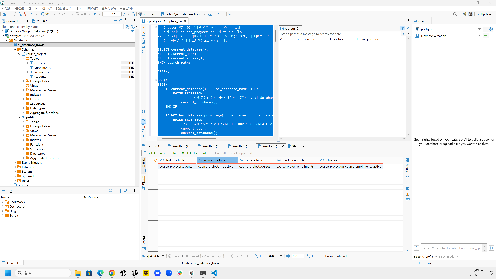
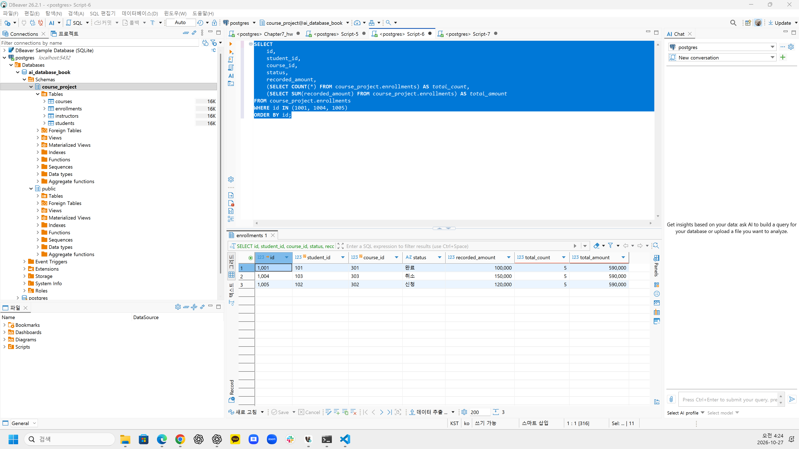
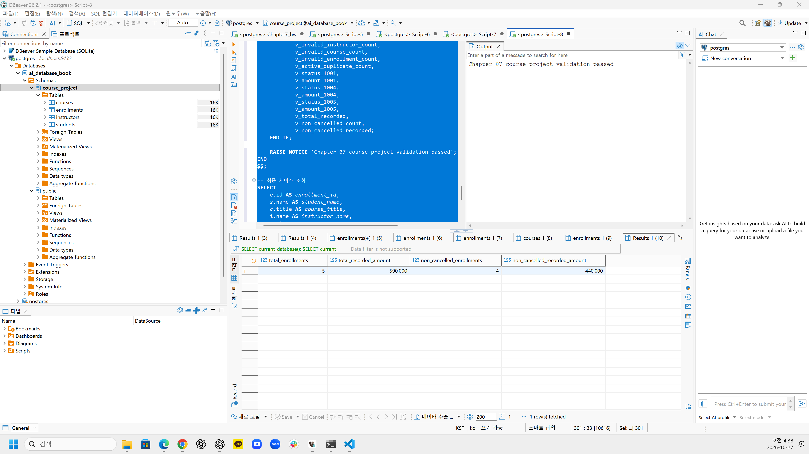
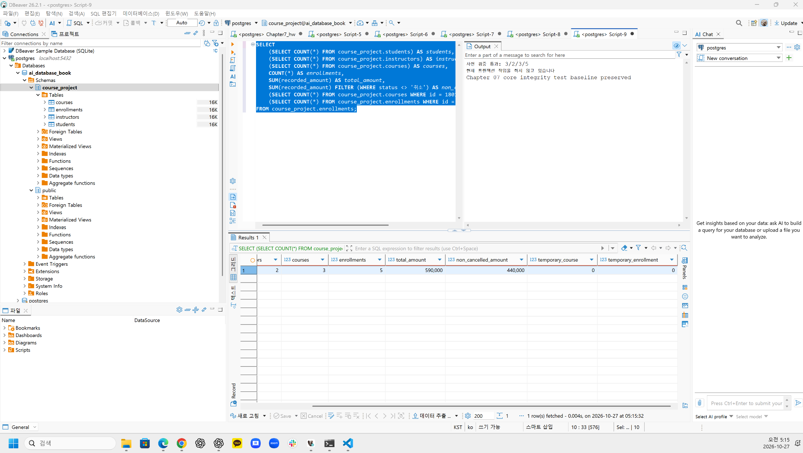
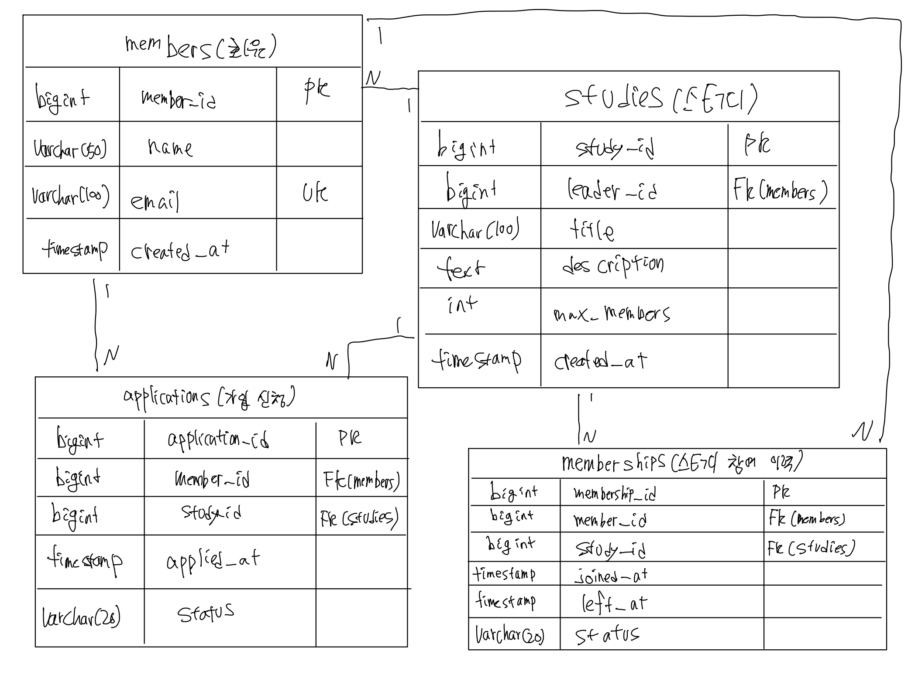

# Chapter 07 확장 실습 답안 템플릿

> **과제:** 실전 프로젝트 1 — 온라인 강의 수강신청 DB 완성하기  
> **사용 방법:** 이 파일을 내려받아 본인의 GitHub 저장소에 `chapter07_answer.md`라는 이름으로 저장한 뒤 실습하면서 바로 작성합니다.  
> **제출 방법:** LMS에는 파일을 직접 업로드하지 않고, **본인 GitHub 저장소의 `chapter07_answer.md` 파일 URL**을 제출합니다.

---

## 제출 전 주의

이 파일과 캡처 화면에는 실제 비밀번호, 전체 DB 접속 URL, API Key, 개인정보를 기록하지 않습니다.

```text
GitHub 계정 또는 별칭:yangguebeom
과제 작성일:2026-10-27
사용한 AI 도구:ChatGPT
```

---

# 1. 시작 환경 확인

다음을 실행합니다.

```sql
SELECT current_database();
SELECT current_user;
SELECT current_schema();
SHOW search_path;
SHOW transaction_read_only;
```

| 확인 항목 | 실제 결과 | 의미 |
| --- | --- | --- |
| `current_database()` | `ai_database_book` | 과제에서 지정한 데이터베이스에 연결되어 있다. |
| `current_user` | `postgres` | 현재 PostgreSQL 접속 계정이다. |
| `current_schema()` | `public` | 현재 기본 스키마이며, 이후 전용 스키마를 명시해서 사용한다. |
| `search_path` | `public, "$user"` | 스키마 이름을 생략할 때 검색하는 경로이다. |
| `transaction_read_only` | `off` | 읽기 전용 트랜잭션이 아니므로 데이터 변경이 가능하다. |

- [x] 현재 DB가 `ai_database_book`이다.
- [x] 쓰기 가능한 연결인지 확인했다.
- [x] 실행할 SQL 범위를 확인했다.
- [x] Auto-commit 상태를 확인했다.

### 프로젝트 SQL을 실행하기 전에 시작 상태를 확인해야 하는 이유

```text
잘못된 데이터베이스에서 SQL을 실행하면 기존 데이터가 변경되거나
의도하지 않은 테이블이 생성될 수 있다. 따라서 실행 전 데이터베이스,
사용자, 스키마와 쓰기 가능 여부를 확인해야 한다.
또한 SQL 실행 범위와 Auto-commit 상태를 확인하면
의도하지 않은 변경을 예방할 수 있다.
```

---

# 2. 프로젝트 범위와 요구사항 읽기

## 2-1. 포함 범위

본문을 그대로 복사하지 말고 자신의 말로 정리합니다.

```text
1. 학생과 강사의 기본 정보를 각각 관리한다.
2. 강의 정보와 해당 강의를 담당하는 강사를 연결하여 관리한다.
3. 학생이 특정 강의를 신청한 내역과 신청 상태를 기록한다.
4. 강의의 현재 기준 가격과 수강신청 당시 기록한 금액을 구분하여 관리한다.
```

## 2-2. 제외 범위

```text
1. 실제 결제 승인, 결제 실패 및 환불 처리는 구현하지 않는다.
2. 강의별 수강 정원과 대기열 기능은 포함하지 않는다.
3. 수강신청의 전체 상태 변경 이력은 별도로 관리하지 않는다.
4. 강의 진도, 수료 콘텐츠, 쿠폰 및 할인 이력은 관리하지 않는다.
```

### 범위를 명확하게 정해야 하는 이유

```text
프로젝트 범위를 명확하게 설정하면 현재 학습한 데이터베이스 설계 및 SQL 지식을 활용하여 구현할 기능에 집중할 수 있다. 또한 불필요한 기능 확장을 방지하고, 정해진 요구사항에 맞춰 데이터베이스가 정상적으로 동작하는지 검증할 수 있다.
```

## 2-3. 요구사항 / 프로젝트 결정 / 미확정 질문 구분

아래 항목 중 대표 항목을 정리합니다.

| ID | 종류 | 내용 요약 | DB 구조/규칙에 미치는 영향 |
| --- | --- | --- | --- |
| P07-R01 | 요구사항 | 회원은 이름과 이메일을 가지며, 이메일은 중복되지 않아야 한다. | members 테이블에 member_id를 PK로 두고 email에 UNIQUE 제약조건을 적용한다. |
| P07-R05 | 요구사항 | 회원은 스터디에 가입 신청할 수 있으며, 신청 상태와 이력을 관리해야 한다. | applications 테이블에 member_id, study_id를 FK로 두고 신청 상태와 신청 시간을 저장한다. |
| P07-R07 | 요구사항 | 스터디 참여 및 탈퇴 이력을 관리해야 한다. | memberships 테이블에 joined_at, left_at, status를 두어 참여 이력을 관리한다. |
| P07-D02 | 프로젝트 결정 | 탈퇴 후 재가입할 때 과거 참여 이력을 보존하고 새로운 참여 행을 생성한다. | memberships에서 동일 회원과 스터디의 과거 기록을 허용하되, 활성 참여 중복은 방지한다. |
| P07-D03 | 프로젝트 결정 | 가입 신청 기록과 실제 스터디 참여 이력을 분리하여 관리한다. | applications와 memberships를 별도 테이블로 설계하여 신청과 참여를 구분한다. |
| P07-Q01 | 미확정 질문 | 스터디장 탈퇴 시 권한 양도와 구성원 자격을 어떤 순서로 처리할 것인가? | 스터디장 변경과 탈퇴 처리의 정확한 순서 및 무결성 검증 방법을 추가로 결정해야 한다. |

### 미확정 질문을 바로 제약조건으로 만들면 안 되는 이유

```text
미확정 질문은 아직 운영 정책과 처리 방식이 완전히 결정되지 않은 사항이기 때문이다.

이를 바로 NOT NULL, CHECK, UNIQUE 등의 제약조건으로 구현하면 추후 정책이 변경되었을 때 데이터 구조를 수정해야 할 수 있다.

특히 스터디장 권한 양도처럼 여러 테이블과 관계되는 업무는 단순한 제약조건만으로 처리하기 어려울 수 있다.

따라서 확정된 요구사항과 프로젝트 결정은 데이터베이스 설계에 반영하고, 미확정 질문은 별도로 기록하여 정책을 확정한 뒤 적절한 제약조건과 처리 방법을 설계해야 한다.
```

---

# 3. 네 테이블의 한 행 의미와 관계

## 3-1. 한 행 의미

```text
course_project.students 한 행 =
온라인 강의 서비스에 등록된 학생 한 명의 정보를 나타낸다.

course_project.instructors 한 행 =
온라인 강의 서비스에서 강의를 담당하는 강사 한 명의 정보를 나타낸다.

course_project.courses 한 행 =
특정 강사가 담당하는 온라인 강의 한 개의 정보를 나타낸다.

course_project.enrollments 한 행 =
특정 학생이 특정 강의에 수강신청한 사건 한 건을 나타낸다.
신청 날짜, 신청 상태, 신청 당시 기록된 금액을 함께 관리한다.
```

## 3-2. 키와 중요 규칙

| 테이블 | PK | FK | 중요 규칙 |
| --- | --- | --- | --- |
| students | id | 없음 | 이름, 이메일, 가입일은 필수이며 이메일은 학생 테이블 내에서 고유해야 한다. 이름과 이메일은 공백만 입력할 수 없다. |
| instructors | id | 없음 | 이름, 이메일, 전문분야는 필수이며 이메일은 강사 테이블 내에서 고유해야 한다. 이름, 이메일, 전문분야는 공백만 입력할 수 없다. |
| courses | id | instructor_id | 반드시 존재하는 강사를 참조해야 한다. 강의 수준은 basic, intermediate, advanced 중 하나이며 가격은 0 이상이어야 한다. |
| enrollments | id | student_id, course_id | 반드시 존재하는 학생과 강의를 참조해야 한다. 상태는 신청, 수강중, 완료, 취소 중 하나이며 기록 금액은 0 이상이어야 한다. |

추가적으로 `enrollments`에는 `uq_course_enrollments_active` 부분 고유 인덱스가 적용된다. 이를 통해 동일 학생이 동일 강의에 '신청' 또는 '수강중' 상태로 중복 등록되는 것을 방지한다.

## 3-3. 관계를 양방향 문장으로 작성

```text
instructors ↔ courses:
한 강사는 0개 이상의 강의를 담당할 수 있다.
한 강의는 정확히 한 강사를 참조한다.
따라서 instructors와 courses는 1:N 관계이다.

students ↔ enrollments:
한 학생은 0개 이상의 수강신청을 할 수 있다.
한 수강신청은 정확히 한 학생을 참조한다.
따라서 students와 enrollments는 1:N 관계이다.

courses ↔ enrollments:
한 강의는 0개 이상의 수강신청을 받을 수 있다.
한 수강신청은 정확히 한 강의를 참조한다.
따라서 courses와 enrollments는 1:N 관계이다.
```

### 학생과 강의의 N:M 관계가 `enrollments`를 통해 어떻게 바뀌는지 설명

```text
한 학생은 여러 강의를 신청할 수 있고, 하나의 강의에도 여러 학생이 신청할 수 있으므로 학생과 강의는 N:M 관계이다.

이 관계를 enrollments 테이블을 통해 students 1:N enrollments N:1 courses 구조로 분리한다.

따라서 학생과 강의의 다대다 관계를 두 개의 일대다 관계로 표현할 수 있으며, 개별 수강신청에 대한 정보도 관리할 수 있다.
```

### `enrollments`가 단순 연결 테이블이 아니라 사건 테이블이라고 볼 수 있는 이유

```text
enrollments는 학생 ID와 강의 ID만 저장하는 단순한 연결 테이블이 아니다.

수강신청이 발생한 날짜(enrolled_at), 신청 상태(status), 신청 당시 기록된 금액(recorded_amount)을 함께 저장한다.

따라서 학생과 강의를 연결하는 역할뿐 아니라 수강신청이라는 사건의 속성을 기록하므로 사건 테이블이라고 볼 수 있다.
```

---

# 4. `recorded_amount`의 의미 이해

```text
courses.price =
현재 해당 강의에 설정되어 있는 기준 가격이다.

enrollments.recorded_amount =
학생이 수강신청을 생성했을 당시 해당 신청 행에 기록한 금액이다.
```

### 두 값이 처음에는 같아도 같은 의미가 아닌 이유

```text
현재 프로젝트에는 할인 기능이 없으므로 새로운 수강신청을 생성할 때 courses.price를 recorded_amount에 복사한다.

그러나 courses.price는 현재 강의의 기준 가격이고, recorded_amount는 신청 당시 기록된 금액이라는 차이가 있다.

따라서 이후 강의 가격이 변경되더라도 기존 수강신청의 recorded_amount는 신청 당시의 금액을 나타내므로 두 값은 서로 다른 의미를 가진다.
```

### `recorded_amount`를 실제 결제 성공액이나 회계 매출로 해석하면 안 되는 이유

```text
recorded_amount는 수강신청 당시 기록한 금액일 뿐 실제 결제가 성공했음을 의미하지 않는다.

현재 프로젝트에는 실제 결제 승인, 결제 실패, 환불 등을 관리하는 기능이 포함되어 있지 않다.

따라서 recorded_amount를 실제 결제 성공액이나 환불 후 금액 또는 회계상 매출로 해석해서는 안 된다.
```

---

# 5. STEP 01 — 스키마와 테이블 생성

실행 파일:

```text
code/chapter07/01_course_project_schema.sql
```

## 5-1. 실행 전 예상

```text
course_project 스키마 존재 여부: 존재하지 않음
예상 테이블 수: 4개
예상 데이터 행 수: students 0행, instructors 0행, courses 0행, enrollments 0행
예상되는 명명 제약조건 수: 15개
예상되는 NOT NULL 열 수: 20개
부분 고유 인덱스 존재 여부: 실행 후 uq_course_enrollments_active 생성 예상
```

## 5-2. 실행 결과

```text
실제 테이블 수: 4개
실제 명명 제약조건 수: 15개
실제 NOT NULL 열 수: 20개
부분 고유 인덱스: uq_course_enrollments_active 생성 확인
네 테이블의 실제 행 수: students 0행, instructors 0행, courses 0행, enrollments 0행
통과 메시지: Chapter 07 course project schema creation passed
```

### 예상과 실제 비교

```text
실행 전 course_project 스키마가 존재하지 않음을 확인하였으며, SQL 실행 후 새로운 스키마와 4개의 테이블이 정상적으로 생성되었다.

명명 제약조건 15개와 NOT NULL 열 20개가 검증되었고, 활성 상태의 중복 수강신청을 방지하는 부분 고유 인덱스도 생성되었다.

또한 네 테이블의 행 수는 모두 0행으로 예상과 일치하였으며, 최종 검증 PASS 메시지가 출력되었다.

따라서 데이터 입력 이전에 필요한 테이블 구조와 무결성 규칙이 정상적으로 준비되었음을 확인하였다.
```

### 증거 화면

권장 경로:

```text
assignments/chapter07/images/step05_schema.png
```

`여기에 스키마/테이블 생성 검증 화면을 삽입하세요.`


**그림 1. Chapter 07 스키마 생성 및 검증 결과**

course_project 스키마에 students, instructors, courses, enrollments
테이블 4개가 정상적으로 생성되었으며, 부분 고유 인덱스의 존재와
스키마 생성 검증 PASS 메시지를 확인하였다.

---

# 6. STEP 02 — Seed 데이터 입력

실행 파일:

```text
code/chapter07/02_course_project_seed.sql
```

## 6-1. 실행 전 예상

```text
students: 3행
instructors: 2행
courses: 3행
enrollments: 4행
recorded_amount 합계: 470000
학생 101 신청 건수: 2건
강의 301 신청 건수: 2건
강사 201 담당 강의 수: 2개
활성 중복 신청: 0건
```

## 6-2. 실제 결과

```text
students: 3행
instructors: 2행
courses: 3행
enrollments: 4행
recorded_amount 합계: 470000
학생 101 신청 건수: 2건
강의 301 신청 건수: 2건
강사 201 담당 강의 수: 2개
활성 중복 신청: 0건
1001 상태: 수강중
1004 상태: 신청
1005 존재 여부: 존재하지 않음
통과 메시지: Chapter 07 course project seed passed
```

### Seed 데이터를 단순 예제가 아니라 검증 데이터라고 볼 수 있는 이유

```text
Seed 데이터는 단순히 테이블에 데이터를 채우기 위한 것이 아니라, 설계한 관계와 제약조건이 실제로 올바르게 동작하는지 확인하기 위한 기준 데이터이다.

이번 실습에서는 한 학생의 여러 수강신청, 한 강의에 대한 여러 학생의 신청, 한 강사의 여러 강의 담당 등 1:N 관계를 확인할 수 있었다.

또한 수강신청 상태와 신청 당시 기록 금액을 확인하고, 전체 recorded_amount 합계 및 활성 중복 신청 여부를 검증하였다.

따라서 Seed 데이터는 데이터베이스의 정상 동작을 재현 가능하게 확인하기 위한 검증 기준이라고 볼 수 있다.
```

---

# 7. STEP 03 — 변경 시나리오 실행

실행 파일:

```text
code/chapter07/03_course_project_changes.sql
```

## 7-1. 실행 전에 상태 변화를 예상

| 신청 ID | 변경 전 예상 상태 | 변경 후 예상 상태 | 예상 recorded_amount |
| ---: | --- | --- | ---: |
| 1001 | 수강중 | 완료 | 100000 |
| 1004 | 신청 | 취소 | 150000 |
| 1005 | 존재하지 않음 | 신청 | 120000 |

```text
변경 후 예상 enrollments 행 수: 5행
변경 후 예상 전체 recorded_amount 합계: 590000
변경 후 예상 취소 제외 건수: 4건
변경 후 예상 취소 제외 recorded_amount 합계: 440000
```

## 7-2. 실제 결과

```text
1001 상태 / recorded_amount: 완료 / 100000
1004 상태 / recorded_amount: 취소 / 150000
1005 상태 / recorded_amount: 신청 / 120000
최종 enrollments 행 수: 5행
전체 recorded_amount 합계: 590000
취소 제외 건수: 4건
취소 제외 recorded_amount 합계: 440000
활성 중복 신청: 0건
통과 메시지: Chapter 07 course project changes passed
```

### 조건부 UPDATE에서 예상 이전 상태를 확인해야 하는 이유

```text
조건부 UPDATE는 데이터를 변경하기 전에 해당 행이 예상한 상태인지 확인하기 위해 필요하다.

예를 들어 신청 ID 1001이 '수강중'일 때만 '완료'로 변경하도록 조건을 지정하면, 이미 다른 상태로 변경된 데이터를 잘못 수정하는 것을 방지할 수 있다.

따라서 UPDATE의 WHERE 절에 기존 상태 조건을 함께 지정하면 의도하지 않은 상태 변경을 줄이고 데이터의 일관성을 유지하는 데 도움이 된다.
```

### 증거 화면

권장 경로:

```text
assignments/chapter07/images/step07_changes.png
```

`여기에 주요 변경 전/후 결과를 삽입하세요.`


**그림 2. Chapter 07 수강신청 변경 시나리오 실행 결과**

신청 ID 1001은 '완료', 1004는 '취소', 1005는 '신청' 상태로
변경 또는 추가되었음을 확인하였다.
전체 수강신청 건수는 5건이며, recorded_amount 합계는
590000으로 예상 결과와 일치하였다.

---

# 8. STEP 04 — 최종 완료 게이트 실행

실행 파일:

```text
code/chapter07/04_course_project_validation.sql
```

## 8-1. 최종 검증 결과

```text
최종 행 수 students/instructors/courses/enrollments: 3 / 2 / 3 / 5
서비스 JOIN 결과 행 수: 5
학생 101 신청 수: 2
강의 301 신청 수: 2
강사 201 강의 수: 2
고아 관계 수: 0
활성 중복 신청 수: 0
전체 recorded_amount: 590000
취소 제외 recorded_amount: 440000
통과 메시지: Chapter 07 course project validation passed
```

### SQL 파일 4개가 모두 실행되었다는 사실과 프로젝트 검증 PASS가 다른 이유

```text
SQL 파일 4개가 모두 실행되었다는 것은 정해진 SQL 명령을 실행했다는 사실을 의미한다. 그러나 SQL 실행이 끝났다는 사실만으로 데이터베이스가 모든 요구사항을 충족한다고 보장할 수는 없다.

프로젝트 검증 PASS는 테이블 구조, 제약조건, 참조 관계, 데이터 행 수, 신청 상태와 기록 금액 등이 사전에 정한 완료 기준을 충족했는지 검증했다는 의미이다.

이번 실습에서는 명명 제약조건 15개와 NOT NULL 열 20개, 서비스 JOIN 5행, 고아 관계와 활성 중복 신청 0건 등을 확인하였고, 최종 Validation PASS 메시지가 출력되었다. 따라서 단순 SQL 실행 완료보다 구체적인 검증 근거를 확보했다고 볼 수 있다.
```

### 증거 화면

권장 경로:

```text
assignments/chapter07/images/step08_validation.png
```

`여기에 최종 validation PASS 화면을 삽입하세요.`


**그림 3. Chapter 07 프로젝트 최종 완료 게이트 검증 결과**

프로젝트의 구조, 관계, 데이터 무결성 및 상태·금액 검증을 통과하였다.
전체 수강신청 5건과 기록 금액 590000원, 취소 제외 4건과
기록 금액 440000원을 확인하였으며, 최종 검증 PASS 메시지가 출력되었다.

---

# 9. 무결성 테스트

실행 파일:

```text
code/chapter07/05_course_project_integrity_tests.sql
```

> 오류 테스트는 파일 전체를 무작정 실행하지 않고 **한 테스트 구간씩** 실행합니다.

## 9-1. 허용되어야 하는 경계값 1개

```text
테스트 내용: 무료 강의의 price=0, description=NULL 및 무료 수강신청의 recorded_amount=0 허용 여부 확인
기대 결과: 무료 강의와 무료 수강신청이 제약조건 위반 없이 정상적으로 삽입되고 조회된다.
실제 결과: 강의 ID 1801과 신청 ID 1802가 정상적으로 삽입되었으며, price=0, description=NULL, recorded_amount=0이 조회되었다. 이후 테스트 데이터 2건을 삭제하였다.
왜 허용되어야 하는가: 무료 강의와 무료 신청은 금액이 0원일 수 있으므로 음수만 제한하는 CHECK 조건에 위배되지 않는다. 또한 강의 설명은 필수 입력 항목이 아니므로 NULL이 허용된다.
```

## 9-2. 실패해야 하는 테스트 1 — 잘못된 참조 또는 값

```text
테스트 내용: 기존 학생과 동일한 이메일(minji@example.com)을 가진 학생 ID 1901을 추가하는 중복 이메일 테스트
기대 결과: 학생 이메일의 UNIQUE 제약조건에 의해 INSERT가 실패해야 한다.
실제 오류 핵심: SQL Error [23505] — 중복된 키 값이 "uq_course_students_email" 고유 제약조건을 위반함. (email)=(minji@example.com) 키가 이미 존재한다는 오류가 발생하였다.
동작한 제약조건/규칙: course_project.students 테이블의 UNIQUE 제약조건 uq_course_students_email
왜 실패해야 하는가: 학생 이메일이 중복되면 회원 식별과 데이터 관리에 혼란이 발생할 수 있으므로 동일 테이블 내에서 이메일의 고유성을 보장해야 한다.
```

## 9-3. 실패해야 하는 테스트 2 — 활성 중복 신청

```text
테스트 내용: 학생 ID 101이 강의 ID 302에 이미 활성 신청한 상태에서 신청 ID 1910을 '수강중' 상태로 추가하는 테스트
기대 결과: 동일 학생과 동일 강의의 두 번째 활성 신청이 부분 고유 인덱스에 의해 거부되어야 한다.
실제 오류 핵심: SQL Error [23505] — 중복된 키 값이 "uq_course_enrollments_active" 고유 제약조건을 위반함. (student_id, course_id)=(101, 302) 키가 이미 존재한다는 오류가 발생하였다.
동작한 인덱스/규칙: uq_course_enrollments_active 부분 고유 인덱스. status가 '신청' 또는 '수강중'인 행에 대해 동일한 student_id와 course_id의 중복을 제한한다.
왜 실패해야 하는가: 동일 학생이 같은 강의에 중복으로 활성 신청하면 신청 건수 및 수강 관리에 오류가 발생할 수 있으므로, 진행 중인 활성 신청의 중복을 방지해야 한다.
```

## 9-4. 실패 후 기준 상태 재검증

```text
04 validation 재실행 결과: Chapter 07 course project validation passed
기존 데이터가 유지되었는가: 예. 학생 3명, 강사 2명, 강의 3개, 수강신청 5건이 유지되었다. 전체 recorded_amount는 590000원, 취소 제외 recorded_amount는 440000원으로 기존 결과와 일치하였다. 활성 중복 신청은 0건이며, 임시 강의와 임시 신청도 각각 0건임을 확인하였다. 또한 Chapter 07 core integrity test baseline preserved 메시지가 출력되었다.
```

### 실패 테스트가 프로젝트 품질 검증에 필요한 이유

```text
정상적인 입력이 성공하는지만 확인해서는 데이터베이스의 무결성을 충분히 검증할 수 없다. 잘못된 데이터가 입력될 때 UNIQUE 제약조건과 부분 고유 인덱스 등이 실제로 동작하여 오류를 발생시키는지도 확인해야 한다.

이번 실습에서는 학생 이메일 중복과 활성 신청 중복이 차단되는 것을 확인하였다. 또한 실패 테스트 이후에도 기존 데이터가 변경되지 않았음을 재검증하여 데이터베이스가 설계한 규칙에 따라 동작하고 있음을 확인하였다.
```

### 증거 화면

권장 경로:

```text
assignments/chapter07/images/step09_integrity.png
```

`여기에 대표 실패 테스트와 기준 상태 유지 결과를 삽입하세요.`


**그림 4. 무결성 테스트 후 기준 상태 유지 및 최종 데이터 확인**

허용되는 경계값 테스트와 실패해야 하는 두 가지 중복 입력 테스트를 수행한 후 기존 데이터가 유지되는지 확인하였다. 검증 결과 `Chapter 07 core integrity test baseline preserved` 메시지가 출력되었으며, 수강신청 5건, 전체 기록 금액 590000원, 취소 제외 기록 금액 440000원과 임시 데이터 0건을 확인하였다.


---

# 10. 재현성 실험

> 이 단계는 본인의 실습 환경이며 보존할 데이터가 없을 때만 수행합니다.

실행 순서:

```text
reset_course_project.sql
→ 01_course_project_schema.sql
→ 02_course_project_seed.sql
→ 03_course_project_changes.sql
→ 04_course_project_validation.sql
```

```text
처음 실행의 최종 결과:
재실행의 최종 결과:
두 결과가 일치했는가:
중간에 수동 수정이 필요했는가:
```

### 다른 사람이 같은 순서로 실행해 같은 결과를 얻는 것이 중요한 이유

```text

```

---

# 11. Chapter 01~06 개인 프로젝트를 중간 프로젝트 초안으로 확장

온라인 강의 예제를 이름만 바꾸지 않고 본인의 아이디어를 사용합니다.

## 11-1. 프로젝트 기본 정보

```text
프로젝트 이름:
스터디 모임 관리 서비스

해결하려는 문제:
스터디 모임의 개설, 가입 신청, 승인, 구성원 관리 및 활동 기록을 체계적으로 관리하고, 탈퇴와 재가입 과정에서도 과거 이력을 보존할 수 있도록 한다.

주요 사용자:
1. 일반 회원: 스터디 검색, 가입 신청, 일정 확인 및 활동 참여
2. 스터디장: 스터디 개설, 신청 승인, 구성원 및 일정 관리
3. 스터디 구성원: 출석 확인, 공지사항 조회, 활동 게시글 및 댓글 작성
```

## 11-2. 포함 범위 / 제외 범위

```text
[포함]
1. 회원 기본 정보 및 프로필 관리
2. 스터디 개설, 검색 및 기본 정보 관리
3. 스터디 가입 신청, 승인, 거절 및 취소 기록 관리
4. 스터디 구성원 관리와 탈퇴·재가입 이력 보존
5. 스터디 일정 및 출석 기록 관리
6. 공지사항, 활동 게시글 및 댓글 관리
7. 스터디 태그 및 분류 관리
8. 스터디 참여 인원과 활동 통계 조회

[제외]
1. 실제 결제 및 환불 기능
2. 실시간 채팅 및 화상회의 기능
3. AI 기반 스터디 자동 추천 및 매칭 기능
4. 외부 캘린더 자동 동기화 기능
```

## 11-3. 요구사항

최소 8개를 작성합니다.

| ID | 요구사항 | 관련 테이블/관계 | 검증 방법 후보 |
| --- | --- | --- | --- |
| P07-MR01 | 회원은 고유 ID, 이름, 이메일 등의 기본 정보를 가진다. | members | PK, NOT NULL 및 이메일 UNIQUE 검증 |
| P07-MR02 | 회원은 스터디를 개설할 수 있으며 각 스터디에는 정확히 한 명의 스터디장이 존재한다. | members, studies | FK 및 스터디장 존재 여부 검증 |
| P07-MR03 | 스터디는 제목, 설명, 개설일, 최대 인원 등의 정보를 가지며 최대 인원에는 스터디장이 포함된다. | studies, memberships | 필수값 및 최대 인원 초과 여부 검증 |
| P07-MR04 | 회원은 스터디 가입을 신청할 수 있으며 신청일과 처리 상태를 기록한다. | members, studies, applications | FK, 상태값 CHECK 및 신청 기록 조회 |
| P07-MR05 | 스터디장은 가입 신청을 승인하거나 거절할 수 있으며 취소 및 거절 기록은 보존한다. | applications, memberships | 승인·거절·취소 후 데이터 조회 |
| P07-MR06 | 동일 회원은 동일 스터디에 활성 멤버십을 중복하여 가질 수 없다. | memberships | 활성 멤버십 중복 INSERT 차단 검증 |
| P07-MR07 | 회원이 탈퇴 후 재가입하면 과거 참여 이력을 보존하고 새로운 멤버십 행을 생성한다. | memberships | 탈퇴·재가입 후 과거 및 신규 행 조회 |
| P07-MR08 | 스터디 일정과 구성원의 출석 기록을 관리하고 출석은 해당 일정과 구성원에 연결한다. | schedules, attendance, memberships | FK 및 출석 기록 조회 |
| P07-MR09 | 스터디 구성원은 공지사항과 활동 게시글을 조회할 수 있다. | notices, activities | 스터디별 게시글 조회 |
| P07-MR10 | 활동 게시글에는 작성자와 연결된 댓글을 등록할 수 있다. | activities, comments, members | FK 및 게시글별 댓글 조회 |
| P07-MR11 | 스터디장이 탈퇴하려면 다른 구성원에게 스터디장 권한을 양도해야 한다. | studies, memberships | 권한 양도 전후 정합성 검증 |
| P07-MR12 | 스터디별 구성원 수, 출석 현황 및 활동 통계를 조회할 수 있다. | memberships, attendance, activities | JOIN 및 집계 쿼리 결과 검증 |

## 11-4. 프로젝트 결정

최소 3개를 작성합니다.

| ID | 이번 프로젝트에서 내린 결정 | 이유 | 구현 후보 |
| --- | --- | --- | --- |
| P07-MD01 | 회원과 스터디의 N:M 관계를 memberships 테이블로 분리하고, 가입 신청은 applications 테이블에서 별도로 관리한다. | 실제 참여 기록과 신청 처리 기록을 구분하고 이력을 보존하기 위해서이다. | 별도 테이블, PK 및 FK |
| P07-MD02 | 탈퇴 후 재가입 시 기존 멤버십을 재사용하지 않고 새로운 멤버십 행을 생성한다. | Chapter 06에서 확정한 재가입 A안을 유지하고 과거 참여 이력을 보존하기 위해서이다. | 멤버십 이력 관리 및 활성 중복 방지 인덱스 |
| P07-MD03 | 스터디 가입은 스터디장이 승인하며 최대 인원에는 스터디장도 포함한다. | 스터디장의 구성원 관리 권한과 실제 참여 가능 인원을 일관되게 유지하기 위해서이다. | 승인 처리 로직 및 최대 인원 검증 |
| P07-MD04 | 스터디장이 탈퇴하기 전 다른 구성원에게 권한을 양도하도록 한다. | 스터디장 없이 운영되는 스터디가 발생하지 않도록 하기 위해서이다. | 권한 양도 및 탈퇴 조건 검증 |
| P07-MD05 | 가입 신청의 취소 및 거절 기록은 삭제하지 않고 보존한다. | 이전 신청 내역을 추적하고 재신청 이력을 구분하기 위해서이다. | 신청 상태 및 처리 이력 관리 |

## 11-5. 미확정 질문

최소 3개를 작성합니다.

```text
P07-MQ01.
회원이 서비스를 완전히 탈퇴할 경우 개인정보 삭제와 과거 스터디 활동 이력 보존을 어떤 방식으로 처리할 것인가?

P07-MQ02.
취소되거나 거절된 가입 신청 이후 재신청할 때, 이전 신청 기록과 신규 신청 기록의 관계를 어떻게 관리할 것인가?

P07-MQ03.
스터디 일정이 변경되거나 취소되면 기존 출석 기록을 유지할 것인가, 별도의 변경 이력을 저장할 것인가?

P07-MQ04.
스터디장이 장기간 활동하지 않거나 계정을 삭제하는 경우 스터디장 권한을 어떤 방식으로 이전할 것인가?

P07-MQ05.
스터디별 활동 통계를 별도 테이블에 저장할 것인가, 기존 데이터에 대한 집계 쿼리로 계산할 것인가?
```

---

# 12. 개인 프로젝트 ERD와 한 행 의미

## 12-1. 테이블 후보

최소 4개를 권장합니다.

| 테이블 | 한 행의 의미 | PK 후보 | FK 후보 | 주요 규칙 |
| --- | --- | --- | --- | --- |
| members | 서비스에 가입한 회원 한 명 | member_id | 없음 | PK, email UNIQUE, 이름과 이메일 NOT NULL |
| studies | 개설된 스터디 한 개 | study_id | leader_id | PK, leader_id FK, 최대 인원 설정 |
| applications | 회원의 스터디 가입 신청 한 건 | application_id | member_id, study_id | PK, FK, 신청 상태 CHECK, 신청 이력 보존 |
| memberships | 회원의 스터디 참여 이력 한 건 | membership_id | member_id, study_id | PK, FK, 참여 상태 CHECK, 활성 중복 참여 방지 |

## 12-2. 관계 문장

```text
1. 한 회원은 0개 이상의 스터디를 개설할 수 있으며, 각 스터디는 정확히 한 명의 스터디장을 참조한다. (members 1:N studies)

2. 한 회원은 0개 이상의 스터디 가입 신청을 할 수 있으며, 각 가입 신청은 정확히 한 명의 회원을 참조한다. (members 1:N applications)

3. 한 스터디는 0개 이상의 가입 신청을 받을 수 있으며, 각 가입 신청은 정확히 하나의 스터디를 참조한다. (studies 1:N applications)

4. 한 회원은 0개 이상의 스터디 참여 이력을 가질 수 있으며, 각 참여 이력은 정확히 한 명의 회원을 참조한다. (members 1:N memberships)

5. 한 스터디는 0개 이상의 회원 참여 이력을 가질 수 있으며, 각 참여 이력은 정확히 하나의 스터디를 참조한다. (studies 1:N memberships)

6. 회원과 스터디는 N:M 관계이며, applications는 가입 신청 사건을, memberships는 실제 참여 및 탈퇴 이력을 별도로 관리한다.
```

## 12-3. ERD

권장 이미지 경로:

```text
assignments/chapter07/images/personal_project_erd.png
```

`여기에 본인의 ERD 이미지를 삽입하세요.`


본 ERD는 members, studies, applications, memberships의 4개 테이블로 구성하였다.

members는 회원 정보를, studies는 개설된 스터디 정보를 관리한다. applications는 스터디 가입 신청 이력을 기록하고, memberships는 실제 스터디 참여 및 탈퇴 이력을 관리한다.

각 테이블의 기본키(PK)와 외래키(FK)를 표시하였으며, 총 5개의 1:N 관계를 통해 회원과 스터디 사이의 관계를 표현하였다.

### Chapter 05~06 ERD에서 이번에 바꾼 점

```text
1. Chapter 05에서 설계한 members, studies, applications, memberships의 4개 핵심 테이블 구조를 유지하였다.

2. Chapter 06에서 확정한 재가입 A안 정책을 반영하였다. memberships에 joined_at, left_at, status를 포함하여 탈퇴 후 재가입 시 과거 참여 이력을 삭제하지 않고 새로운 행을 생성하도록 설계하였다.

3. applications와 memberships의 역할을 구분하였다. applications는 가입 신청과 승인·거절 등의 이력을 관리하고, memberships는 실제 스터디 참여 및 탈퇴 이력을 관리한다.

4. studies의 leader_id가 members의 member_id를 참조하도록 하여 스터디장과 스터디 사이의 1:N 관계를 명확히 표현하였다.

5. 회원과 스터디 사이의 N:M 관계를 applications와 memberships로 분리하고, 전체 ERD에 5개의 1:N 관계를 표시하였다.

6. 회원 이메일의 UNIQUE 제약조건을 명시하고, 가입 신청 및 참여 상태에 대한 CHECK 제약조건과 활성 중복 참여 방지 규칙을 제약조건 후보로 정리하였다. 구체적인 구현 방식은 이후 SQL 설계 단계에서 검증할 예정이다.
```

---

# 13. 개인 프로젝트 완료 기준 만들기

“잘 동작한다”처럼 모호하게 쓰지 말고 검증 가능한 기준을 최소 6개 작성합니다.

| 번호 | 완료 기준 | 자동 SQL 검증 가능? | 검증 방법 |
| ---: | --- | --- | --- |
| 1 | members, studies, applications, memberships의 4개 테이블이 존재하고 각각 PK가 설정되어 있다. | 가능 | information_schema와 pg_constraint를 조회하여 테이블 및 PK의 존재를 확인한다. |
| 2 | 4개 테이블 사이에 총 5개의 FK 관계가 올바르게 설정되어 있다. | 가능 | pg_constraint를 조회하여 FK 개수 및 참조 대상을 확인한다. |
| 3 | 회원 이메일은 중복될 수 없으며, 회원 이름과 이메일은 NULL이 될 수 없다. | 가능 | UNIQUE 및 NOT NULL 제약조건을 확인하고 잘못된 데이터 입력을 시도한다. |
| 4 | 스터디의 최대 인원은 1명 이상이며, 활성 구성원 수가 최대 인원을 초과하지 않는다. | 부분 가능 | CHECK 제약조건과 활성 memberships 수를 검증한다. 정원 초과 방지는 별도의 업무 로직 검증이 필요하다. |
| 5 | 가입 신청 및 참여 상태에는 허용된 값만 입력할 수 있으며, 동일 회원의 동일 스터디 활성 중복 참여가 방지된다. | 가능 | CHECK 제약조건과 활성 중복 참여 방지 규칙을 확인하고 실패 테스트를 수행한다. |
| 6 | 회원이 스터디를 탈퇴한 후 재가입해도 과거 참여 이력이 유지되며 새로운 memberships 행이 생성된다. | 가능 | 탈퇴 및 재가입 Seed 데이터를 입력하고 이전 참여 기록과 새로운 기록이 모두 존재하는지 조회한다. |

예시 형식:

```text
Seed 실행 후 A/B/C/D 테이블의 행 수가 각각 5/3/8/12다.
존재하지 않는 부모를 참조하는 행은 0건이다.
허용되지 않은 상태 입력은 DB가 거부한다.
검증 SQL이 예상 결과를 반환한다.
```

```text
1. 네 개의 핵심 테이블과 기본키가 정확히 존재한다.
2. 다섯 개의 외래키가 올바른 테이블을 참조한다.
3. 중복 이메일과 필수값 누락이 거부된다.
4. 최대 인원이 1명 이상이며 정원 초과가 방지된다.
5. 잘못된 상태값과 활성 중복 참여가 거부된다.
6. 탈퇴 후 재가입해도 과거 참여 이력이 보존된다.
```

---

# 14. AI를 프로젝트 리뷰어로 사용

AI에게 프로젝트를 대신 완성시키지 않고 누락과 위험을 찾게 합니다.

## 14-1. AI에게 전달한 핵심 자료

```text
요구사항:
스터디 모임 관리 서비스의 회원 관리, 스터디 개설,
가입 신청 및 승인·거절, 구성원 관리,
참여·탈퇴 및 재가입 이력 보존을 대상으로 한다.

테이블/ERD 설명:
members(member_id PK, name, email, created_at)
studies(study_id PK, leader_id FK, title, description,
max_members, created_at)
applications(application_id PK, member_id FK, study_id FK,
applied_at, status)
memberships(membership_id PK, member_id FK, study_id FK,
joined_at, left_at, status)

4개의 핵심 테이블과 총 5개의 1:N 관계로 구성한다.
회원과 스터디 사이의 N:M 관계는 신청 및 참여 이력
테이블을 통해 관리한다.

프로젝트 결정:
1. 스터디장은 각 스터디에 정확히 한 명 존재한다.
2. 가입 신청은 스터디장의 승인을 거친다.
3. 취소 및 거절된 신청 이력은 보존한다.
4. 스터디 최대 인원에는 스터디장도 포함한다.
5. 스터디장이 탈퇴하려면 권한을 먼저 양도한다.
6. 탈퇴 후 재가입 시 기존 참여 이력을 보존한다.
7. 동일 회원의 활성 중복 참여를 방지한다.

미확정 질문:
1. 회원 계정 탈퇴 시 이력 보존 방법
2. 동일 이메일 재가입 시 계정 처리 방식
3. 스터디장 권한 양도 시 검증 방법
4. 동시 가입으로 인한 정원 초과 방지 방법
5. 신청 취소 또는 거절 이후 재신청 제한 여부

완료 기준:
1. 핵심 테이블 4개와 각 PK가 존재한다.
2. 총 5개의 FK 관계가 존재한다.
3. 이메일 중복과 필수값 누락이 거부된다.
4. 스터디 정원 제한을 검증할 수 있다.
5. 잘못된 상태값과 활성 중복 참여가 거부된다.
6. 탈퇴 및 재가입 이후에도 이전 참여 이력이 보존된다.
```

## 14-2. 내가 사용한 프롬프트

```text
나는 데이터베이스 입문 수업의 중간 프로젝트 초안을
작성하고 있습니다.

프로젝트는 '스터디 모임 관리 서비스'이며,
회원, 스터디, 가입 신청, 참여 이력을 관리합니다.

아래 프로젝트를 대신 완성하지 말고
데이터베이스 설계 리뷰어로서 검토해 주세요.

특히 다음 사항을 찾아주세요.

1. 요구사항과 ERD가 연결되지 않는 부분
2. 한 행의 의미가 섞인 테이블
3. 빠진 PK/FK 관계 후보
4. 근거 없이 추가한 UNIQUE / NOT NULL / CHECK / CASCADE
5. 미확정 정책을 임의로 확정한 부분
6. Seed 데이터로 검증하기 어려운 요구사항
7. 모호해서 자동 검증할 수 없는 완료 기준
8. 아직 배우지 않은 기능을 꼭 넣으려는 부분

정답 ERD나 전체 SQL을 대신 작성하지 말고,
문제점과 확인 질문을 우선순위 순으로 알려주세요.

각 제안의 이유를 설명해 주고,
수용 / 수정 / 보류 / 거절로 분류할 수 있도록
검토 의견을 제공해 주세요.

[내 프로젝트 내용]
프로젝트 범위, 요구사항, 프로젝트 결정,
미확정 질문, 테이블/ERD 설명, 완료 기준을 전달함.
```

## 14-3. AI 제안 검토

| AI 제안 | 수용 / 수정 / 보류 / 거절 | 실제 근거 | 반영 내용 |
| --- | --- | --- | --- |
| 회원 이메일 UNIQUE 및 NOT NULL 적용 | 수용 | 동일 이메일 중복은 회원 식별과 관리에 혼란을 줄 수 있다. | 이메일 고유성과 필수 입력을 제약조건 후보로 정리하였다. |
| 스터디 최대 인원에 CHECK 적용 | 수용 | 최대 인원이 0명 이하인 스터디는 정상적으로 운영하기 어렵다. | max_members가 1 이상이어야 한다는 규칙을 반영하였다. |
| 신청 및 참여 상태의 CHECK 적용 | 수정 | applications와 memberships는 서로 다른 상태를 관리하므로 상태값을 구분해야 한다. | 각 테이블에서 허용할 상태 목록을 확정한 뒤 CHECK를 구현하기로 하였다. |
| 탈퇴 후 재가입을 위한 과거 참여 이력 보존 | 수용 | Chapter 06에서 확정한 재가입 A안과 일치한다. | 과거 memberships 행을 유지하고 재가입 시 새 행을 생성하도록 설계하였다. |
| 스터디장 탈퇴 시 자동 권한 양도 | 보류 | 양도 대상자의 참여 상태 확인 등 추가 업무 규칙이 필요하다. | 현재는 권한 양도 후 탈퇴 정책만 유지하고 자동화 방식은 보류하였다. |
| 복잡한 트리거를 통한 정원 및 상태 관리 | 보류 | 현재 학습 범위에서 구현이 복잡하며 구체적인 운영 정책도 추가 검토가 필요하다. | 필요한 검증 조건을 먼저 정의하고 이후 SQL 구현 단계에서 검토하기로 하였다. |

### AI가 미확정 정책을 임의로 확정하려 한 부분이 있었나요?

```text
AI 리뷰에서는 스터디장 권한 양도 방식,
신청 상태의 허용값, 정원 초과 방지 방식 등에 대해
구체적인 구현 방향을 제안하였다.

그러나 일부 내용은 아직 확정되지 않은 업무 정책이다.

따라서 AI의 제안을 곧바로 최종 설계로 확정하지 않고,
기존 Chapter 05~06에서 결정한 정책과 비교하였다.

확정된 재가입 A안과 이력 보존 정책은 유지하고,
추가적인 판단이 필요한 부분은 수정 또는 보류로 분류하였다.
```

### AI가 제안한 규칙 중 아직 배우지 않은 기능이라 보류한 것이 있나요?

```text
스터디장 권한 자동 양도와 동시 가입에 따른
정원 초과 방지 기능은 구현을 보류하였다.

이 기능들은 여러 테이블의 상태를 함께 확인하거나
복잡한 트랜잭션 및 트리거 처리가 필요할 수 있다.

현재는 제약조건과 업무 규칙을 명확하게 정리하고,
구체적인 구현 방법은 이후 학습 단계에서
검토하기로 하였다.
```

### AI 활용 후 실제로 좋아진 부분

```text
AI를 리뷰어로 활용하면서 테이블과 관계를
설계하는 것뿐 아니라 해당 설계가 요구사항을
실제로 만족하는지 검증하는 과정의 중요성을 확인하였다.

특히 이메일 고유성, 필수값 입력, 상태값 제한,
활성 중복 참여 방지, 탈퇴 및 재가입 이력 보존을
구체적인 검증 항목으로 정리할 수 있었다.

또한 구현 범위와 미확정 정책을 분리하고,
현재 학습 단계에서 필요한 기능과 나중에
구현할 기능을 구분할 수 있었다.
```

---

# 15. 최종 성찰

아래 문장은 반드시 본인의 말로 작성합니다.

```text
1. 데이터베이스 프로젝트가 완료되었다고 판단하려면
   SQL 파일의 존재보다 요구사항이 실제로 충족되는지
   검증할 수 있는 기준이 중요하다.

2. Seed 데이터의 목적은 단순히 화면을 채우는 것이 아니라
   테이블 사이의 관계와 제약조건이 예상한 대로
   작동하는지 확인하는 것이다.

3. 실패 테스트가 필요한 이유는
   잘못된 데이터의 입력을 데이터베이스가 실제로
   차단하는지 확인하고 데이터 무결성을 보장하기 위해서이다.

4. 요구사항과 프로젝트 결정을 구분해야 하는 이유는
   구현해야 할 기능과 해당 기능의 구체적인 운영 방식을
   구분하여 설계 과정의 혼란을 줄이기 위해서이다.

5. 내가 만든 개인 프로젝트에서 가장 먼저 추가 확인해야 할 정책은
   회원이 스터디를 탈퇴한 뒤 재가입할 때
   기존 참여 이력을 보존하면서 활성 중복 참여를
   방지하는 방법이다.
```

---

# 16. 제출 체크리스트

- [x] `chapter07_answer.md`를 본인 저장소에 만들었다.
- [x] 시작 환경과 현재 DB를 확인했다.
- [x] 프로젝트 포함/제외 범위를 설명했다.
- [x] 요구사항/결정/미확정 질문을 구분했다.
- [x] 네 테이블의 한 행 의미와 관계를 설명했다.
- [x] `01_course_project_schema.sql`을 실행하고 결과를 확인했다.
- [x] `02_course_project_seed.sql`의 기준 상태를 확인했다.
- [x] `03_course_project_changes.sql` 전후 상태를 비교했다.
- [x] `04_course_project_validation.sql` PASS를 확인했다.
- [x] 허용 경계값 1개 이상을 확인했다.
- [x] 실패 테스트 2개 이상을 한 구간씩 실행했다.
- [x] 실패 후 validation을 다시 실행했다.
- [x] 개인 프로젝트 요구사항 8개 이상을 작성했다.
- [x] 프로젝트 결정 3개 이상과 미확정 질문 3개 이상을 작성했다.
- [x] 개인 프로젝트 ERD를 작성했다.
- [x] 검증 가능한 완료 기준 6개 이상을 작성했다.
- [x] AI 제안을 수용/수정/보류/거절로 구분했다.
- [x] 핵심 캡처는 3~4장 정도로 정리했다.
- [x] 캡처에 비밀번호나 개인정보가 없다.
- [x] GitHub 웹에서 Markdown과 이미지가 정상적으로 보인다.
- [x] 최종 파일을 commit/push했다.

---

# 17. LMS 제출 URL

아래 형식의 **본인 GitHub 파일 URL**을 LMS에 제출합니다.

```text
https://github.com/<본인-GitHub-ID>/<본인-저장소>/blob/main/assignments/chapter07/chapter07_answer.md
```

내 제출 URL:

```text
https://github.com/yangguebeom/snu-database-2026-2/blob/main/assignments/chapter07/chapter07_answer.md
```

> 저장소 메인 URL, 교수자 템플릿 URL, Raw URL이 아니라 **작성 완료된 본인 `chapter07_answer.md` 파일 화면 URL**을 제출합니다.
