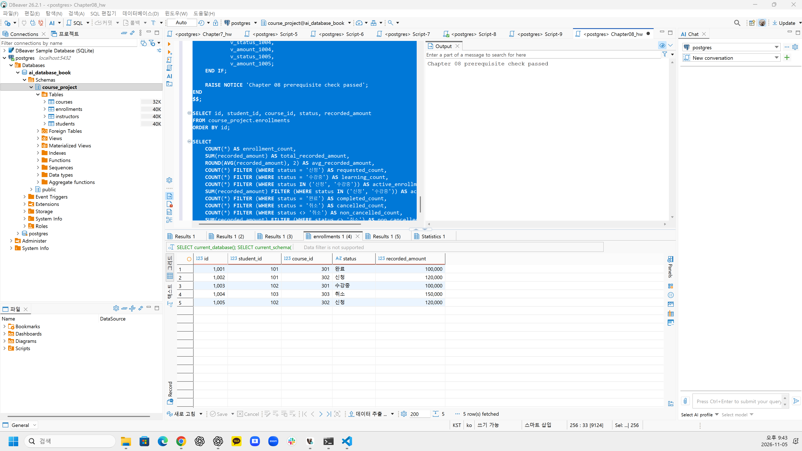
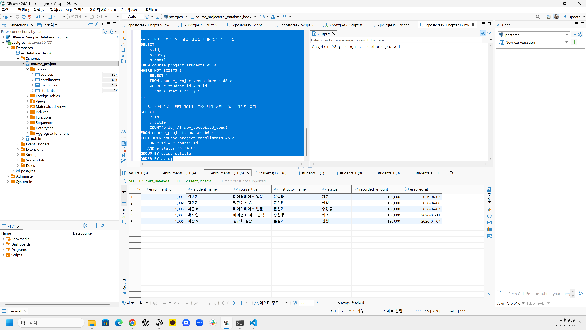
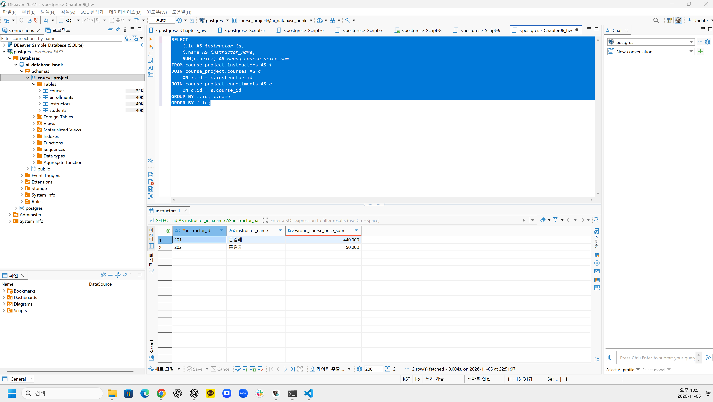
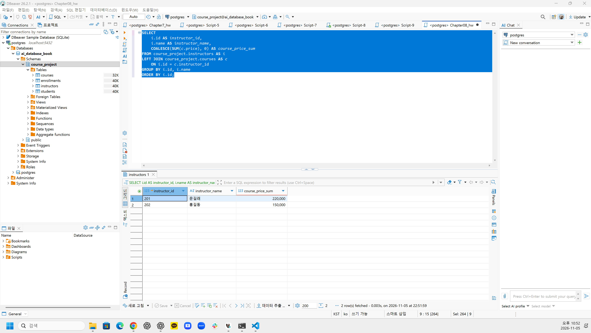
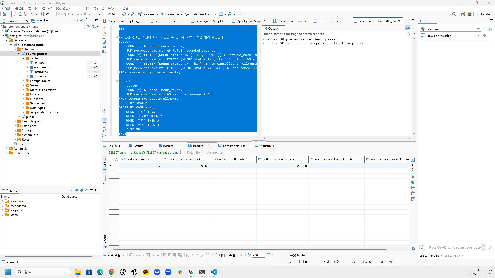

# Chapter 08 확장 실습 답안 템플릿

> **과제:** JOIN과 집계로 서비스 질문에 답하기  
> **사용 방법:** 이 파일을 내려받아 본인의 GitHub 저장소에 `chapter08_answer.md`라는 이름으로 저장한 뒤 실습하면서 바로 작성합니다.  
> **제출 방법:** LMS에는 파일을 직접 업로드하지 않고, **본인 GitHub 저장소의 `chapter08_answer.md` 파일 URL**을 제출합니다.

---

## 제출 전 주의

이 파일과 캡처 화면에는 실제 비밀번호, 전체 DB 접속 URL, API Key, 개인정보를 기록하지 않습니다.

```text
GitHub 계정 또는 별칭:yangguebeom
과제 작성일:2026-11-05
사용한 AI 도구:ChatGPT
```

---

# 1. Chapter 07 기준 상태 확인

다음을 실행합니다.

```text
code/chapter08/00_check_course_project.sql
```

## 1-1. 사전 검사 결과

```text
검증 메시지: Chapter 08 prerequisite check passed

students 행 수: 3
instructors 행 수: 2
courses 행 수: 3
enrollments 행 수: 5

전체 신청 건수: 5
전체 recorded_amount: 590000
활성 신청 건수: 3
활성 recorded_amount: 340000
취소 제외 신청 건수: 4
취소 제외 recorded_amount: 440000
```

기준값:

```text
students = 3
instructors = 2
courses = 3
enrollments = 5

전체 = 5 / 590000
활성 = 3 / 340000
취소 제외 = 4 / 440000
```

### 기준값이 다르면 그대로 진행하면 안 되는 이유

```text
Chapter 08은 Chapter 07의 최종 데이터를 기준으로 JOIN과 집계를 수행하므로, 기준값이 다르면 SQL 실행 결과도 달라질 수 있다. 이 경우 SQL의 오류와 데이터 상태의 차이를 구분하기 어려워지므로, Chapter 07의 데이터를 기준 상태로 복원하고 사전 검사를 다시 통과한 뒤 진행해야 한다.
```

### 증거 화면

권장 경로:

```text
assignments/chapter08/images/step01_prerequisite.png
```

`여기에 사전 검사 통과 화면을 삽입하세요.`



Chapter 08 사전 검증 통과 메시지와 신청 데이터 5행을 확인하여 Chapter 07의 최종 상태가 정상적으로 유지되고 있음을 검증하였다.

---

# 2. 업무 질문을 SQL보다 먼저 정의하기

다음 세 질문을 각각 SQL 작성 전에 먼저 정의합니다.

## 질문 A

```text
업무 질문: 신청 한 건마다 학생 이름, 강의 제목, 강사 이름을 조회하려면?
결과 한 행의 의미: 학생이 특정 강의에 신청한 기록 한 건
포함 상태: 신청, 수강중, 완료, 취소
제외 상태: 없음
JOIN할 테이블: enrollments, students, courses, instructors
JOIN 경로: enrollments.student_id → students.id
           enrollments.course_id → courses.id
           courses.instructor_id → instructors.id
INNER JOIN / LEFT JOIN 선택: INNER JOIN
그 이유: 모든 신청 기록에 연결된 학생, 강의, 강사가 존재하며, 연결된 정보를 함께 조회하기 위해서이다.
예상 행 수: 5행
```

## 질문 B

```text
업무 질문: 취소되지 않은 신청의 건수와 기록 금액을 강의별로 조회하려면?
결과 한 행의 의미: 강의 한 개의 취소 제외 신청 집계
포함 상태: 신청, 수강중, 완료
제외 상태: 취소
JOIN할 테이블: courses, enrollments
JOIN 경로: courses.id → enrollments.course_id
집계 대상: 취소 제외 신청 건수 COUNT(e.id), 기록 금액 SUM(e.recorded_amount)
예상 결과: 강의 301 = 2건 / 200000
           강의 302 = 2건 / 240000
           강의 303 = 0건 / 0
           전체 = 4건 / 440000
```

## 질문 C

```text
업무 질문: 취소되지 않은 신청이 없는 학생도 포함하여 학생별 신청 건수를 조회하려면?
결과 한 행의 의미: 학생 한 명의 취소 제외 신청 건수
포함 상태: 신청, 수강중, 완료
제외 상태: 취소
0건인 부모도 보여야 하는가: 예. 신청이 없는 학생도 결과에 포함한다.
NULL을 어떻게 해석할 것인가: LEFT JOIN에서 연결된 신청이 없으면 enrollments의 열이 NULL이 되며, COUNT(e.id)로 0건으로 집계한다.
예상 결과: 학생 101 = 2건
           학생 102 = 2건
           학생 103 = 0건
           전체 학생 = 3명
```

---

# 3. INNER JOIN과 다중 JOIN

## 3-1. 신청 한 건마다 학생 이름과 강의 제목 조회

실행 전 예상:

```text
결과 한 행 = 학생의 강의 신청 기록 한 건
예상 행 수 = 5행
JOIN 경로 = enrollments.student_id → students.id
            enrollments.course_id → courses.id
```

내가 실행한 SQL:

```sql
SELECT
    e.id AS enrollment_id,
    s.name AS student_name,
    c.title AS course_title,
    e.status
FROM course_project.enrollments AS e
INNER JOIN course_project.students AS s
    ON e.student_id = s.id
INNER JOIN course_project.courses AS c
    ON e.course_id = c.id
ORDER BY e.id;
```

실제 결과:

```text
실제 행 수: 5행
예상과 일치 여부: 일치
```

### 학생 이름이 여러 번 보이는 것이 중복 오류가 아닐 수 있는 이유

```text
한 학생이 여러 강의에 신청할 수 있으므로 학생 이름이 여러 행에 반복되어 나타날 수 있다. 결과의 한 행은 학생 한 명이 아니라 신청 기록 한 건을 의미하므로, 신청 ID가 서로 다르다면 정상적인 1:N 관계의 결과이다.
```

## 3-2. 학생·강의·강사까지 연결

```text
결과 한 행 = 학생의 강의 신청 기록 한 건에 학생 이름, 강의 제목, 강사 이름을 연결한 결과
강사까지 가는 JOIN 경로 = enrollments.course_id → courses.id → courses.instructor_id → instructors.id
```

```sql
SELECT
    e.id AS enrollment_id,
    s.name AS student_name,
    c.title AS course_title,
    i.name AS instructor_name,
    e.status,
    e.recorded_amount,
    e.enrolled_at
FROM course_project.enrollments AS e
JOIN course_project.students AS s
    ON e.student_id = s.id
JOIN course_project.courses AS c
    ON e.course_id = c.id
JOIN course_project.instructors AS i
    ON c.instructor_id = i.id
ORDER BY e.id;
```

실제 행 수:

```text
5행
```

### 증거 화면

권장 경로:

```text
assignments/chapter08/images/step03_inner_join.png
```

`여기에 다중 JOIN 결과 화면을 삽입하세요.`


신청 기록 5건에 학생 이름, 강의 제목, 강사 이름, 신청 상태 및 기록 금액이 정상적으로 연결되었음을 확인하였다.

---

# 4. LEFT JOIN과 0건 표현

## 4-1. 강의별 취소 제외 신청 수

신청이 없는 강의도 결과에 남도록 작성합니다.

실행 전:

```text
결과 한 행 = 강의 한 개
강의 303의 예상 실제 신청 수 = 0건
강의 303의 예상 고유 학생 수 = 0명
강의 303의 예상 recorded_amount = 0
```

내 SQL:

```sql
SELECT
    c.id AS course_id,
    c.title AS course_title,
    COUNT(e.id) AS non_cancelled_count,
    COUNT(DISTINCT e.student_id) AS unique_student_count,
    COALESCE(SUM(e.recorded_amount), 0) AS total_recorded_amount
FROM course_project.courses AS c
LEFT JOIN course_project.enrollments AS e
    ON c.id = e.course_id
   AND e.status <> '취소'
GROUP BY c.id, c.title
ORDER BY c.id;
```

실제 결과:

```text
강의 301: 취소 제외 신청 2건 / 고유 학생 2명 / recorded_amount 200000
강의 302: 취소 제외 신청 2건 / 고유 학생 2명 / recorded_amount 240000
강의 303: 취소 제외 신청 0건 / 고유 학생 0명 / recorded_amount 0
```

## 4-2. `COUNT(*)`와 `COUNT(e.id)` 비교

강의 303을 기준으로 작성합니다.

```text
COUNT(*) 결과: 1
COUNT(e.id) 결과: 0
COUNT(DISTINCT e.student_id) 결과: 0
```

### 왜 `COUNT(*) = 1`인데 실제 신청 수는 0일 수 있나요?

```text
`LEFT JOIN`은 조건에 맞는 신청 기록이 없어도 부모 테이블인 `courses`의 행을 유지한다. 강의 303은 취소 제외 신청이 없으므로 `enrollments`의 열이 NULL인 행이 하나 생성된다. `COUNT(*)`는 이 행까지 계산하므로 1이지만, 실제 신청 건수는 0이다.
```

### 자식 사건 수를 셀 때 `COUNT(child.id)`가 더 적절한 이유

```text
`COUNT(child.id)`는 NULL이 아닌 자식 테이블의 ID만 계산한다. 따라서 `LEFT JOIN`으로 유지된 부모 행은 신청 건수에 포함하지 않고 실제 연결된 신청 기록만 계산할 수 있다.
```

---

# 5. `LEFT JOIN`에서 `ON`과 `WHERE` 조건 비교

취소 제외 신청만 연결한다고 가정합니다.

## 5-1. 조건을 `ON`에 둔 경우

```sql
SELECT
    s.id,
    s.name,
    COUNT(e.id) AS non_cancelled_count
FROM course_project.students AS s
LEFT JOIN course_project.enrollments AS e
    ON s.id = e.student_id
   AND e.status <> '취소'
GROUP BY s.id, s.name
ORDER BY s.id;
```

```text
결과 학생 수: 3명
박서연 포함 여부: 포함 (취소 제외 신청 0건)
```

## 5-2. 조건을 `WHERE`에 둔 경우

```sql
SELECT
    s.id,
    s.name,
    COUNT(e.id) AS non_cancelled_count
FROM course_project.students AS s
LEFT JOIN course_project.enrollments AS e
    ON s.id = e.student_id
WHERE e.status <> '취소'
GROUP BY s.id, s.name
ORDER BY s.id;
```

```text
결과 학생 수: 2명
박서연 포함 여부: 제외
```

## 5-3. 차이 설명

```text
ON 조건이 LEFT JOIN의 오른쪽 연결 대상을 제한하는 방식:
취소 상태가 아닌 신청 기록만 연결하되, 조건에 맞는 신청이 없는 학생도 NULL 확장 행으로 유지한다. 따라서 학생 3명이 모두 조회된다.

WHERE 조건이 JOIN 이후 결과 행을 제거하는 방식:
LEFT JOIN을 수행한 후 취소 상태가 아닌 행만 남긴다. 취소 신청만 있는 학생의 행은 조건을 만족하지 않아 제거되며, NULL 확장 행도 조건을 만족하지 못해 제거된다.

이번 사례에서 ON = 3명, WHERE = 2명이 되는 이유:
박서연은 취소 상태인 신청 1004만 가지고 있다. ON 조건에서는 연결 가능한 신청이 없어도 박서연이 0건으로 유지되지만, WHERE 조건에서는 취소 신청 행이 제거되어 결과에서 제외되기 때문이다.
```

---

# 6. 신청이 없는 학생 찾기 — 두 방법 비교

## 방법 1. `LEFT JOIN ... IS NULL`

```sql
SELECT
    s.id,
    s.name,
    s.email
FROM course_project.students AS s
LEFT JOIN course_project.enrollments AS e
    ON e.student_id = s.id
   AND e.status <> '취소'
WHERE e.id IS NULL;
```

## 방법 2. `NOT EXISTS`

```sql
SELECT
    s.id,
    s.name,
    s.email
FROM course_project.students AS s
WHERE NOT EXISTS (
    SELECT 1
    FROM course_project.enrollments AS e
    WHERE e.student_id = s.id
      AND e.status <> '취소'
);
```

```text
방법 1 결과: 학생 103 / 박서연 / 1명
방법 2 결과: 학생 103 / 박서연 / 1명
두 결과가 같은가: 예. 두 방법 모두 박서연 1명이 조회된다.
찾아진 학생: 박서연 (student_id = 103)
```

### 두 방식의 공통 의미를 자신의 말로 설명

```text
두 방식 모두 취소되지 않은 신청 기록이 존재하지 않는 학생을 찾는다.

`LEFT JOIN ... IS NULL`은 모든 학생을 유지하면서 취소 제외 신청을 연결한 후, 연결된 신청 ID가 NULL인 학생을 찾는다.

`NOT EXISTS`는 학생별로 취소 제외 신청 기록이 존재하는지 확인하고, 해당 기록이 존재하지 않는 학생만 반환한다.

두 방법은 SQL 작성 방식은 다르지만, 취소 제외 신청이 없는 학생을 찾는다는 업무적 의미가 같다.
```

---

# 7. 기본 집계 검산

다음 결과를 직접 확인합니다.

| 분석 범위 | 예상 건수 | 실제 건수 | 예상 금액 | 실제 금액 | 일치? |
| --- | ---: | ---: | ---: | ---: | --- |
| 전체 신청 | 5 | 5 | 590000 | 590000 | 일치 |
| 활성 신청 | 3 | 3 | 340000 | 340000 | 일치 |
| 취소 제외 | 4 | 4 | 440000 | 440000 | 일치 |
| 취소 | 1 | 1 | 150000 | 150000 | 일치 |

## 7-1. 전체 평균 `recorded_amount`

```text
예상 평균: 118000.00
실제 평균: 118000.00
```

## 7-2. 취소 제외 평균

```text
예상 평균: 110000.00
실제 평균: 110000.00
```

### `recorded_amount`를 실제 회계 매출이라고 부르면 안 되는 이유

```text
`recorded_amount`는 수강 신청 당시 기록된 금액이며, 실제 결제 성공 여부나 환불 여부를 나타내지 않는다. 취소된 신청도 기록 금액이 유지되므로 단순히 금액을 합산한 결과를 실제 회계 매출로 해석할 수 없다. 실제 매출을 계산하려면 결제 및 환불 내역을 별도로 확인해야 한다.
```

---

# 8. `GROUP BY`, `HAVING`, `FILTER`

## 8-1. 상태별 신청 건수

```sql
SELECT
    status,
    COUNT(*) AS enrollment_count,
    SUM(recorded_amount) AS total_recorded_amount
FROM course_project.enrollments
GROUP BY status
ORDER BY CASE status
    WHEN '신청' THEN 1
    WHEN '수강중' THEN 2
    WHEN '완료' THEN 3
    WHEN '취소' THEN 4
    ELSE 99
END;
```

결과:

```text
신청: 2건 / 240000
수강중: 1건 / 100000
완료: 1건 / 100000
취소: 1건 / 150000
상태별 합계: 5건 / 590000
```

### 상태별 건수 합이 전체 신청 5건과 맞는지 검산

```text
상태별 신청 건수를 합산하면 2 + 1 + 1 + 1 = 5건으로, 전체 신청 건수 5건과 일치한다. 기록 금액도 240000 + 100000 + 100000 + 150000 = 590000으로 전체 기록 금액과 일치한다.
```

## 8-2. 강의별 취소 제외 신청 수와 금액

```sql
SELECT
    c.id AS course_id,
    c.title AS course_title,
    COUNT(e.id) AS non_cancelled_count,
    COUNT(DISTINCT e.student_id) AS student_count,
    COALESCE(SUM(e.recorded_amount), 0) AS non_cancelled_recorded_amount
FROM course_project.courses AS c
LEFT JOIN course_project.enrollments AS e
    ON c.id = e.course_id
   AND e.status <> '취소'
GROUP BY c.id, c.title
ORDER BY c.id;
```

```text
강의 301: 2건 / 2명 / 200000
강의 302: 2건 / 2명 / 240000
강의 303: 0건 / 0명 / 0
강의별 합계를 다시 더한 값: 440000
전체 취소 제외 기준 440000과 일치 여부: 일치
```

## 8-3. `HAVING` 사용

취소 제외 신청이 2건 이상인 강의를 조회합니다.

```sql
SELECT
    c.id,
    c.title,
    COUNT(e.id) AS enrollment_count
FROM course_project.courses AS c
JOIN course_project.enrollments AS e
    ON c.id = e.course_id
WHERE e.status <> '취소'
GROUP BY c.id, c.title
HAVING COUNT(e.id) >= 2
ORDER BY c.id;
```

```text
예상 강의 수: 2개
실제 강의 수: 2개
```

---

# 9. 과대 집계 오류 직접 관찰

강사 201의 강의 가격 합계를 구한다고 가정합니다.

## 9-1. 신청까지 JOIN해서 잘못 집계한 결과

```sql
SELECT
    i.id AS instructor_id,
    i.name AS instructor_name,
    SUM(c.price) AS wrong_course_price_sum
FROM course_project.instructors AS i
JOIN course_project.courses AS c
    ON i.id = c.instructor_id
JOIN course_project.enrollments AS e
    ON c.id = e.course_id
GROUP BY i.id, i.name
ORDER BY i.id;
```

```text
강사 201 잘못된 가격 합계: 440000
```

본문 기준:

```text
440000
```

## 9-2. 강의 수준에서 올바르게 집계

```sql
SELECT
    i.id AS instructor_id,
    i.name AS instructor_name,
    COALESCE(SUM(c.price), 0) AS course_price_sum
FROM course_project.instructors AS i
LEFT JOIN course_project.courses AS c
    ON i.id = c.instructor_id
GROUP BY i.id, i.name
ORDER BY i.id;
```

```text
강사 201 올바른 가격 합계: 220000
```

본문 기준:

```text
220000
```

## 9-3. 왜 두 결과가 달라졌나요?

```text
JOIN 전 강의 행 수: 강사 201이 담당하는 강의 2행 (강의 301, 302)

JOIN 후 강의가 반복된 이유: 강의와 신청은 1:N 관계이므로, 신청 테이블까지 JOIN하면 강의 한 건이 연결된 신청 건수만큼 반복되기 때문이다.

SUM이 무엇을 반복해서 더했는가: 강의 301의 가격 100000을 2번, 강의 302의 가격 120000을 2번 더하여 440000으로 과대 집계하였다. 실제 강의 가격 합계는 100000 + 120000 = 220000이다.
```

### `SUM(DISTINCT c.price)`를 일반적인 해결책으로 사용하면 안 되는 이유

```text
`SUM(DISTINCT c.price)`는 강의 ID가 아니라 가격 값의 중복을 제거한다. 서로 다른 강의의 가격이 같더라도 하나의 가격만 합산하므로 실제 강의 가격 합계보다 작아질 수 있다.

따라서 강의 가격 합계를 구할 때는 신청 테이블을 불필요하게 JOIN하지 않고, 강의 한 건을 한 행으로 유지한 상태에서 집계해야 한다.
```

### 증거 화면

권장 경로:

```text
assignments/chapter08/images/step09_over_aggregation.png
```

`여기에 잘못된 합계와 올바른 합계를 비교한 화면을 삽입하세요.`



신청 테이블까지 JOIN하여 강의 가격을 합산한 결과, 강사 201의 가격 합계가 440000으로 과대 집계되었다.



신청 테이블을 제외하고 강의 수준에서 집계한 결과, 강사 201의 올바른 가격 합계가 220000으로 확인되었다.

---

# 10. 상세 결과 ↔ 집계 결과 교차 검산

강의 하나를 선택합니다.

```text
선택한 course_id: 301
강의 제목: 데이터베이스 입문
```

## 10-1. 상세 신청 행 조회

```sql
SELECT
    e.id AS enrollment_id,
    e.student_id,
    e.course_id,
    e.status,
    e.recorded_amount
FROM course_project.enrollments AS e
WHERE e.course_id = 301
  AND e.status <> '취소'
ORDER BY e.id;
```

```text
상세 행 수: 2행
상세 recorded_amount를 직접 더한 값: 100000 + 100000 = 200000
```

## 10-2. 집계 SQL

```sql
SELECT
    COUNT(*) AS enrollment_count,
    COALESCE(SUM(recorded_amount), 0) AS total_recorded_amount
FROM course_project.enrollments
WHERE course_id = 301
  AND status <> '취소';
```

```text
집계 건수: 2건
집계 금액: 200000
```

## 10-3. 비교

```text
상세 행 수와 COUNT 결과 일치 여부: 일치 (2행 = 2건)
상세 금액 합과 SUM 결과 일치 여부: 일치 (200000 = 200000)
다르다면 원인: 차이 없음
```

---

# 11. 자동 완료 게이트

다음을 실행합니다.

```text
code/chapter08/03_join_aggregation_validation.sql
```

```text
최종 검증 메시지: Chapter 08 join and aggregation validation passed
```

기대 메시지:

```text
Chapter 08 join and aggregation validation passed
```

### 자동 검증이 통과했어도 사람이 SQL 의미를 설명해야 하는 이유

```text
자동 검증은 정해진 기준값과 실제 SQL 결과가 일치하는지 확인하지만, 업무 질문과 집계 기준이 올바르게 정의되었는지까지 보장하지는 않는다.

예를 들어 `recorded_amount`를 실제 매출로 잘못 해석하거나, JOIN으로 인해 중복된 행을 합산하더라도 특정 데이터에서는 예상값과 우연히 일치할 수 있다.

따라서 자동 검증 통과와 별개로 결과 한 행의 의미, 포함·제외 상태, JOIN 경로, 집계 대상 및 상세 데이터와의 일치 여부를 직접 확인해야 한다.
```

### 증거 화면

권장 경로:

```text
assignments/chapter08/images/step11_validation.png
```



 `03_join_aggregation_validation.sql` 실행 결과 `Chapter 08 join and aggregation validation passed` 메시지가 출력되었으며, 전체 신청 5건 / 590000, 활성 신청 3건 / 340000 등 주요 집계 결과가 기준값과 일치함을 확인하였다.

---

# 12. 개인 프로젝트 업무 질문 3개 만들기

Chapter 07에서 작성한 개인 프로젝트를 사용합니다.

| 질문 ID | 업무 질문 | 결과 한 행 | 포함/제외 범위 | JOIN 경로 | 집계 대상 | 검산 방법 |
| --- | --- | --- | --- | --- | --- | --- |
| P08-Q01 | 스터디별 전체 가입 신청 기록은 몇 건인가? | 스터디 한 개 | 모든 신청 상태 포함, 제외 없음, 신청 0건 스터디 포함 | studies → applications | COUNT(a.application_id) | applications의 study_id별 신청 기록 수와 비교 |
| P08-Q02 | 스터디별 전체 참여 이력은 몇 건인가? | 스터디 한 개 | 과거 및 현재 참여 이력 포함, 제외 없음, 참여 이력 0건 스터디 포함 | studies → memberships | COUNT(ms.membership_id) | memberships의 study_id별 참여 이력 수와 비교 |
| P08-Q03 | 회원별 전체 가입 신청 기록은 몇 건인가? | 회원 한 명 | 모든 신청 상태 포함, 제외 없음, 신청 이력 0건 회원 포함 | members → applications | COUNT(a.application_id) | applications의 member_id별 신청 기록 수와 비교 |

## 12-1. 질문 1 SQL

```sql
SELECT
    s.study_id,
    s.title,
    COUNT(a.application_id) AS application_count
FROM studies AS s
LEFT JOIN applications AS a
    ON s.study_id = a.study_id
GROUP BY s.study_id, s.title
ORDER BY s.study_id;
```

```text
예상 결과: 스터디별 전체 가입 신청 기록 수가 출력되며, 신청 기록이 없는 스터디도 0건으로 표시된다.
실제 결과: 미실행 (개인 프로젝트 테이블의 PostgreSQL 구현 및 실행 결과 미확인)
검산 결과: 미실행. 추후 applications에서 study_id별 COUNT(*) 결과와 비교하고, 신청 기록이 없는 스터디도 출력되는지 확인한다.
```

## 12-2. 질문 2 SQL

```sql
SELECT
    s.study_id,
    s.title,
    COUNT(ms.membership_id) AS membership_history_count
FROM studies AS s
LEFT JOIN memberships AS ms
    ON s.study_id = ms.study_id
GROUP BY s.study_id, s.title
ORDER BY s.study_id;
```

```text
예상 결과: 스터디별 전체 참여 이력 수가 출력되며, 참여 이력이 없는 스터디도 0건으로 표시된다. 탈퇴 후 재가입으로 생성된 새로운 참여 기록도 각각 집계한다.
실제 결과: 미실행 (개인 프로젝트 테이블의 PostgreSQL 구현 및 실행 결과 미확인)
검산 결과: 미실행. 추후 memberships에서 study_id별 COUNT(*) 결과와 비교하고, 탈퇴 후 재가입 이력이 누락되지 않았는지 확인한다.
```

## 12-3. 질문 3 SQL

```sql
SELECT
    m.member_id,
    m.name,
    COUNT(a.application_id) AS application_count
FROM members AS m
LEFT JOIN applications AS a
    ON m.member_id = a.member_id
GROUP BY m.member_id, m.name
ORDER BY m.member_id;
```

```text
예상 결과: 회원별 전체 가입 신청 기록 수가 출력되며, 신청 이력이 없는 회원도 0건으로 표시된다.
실제 결과: 미실행 (개인 프로젝트 테이블의 PostgreSQL 구현 및 실행 결과 미확인)
검산 결과: 미실행. 추후 applications에서 member_id별 COUNT(*) 결과와 비교하고, 신청 이력이 없는 회원도 결과에 포함되는지 확인한다.
```

> 아직 개인 프로젝트 테이블을 PostgreSQL로 완성하지 않았다면 SQL 초안과 예상 검산 방법까지만 작성하고 `미실행`이라고 명시합니다.

---

# 13. AI를 JOIN·집계 리뷰어로 활용

## 13-1. 내가 AI에게 전달한 질문

```text
다음 업무 질문과 SQL을 검토해 주세요.
SQL이 실행된다는 이유로 정답이라고 판단하지 말아 주세요.

먼저 다음을 확인해 주세요.
1. 결과 한 행의 의미
2. 포함/제외 상태
3. PK/FK JOIN 경로
4. INNER JOIN과 LEFT JOIN 선택
5. COUNT 대상
6. NULL과 0건 해석
7. 여러 1:N JOIN으로 인한 과대 집계 위험
8. 상세 결과로 검산할 방법

근거 없는 DISTINCT나 COALESCE를 먼저 제안하지 말고,
질문의 의미와 행 단위가 잘못되었는지 먼저 확인해 주세요.

[업무 질문]
스터디별 전체 참여 이력은 몇 건인가?
참여 이력이 없는 스터디도 0건으로 표시해야 한다.
탈퇴 후 재가입하면 새로운 memberships 행을 생성하고 과거 이력은 보존한다.

[테이블 구조]
studies(study_id PK, leader_id FK, title, description, max_members, created_at)
memberships(membership_id PK, member_id FK, study_id FK, joined_at)

JOIN 관계:
studies.study_id = memberships.study_id

[내 SQL]
SELECT
    s.study_id,
    s.title,
    COUNT(ms.membership_id) AS membership_history_count
FROM studies AS s
LEFT JOIN memberships AS ms
    ON s.study_id = ms.study_id
GROUP BY s.study_id, s.title
ORDER BY s.study_id;
```

## 13-2. 내 SQL과 AI SQL 비교

| 검토 항목 | 내 판단/SQL | AI 제안 | 최종 선택 | 이유 |
| --- | --- | --- | --- | --- |
| 결과 한 행 | 스터디 한 개 | `study_id` 기준 그룹화 유지 | 수용 | 스터디별 참여 이력 수를 묻는 질문과 일치한다. |
| 상태 범위 | 현재 및 과거 참여 이력 모두 포함 | 전체 이력과 현재 참여 인원을 구분하도록 제안 | 수용 | 탈퇴 및 재가입 이력도 보존하는 정책이므로 전체 이력을 집계한다. |
| JOIN 경로 | `studies.study_id → memberships.study_id` | 실제 PK/FK 관계를 따라 JOIN 유지 | 수용 | 스터디와 참여 이력의 1:N 관계에 맞는 경로이다. |
| INNER/LEFT 선택 | `LEFT JOIN` | 0건인 스터디를 유지하기 위해 LEFT JOIN 권장 | 수용 | INNER JOIN은 참여 이력이 없는 스터디를 제외한다. |
| COUNT 대상 | `COUNT(ms.membership_id)` | COUNT(*) 대신 자식 테이블 PK를 집계하도록 권장 | 수용 | NULL 확장 행을 실제 참여 이력으로 잘못 계산하지 않는다. |
| 과대 집계 위험 | 스터디와 참여 이력만 JOIN | 다른 1:N 테이블 추가 시 중복 집계 위험 확인 | 수용 | 불필요한 JOIN을 추가하지 않고 참여 이력 한 건을 한 번만 계산한다. |
| 상세 검산 방법 | 스터디별 참여 이력 행 수 비교 | 상세 행 수와 집계 결과 비교 및 0건 스터디 확인 | 수정 | 전체 건수뿐 아니라 스터디별 집계 및 0건 처리까지 검증하도록 보완한다. |

### AI가 만든 SQL에서 발견한 위험 또는 확인한 점

```text
AI 검토 결과, 기존 SQL의 LEFT JOIN 경로와 COUNT 대상은 업무 질문에 적합하였다.

참여 이력이 없는 스터디도 표시해야 하므로 LEFT JOIN을 유지하고,
COUNT(*) 대신 COUNT(ms.membership_id)를 사용하는 것이 적절하다.

탈퇴 후 재가입한 회원의 참여 기록은 별도의 행으로 보존되므로,
이 SQL은 현재 참여 인원이 아니라 전체 참여 이력 수를 나타낸다.

다른 1:N 테이블을 추가로 JOIN하면 참여 이력이 중복되어 과대 집계될
위험이 있으므로 불필요한 JOIN은 추가하지 않기로 하였다.

상세 검산 방법은 스터디별 memberships 행 수와 집계 결과를 비교하고,
참여 이력이 없는 스터디가 0건으로 표시되는지 확인하도록 보완하였다.

최종 SQL은 기존 SQL을 유지한다.
실제 실행 결과는 개인 프로젝트 테이블의 PostgreSQL 구현 및 실행 결과가
확인되지 않았으므로 미실행으로 기록한다.
```

### AI SQL이 실행 성공했다고 바로 정답이라고 할 수 없는 이유

```text
SQL이 오류 없이 실행되더라도 결과 한 행의 의미와 집계 기준이
업무 질문에 맞지 않으면 잘못된 결과가 나올 수 있다.

예를 들어 현재 참여 인원을 구해야 하는데 과거 탈퇴 이력까지 포함하거나,
LEFT JOIN에서 COUNT(*)를 사용하여 참여 이력이 없는 스터디를 1건으로
계산하면 SQL은 정상 실행되어도 업무적으로 잘못된 결과가 된다.

따라서 실행 성공 여부뿐 아니라 JOIN 경로, 포함/제외 범위,
COUNT 대상, 중복 가능성을 검토하고 상세 행과 집계 결과를
직접 비교하여 검증해야 한다.
```

---

# 14. 최종 성찰

아래 문장은 본인의 말로 작성합니다.

```text
1. JOIN SQL을 작성하기 전에 가장 먼저 정해야 하는 것은
   업무 질문과 결과 한 행이 무엇을 의미하는지, 어떤 데이터를 포함하고 제외할 것인지이다.

2. LEFT JOIN에서 COUNT(*) 대신 COUNT(child.id)를 검토해야 하는 이유는
   자식 행이 없어도 부모 행은 유지되므로 COUNT(*)는 1을 반환할 수 있지만,
   COUNT(child.id)는 실제 연결된 자식 행만 계산하기 때문이다.

3. ON과 WHERE 조건 위치가 중요한 이유는
   ON은 JOIN할 대상을 제한하면서 LEFT JOIN의 부모 행을 유지하지만,
   WHERE는 JOIN 이후 조건에 맞지 않는 결과 행을 제거하여
   0건인 부모까지 제외할 수 있기 때문이다.

4. 여러 1:N 관계를 JOIN한 뒤 바로 SUM하면 위험한 이유는
   JOIN 과정에서 동일한 부모 행이 여러 번 반복되어
   같은 금액을 중복 합산하는 과대 집계가 발생할 수 있기 때문이다.

5. 집계 결과를 신뢰하기 전에 가장 좋은 검산 방법 중 하나는
   동일한 조건으로 상세 데이터를 조회하여 실제 행 수와 금액을 직접 계산하고,
   COUNT와 SUM으로 구한 집계 결과와 비교하는 것이다.
```

---

# 15. 제출 체크리스트

- [x] `chapter08_answer.md`를 본인 저장소에 만들었다.
- [x] `00_check_course_project.sql`이 통과했다.
- [x] 업무 질문마다 결과 한 행을 먼저 정의했다.
- [x] INNER JOIN과 다중 JOIN을 실행했다.
- [x] LEFT JOIN에서 0건 부모를 확인했다.
- [x] `COUNT(*)`와 `COUNT(child.id)` 차이를 설명했다.
- [x] ON과 WHERE 조건 위치 차이를 직접 비교했다.
- [x] `LEFT JOIN ... IS NULL`과 `NOT EXISTS`를 비교했다.
- [x] 전체/활성/취소 제외 기준값을 직접 검산했다.
- [x] `GROUP BY`, `HAVING`을 사용했다.
- [x] 과대 집계 오류와 수정 결과를 비교했다.
- [x] 상세 결과와 집계 결과를 교차 검산했다.
- [x] `03_join_aggregation_validation.sql`이 통과했다.
- [x] 개인 프로젝트 업무 질문 3개를 작성했다.
- [x] AI SQL을 실행 성공 여부가 아니라 의미와 검산 결과로 평가했다.
- [x] 핵심 캡처는 3~4장 정도만 사용했다.
- [x] 비밀번호·개인정보·비밀정보가 없다.
- [x] GitHub 웹에서 Markdown과 이미지가 정상적으로 보인다.
- [x] 최종 답안을 commit/push했다.

---

# 16. LMS 제출 URL

아래 형식의 **본인 GitHub 파일 URL**을 LMS에 제출합니다.

```text
https://github.com/<본인-GitHub-ID>/<본인-저장소>/blob/main/assignments/chapter08/chapter08_answer.md
```

내 제출 URL:

```text
https://github.com/yangguebeom/snu-database-2026-2/blob/main/assignments/chapter08/chapter08_answer.md
```

> 저장소 메인 URL, 교수자 템플릿 URL, Raw URL이 아니라 **작성 완료된 본인 `chapter08_answer.md` 파일 화면 URL**을 제출합니다.
