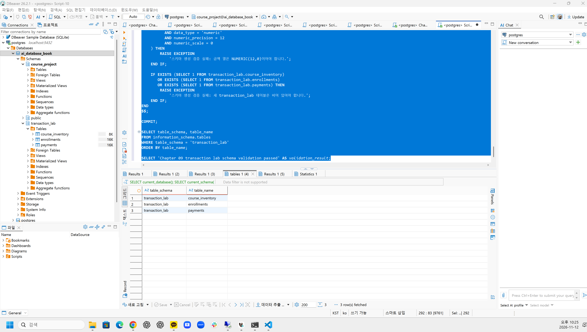
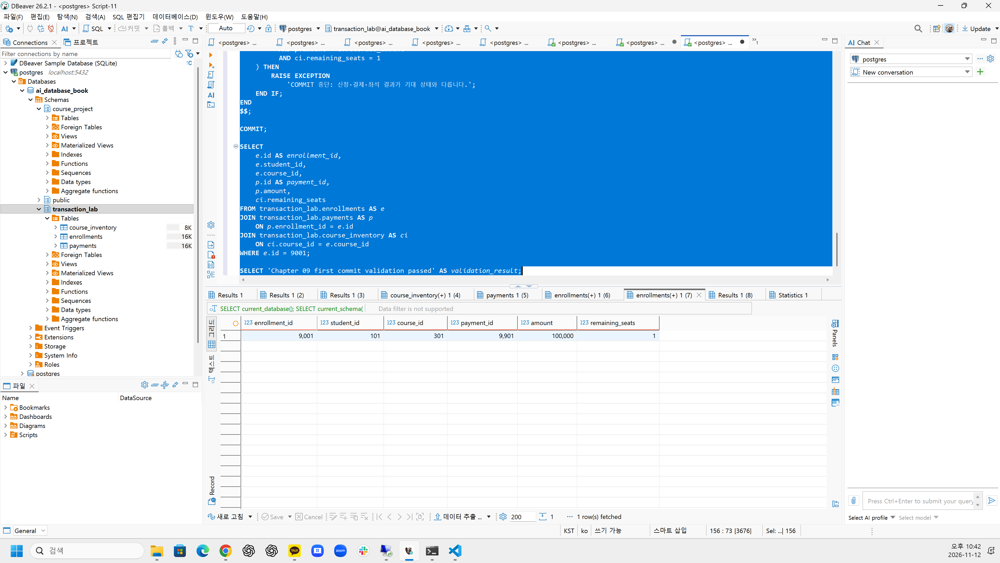
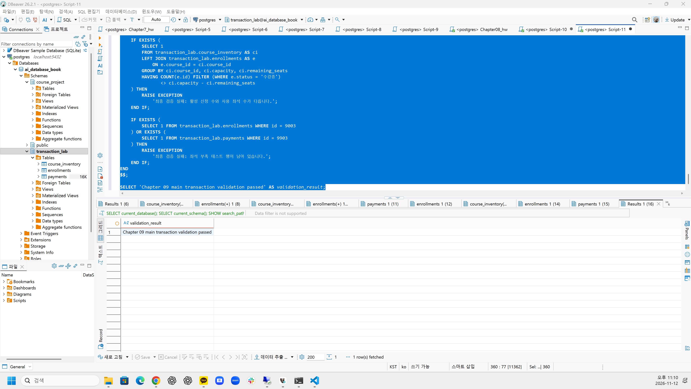

# Chapter 09 확장 실습 답안 템플릿

> **과제:** 트랜잭션으로 데이터 정합성 지키기  
> **사용 방법:** 이 파일을 내려받아 본인의 GitHub 저장소에 `chapter09_answer.md`라는 이름으로 저장한 뒤 실습하면서 바로 작성합니다.  
> **제출 방법:** LMS에는 파일을 직접 업로드하지 않고, **본인 GitHub 저장소의 `chapter09_answer.md` 파일 URL**을 제출합니다.

---

## 제출 전 주의

이 파일과 캡처 화면에는 실제 비밀번호, 전체 DB 접속 URL, API Key, 개인정보를 기록하지 않습니다.

```text
GitHub 계정 또는 별칭:yangguebeom
과제 작성일:2026-11-12
사용한 AI 도구:ChatGPT
```

---

# 1. 시작 환경과 Chapter 07·08 기준 상태 확인

다음을 실행하거나 Chapter 09의 `01_transaction_lab_schema.sql` 사전 검사를 확인합니다.

```sql
SELECT current_database();
SELECT current_user;
SELECT current_schema();
SHOW search_path;
SHOW transaction_read_only;
```

| 확인 항목 | 실제 결과 | 의미 |
| --- | --- | --- |
| `current_database()` | `ai_database_book` | Chapter 07·08에서 사용한 데이터베이스에 정상 접속 |
| `current_user` | `postgres` | 현재 PostgreSQL 접속 사용자 |
| `current_schema()` | `course_project` | 현재 기본 스키마가 기존 강의 프로젝트 스키마임 |
| `search_path` | `course_project, "$user", public` | 테이블 검색 시 적용되는 스키마 탐색 순서 |
| `transaction_read_only` | `off` | 읽기 전용 상태가 아니므로 데이터 변경 가능 |

Chapter 07·08 기준값:

```text
students = 3
instructors = 2
courses = 3
enrollments = 5
전체 recorded_amount = 590000
활성 = 3 / 340000
취소 제외 = 4 / 440000
```

### 기준 상태가 다르면 Chapter 09를 계속 진행하면 안 되는 이유

```text
Chapter 09는 Chapter 07·08의 데이터를 기준으로 별도 transaction_lab에서 트랜잭션을 실습한다. 기존 데이터의 행 수, 상태별 건수, 금액 등이 기준값과 다르면 실습 결과가 달라질 수 있으며, 문제가 발생했을 때 기존 데이터의 문제인지 트랜잭션 처리 문제인지 구분하기 어렵다. 따라서 기준 상태가 일치하는지 먼저 확인하고, 불일치하면 원인을 확인하여 기존 데이터를 복구한 뒤 실습을 진행해야 한다.
```

---

# 2. `transaction_lab` 스키마 생성

실행 파일:

```text
code/chapter09/01_transaction_lab_schema.sql
```

## 2-1. 생성 전 예상

```text
생성될 스키마: transaction_lab
생성될 테이블 3개:
- course_inventory
- enrollments
- payments

course_inventory 한 행의 의미: 특정 강의의 좌석 상태 한 건
enrollments 한 행의 의미: transaction_lab에서 생성한 수강신청 사건 한 건
payments 한 행의 의미: 특정 lab enrollment에 연결된 결제 기록 한 건
```

## 2-2. 생성 결과

```text
통과 메시지: Chapter 09 transaction lab schema validation passed
```

기대 메시지:

```text
Chapter 09 transaction lab schema validation passed
```

### Chapter 07·08의 `course_project`와 별도 `transaction_lab`을 사용하는 이유

```text
course_project는 Chapter 07·08의 기준 데이터를 유지하고, transaction_lab은 좌석·수강신청·결제 트랜잭션을 독립적으로 실습하기 위해 사용한다. 스키마를 분리하면 기존 데이터를 보호하면서 실습 데이터를 초기화할 수 있고, 동일한 학생·강의 ID를 사용하더라도 실습 테이블의 변경 및 삭제 범위를 transaction_lab으로 제한할 수 있다.
```

### 증거 화면

권장 경로:

```text
assignments/chapter09/images/step02_schema.png
```

`여기에 transaction_lab 구조가 보이는 핵심 화면을 삽입하세요.`



DBeaver에서 `transaction_lab` 스키마 아래 `course_inventory`, `enrollments`, `payments` 테이블 3개가 생성된 것을 확인하였다. 실행 결과에서도 스키마 생성 검증 통과 메시지가 출력되어 정상적으로 생성되었음을 확인하였다.

---

# 3. 초기 좌석과 기준 데이터 입력

실행 파일:

```text
code/chapter09/02_transaction_lab_seed.sql
```

## 3-1. 실행 전 예상

```text
course 301 remaining_seats 예상: 3
course 302 remaining_seats 예상: 0
course 303 remaining_seats 예상: 0
lab enrollments 예상 행 수: 0
payments 예상 행 수: 0
```

## 3-2. 실제 결과

```text
course 301 remaining_seats: 2
course 302 remaining_seats: 1
course 303 remaining_seats: 1
lab enrollments 행 수: 0
payments 행 수: 0
통과 메시지: Chapter 09 transaction lab seed validation passed
```

기대 초기 상태:

```text
course 301 / 302 / 303 remaining_seats = 3 / 0 / 0
lab enrollments = 0
payments = 0
```

### 예상과 실제가 다른 경우 원인

```text
교수님 블로그의 기대 초기 좌석은 3 / 0 / 0이지만, 실제 제공된 02_transaction_lab_seed.sql의 INSERT 구문에서는 강의 301, 302, 303의 capacity와 remaining_seats를 각각 2 / 1 / 1로 설정한다. 이후 DO 블록의 검증 조건도 2 / 1 / 1을 기준으로 작성되어 있다. 따라서 예상과 실제의 차이는 트랜잭션 실행 오류가 아니라 블로그에 기재된 기대값과 제공 SQL의 초기 설정이 서로 다르기 때문에 발생한 것이다. 원본 SQL을 수정하지 않고 실행했으며 최종 검증 메시지가 정상적으로 출력되었다.
```

---

# 4. 첫 번째 정상 COMMIT 추적

실행 파일:

```text
code/chapter09/03_commit_transaction.sql
```

이 실습은 학생 101이 강의 301을 신청하는 하나의 업무 단위를 추적합니다.

## 4-1. 업무 단위 정의

```text
이 트랜잭션에서 함께 성공해야 하는 변경 1: course 301의 남은 좌석을 2개에서 1개로 감소시킨다.
변경 2: 학생 101의 강의 301 수강신청(enrollment 9001)을 생성한다.
변경 3: 해당 신청과 연결된 결제(payment 9901)를 생성한다.

하나라도 실패하면 전체를 취소해야 하는 이유:
좌석 차감, 수강신청 생성, 결제 기록 생성은 하나의 신청 업무를 구성한다. 일부 변경만 반영되면 좌석은 줄었지만 신청이 없거나, 신청은 있지만 결제가 없는 등 데이터 불일치가 발생할 수 있으므로 전체를 ROLLBACK해야 한다.
```

## 4-2. 상태 변화 기록

| 시점 | course 301 남은 좌석 | lab enrollment 9001 | payment 9901 | 설명 |
| --- | ---: | --- | --- | --- |
| BEGIN 전 | 2 | 없음 | 없음 | 초기 좌석이 2개이고 신청·결제 기록이 없는 상태 |
| 트랜잭션 내부 | 1 | 생성됨(학생 101, 강의 301, 수강중, 100000) | 생성됨(9001 연결, 100000) | 좌석 차감과 신청·결제 생성 후 COMMIT 전 정합성 검증 |
| COMMIT 후 | 1 | 유지됨 | 유지됨 | 변경 사항이 확정되었으며 신청·결제·좌석 관계가 정상적으로 유지됨 |

## 4-3. COMMIT 조건

```text
좌석 UPDATE 기대 영향 행 수: 1
실제 영향 행 수: 1 (RETURNING 결과와 잔여 좌석 2 → 1로 확인)
신청 생성 기대 행 수: 1
결제 생성 기대 행 수: 1
recorded_amount와 payment.amount 일치 여부: 일치 (100000 = 100000)
최종 COMMIT 판단: 좌석 1개 차감, 신청 9001 생성, 결제 9901 생성 및 금액 일치를 확인하여 COMMIT 성공
```

기대 메시지:

```text
Chapter 09 first commit validation passed
```

### SQL 오류가 없었다는 사실만으로 COMMIT하면 안 되는 이유

```text
SQL 문장이 오류 없이 실행되더라도 조건부 UPDATE의 영향 행 수가 0이거나 예상보다 많은 행이 변경될 수 있다. 또한 수강신청과 결제 기록이 생성되었더라도 신청 금액과 결제 금액이 다르거나 좌석 수가 올바르게 감소하지 않을 수 있다. 따라서 COMMIT 전에 영향 행 수와 좌석·신청·결제의 최종 정합성을 검증해야 한다.
```

### 증거 화면

권장 경로:

```text
assignments/chapter09/images/step04_commit.png
```

`여기에 COMMIT 후 좌석·신청·결제 관계를 확인할 수 있는 화면을 삽입하세요.`



COMMIT 후 enrollment 9001이 학생 101의 강의 301 신청으로 유지되고, payment 9901이 해당 신청에 연결되어 있으며, 결제 금액 100000과 잔여 좌석 1이 정상적으로 확인되었다.

---

# 5. ROLLBACK으로 전체 원상복구 확인

실행 파일:

```text
code/chapter09/04_rollback_transaction.sql
```

## 5-1. ROLLBACK 전 예상

```text
트랜잭션 안에서 임시로 바뀔 값:
강의 302의 remaining_seats가 1에서 0으로 감소하고, 학생 102의 수강신청 9002와 결제 9902(120000)가 생성된다.

ROLLBACK 후 다시 돌아와야 할 값:
강의 302의 remaining_seats는 1로 복구되고, 임시 생성된 enrollment 9002와 payment 9902는 존재하지 않아야 한다.

이미 이전 파일에서 COMMIT된 9001/9901은 유지되어야 하는가:
예. 이전 트랜잭션에서 COMMIT된 신청 9001과 결제 9901은 현재 트랜잭션의 ROLLBACK 대상이 아니므로 유지되어야 한다.
```

## 5-2. 실제 결과

```text
ROLLBACK 후 course 301 상태: remaining_seats = 1 (이전 COMMIT 상태 유지)
ROLLBACK 후 lab enrollments 행 수: 1 (9001만 유지, 9002는 삭제됨)
ROLLBACK 후 payments 행 수: 1 (9901만 유지, 9902는 삭제됨)
9001 존재 여부: 존재 (최종 검증 통과)
9901 존재 여부: 존재 (최종 검증 통과)
통과 메시지: Chapter 09 rollback validation passed
```

기대 메시지:

```text
Chapter 09 rollback validation passed
```

## 5-3. ROLLBACK과 IDENTITY

```text
ROLLBACK이 테이블 행 변경을 되돌리는 방식:
현재 트랜잭션에서 실행한 좌석 UPDATE와 신청·결제 INSERT가 취소되어 BEGIN 이전 상태로 복구된다. 실제로 강의 302의 잔여 좌석은 0에서 1로 돌아왔고, 임시 생성한 enrollment 9002와 payment 9902도 남지 않았다. 이전에 COMMIT한 9001과 9901은 유지되었다.

IDENTITY 자동 번호가 반드시 이전 값으로 되돌아가지는 않는 이유:
PostgreSQL의 IDENTITY는 시퀀스를 사용하여 번호를 생성하며, 시퀀스에서 이미 할당한 번호는 트랜잭션을 ROLLBACK하더라도 일반적으로 되돌리지 않는다. 따라서 트랜잭션이 취소되어 행은 삭제되더라도 다음 자동 생성 번호는 증가한 상태일 수 있다. 이번 실습에서는 ID를 직접 지정했으므로 자동 번호 건너뛰기를 실제 관찰한 것은 아니다.

번호가 건너뛰었다고 데이터 손상이라고 단정할 수 없는 이유:
IDENTITY의 목적은 각 행을 고유하게 식별하는 것이며, 번호가 연속적으로 증가하는 것을 보장하는 것이 아니다. ROLLBACK 등으로 일부 번호가 사용되지 않아도 PK 중복이나 데이터 정합성 문제가 발생한 것은 아니므로 번호의 빈 구간만으로 데이터 손상이라고 판단할 수 없다.
```

---

# 6. 두 번째 COMMIT과 좌석 부족 0행 관찰

실행 파일:

```text
code/chapter09/05_commit_and_sold_out.sql
```

## 6-1. 두 번째 정상 COMMIT

```text
생성된 enrollment id: 9002
학생 id: 103
course id: 302
recorded_amount: 120000
payment id: 9902
payment amount: 120000
```

## 6-2. 좌석 부족 시도

```text
좌석 확보 UPDATE 기대 영향 행 수: 0
실제 영향 행 수: 0 (seat CTE의 RETURNING 결과가 0행)
후속 enrollment 생성 행 수: 0
후속 payment 생성 행 수: 0
```

기준상 좌석 부족 시 생성되지 않아야 하는 ID:

```text
9003
9903
```

### `UPDATE 0`이 SQL 실패가 아니라 업무상 실패일 수 있는 이유

```text
조건부 UPDATE는 remaining_seats > 0인 경우에만 좌석을 차감한다. 강의 302의 남은 좌석이 0이면 조건에 맞는 행이 없으므로 UPDATE 영향 행 수가 0이 된다. 이는 SQL 문법이나 실행 오류가 아니라 좌석이 부족하여 신청 조건을 충족하지 못한 업무상 실패이다.
```

### 영향 행 수가 0인데 신청과 결제를 계속 생성하면 어떤 정합성 문제가 생기나요?

```text
좌석을 확보하지 못했는데도 신청과 결제 기록을 생성하면 실제 남은 좌석이 없는 강의에 수강신청이 확정되는 문제가 발생한다. 이 경우 좌석 수와 신청 건수가 일치하지 않고, 수강할 수 없는 학생의 결제 기록까지 남을 수 있다. 따라서 좌석 UPDATE가 0행이면 후속 enrollment와 payment도 생성하지 않아야 한다.
```

---

# 7. 주 실습 최종 정합성 검증

실행 파일:

```text
code/chapter09/06_transaction_validation.sql
```

## 7-1. lab 최종 상태

| 항목 | 기대값 | 실제값 | 일치? |
| --- | ---: | ---: | --- |
| course_inventory 행 수 | 3 | 3 | 일치 |
| lab enrollments 행 수 | 2 | 2 | 일치 |
| payments 행 수 | 2 | 2 | 일치 |
| course 301 remaining | 1 | 1 | 일치 |
| course 302 remaining | 0 | 0 | 일치 |
| course 303 remaining | 1 | 1 | 일치 |

## 7-2. 주요 행

```text
9001 = student 101 / course 301 / amount 100000 / payment 9901
실제: student 101 / course 301 / amount 100000 / payment 9901

9002 = student 103 / course 302 / amount 120000 / payment 9902
실제: student 103 / course 302 / amount 120000 / payment 9902

9003·9903 = 존재하지 않아야 함
실제: enrollment 9003과 payment 9903 모두 조회 결과 0행으로 존재하지 않음
```

## 7-3. 보호 대상 확인

```text
course_project.enrollments 행 수: 5
전체 recorded_amount: 590000
활성 건수/금액: 3 / 340000
취소 제외 건수/금액: 4 / 440000
```

기대값:

```text
course_project.enrollments = 5
전체 = 590000
활성 = 3 / 340000
취소 제외 = 4 / 440000
```

최종 기대 메시지:

```text
Chapter 09 main transaction validation passed
```

### transaction_lab 실습 후에도 course_project 기준 상태를 다시 검사하는 이유

```text
Chapter 09는 기존 Chapter 07·08의 course_project 데이터를 유지하면서 별도의 transaction_lab에서 트랜잭션을 실습한다. transaction_lab의 좌석·수강신청·결제 상태가 정상적이더라도 기존 course_project 데이터가 변경되었다면 실습이 올바르게 완료되었다고 볼 수 없다. 따라서 새로운 실습 데이터의 정합성뿐 아니라 기존 프로젝트의 행 수, 상태별 건수, 금액 등이 기준값과 일치하는지도 함께 확인해야 한다.
```



`06_transaction_validation.sql` 실행 결과 `Chapter 09 main transaction validation passed` 메시지를 확인하였다. `transaction_lab`의 최종 좌석·신청·결제 상태가 기준값과 일치하고, 기존 `course_project` 데이터도 정상적으로 유지되었음을 검증하였다.

---

# 8. ACID를 이번 실습으로 설명

교과서 정의를 그대로 복사하지 말고 이번 좌석·신청·결제 사례로 작성합니다.

```text
Atomicity:
좌석 차감, 수강신청 생성, 결제 생성은 하나의 업무이므로 모두 성공하거나 모두 취소되어야 한다. STEP 4에서는 세 변경이 함께 COMMIT되었고, STEP 5에서는 강의 302의 좌석 차감과 임시 신청 9002·결제 9902가 ROLLBACK으로 모두 취소되었다.

Consistency:
트랜잭션이 완료된 후에도 잔여 좌석이 음수가 아니어야 하고, 신청 금액과 결제 금액이 일치하며, 사용한 좌석 수와 활성 신청 수가 일치해야 한다. STEP 7에서 이러한 조건을 검증했고, 좌석 부족으로 실패한 신청 9003과 결제 9903이 생성되지 않았음을 확인했다.

Isolation:
여러 학생이 동시에 마지막 좌석을 신청하더라도 서로의 작업이 충돌하여 좌석이 초과 배정되지 않도록 해야 한다. 이번 SQL에서는 SELECT ... FOR UPDATE로 해당 강의의 좌석 행을 잠그고, remaining_seats > 0 조건으로 좌석을 차감하도록 작성했다. 실제 두 세션 간 Lock 대기 동작은 아직 실습하지 않았다.

Durability:
COMMIT이 성공한 변경은 이후 다른 트랜잭션이 ROLLBACK되더라도 유지되어야 한다. STEP 4에서 확정된 신청 9001과 결제 9901은 STEP 5의 ROLLBACK 이후에도 유지되었으며, STEP 7 최종 검증에서도 정상적으로 확인되었다.
```

### Atomicity와 Consistency가 같은 뜻이 아닌 이유

```text
Atomicity는 하나의 트랜잭션에 포함된 변경들이 전부 반영되거나 전부 취소되는 것을 의미한다. 반면 Consistency는 트랜잭션 전후의 데이터가 업무 규칙과 무결성 조건을 만족하는 것을 의미한다.

예를 들어 좌석을 차감하지 않고 신청과 결제만 생성하는 잘못된 SQL을 하나의 트랜잭션으로 묶어 COMMIT하면 모든 변경이 함께 반영되므로 Atomicity는 지켜질 수 있다. 하지만 좌석 확보 없이 신청과 결제가 생성되어 좌석 수와 활성 신청 수가 불일치하므로 Consistency는 깨진다.

따라서 트랜잭션으로 변경을 묶는 것뿐 아니라 제약조건, 조건부 UPDATE의 영향 행 수, COMMIT 전 정합성 검증을 함께 적용해야 한다.
```

---

# 9. 선택 실습 — 두 세션 Lock 대기 관찰

실행 파일:

```text
code/chapter09/07_concurrency_two_sessions.sql
```

가능하면 DBeaver에서 **서로 다른 두 연결 세션**으로 수행합니다.

## 9-1. 내 환경

```text
실제 두 세션 실습 수행 / 절차 분석만 수행:
transaction_isolation:
lock_timeout:
```

## 9-2. 시간 순서 기록

| 순서 | Session A | Session B | 관찰 |
| ---: | --- | --- | --- |
| 1 |  |  |  |
| 2 |  |  |  |
| 3 |  |  |  |
| 4 |  |  |  |

```text
먼저 Lock을 획득한 세션:
대기한 세션:
A가 COMMIT/ROLLBACK한 뒤 B에서 일어난 일:
```

### Lock 대기와 Deadlock의 차이

```text

```

### `SELECT ... FOR UPDATE`가 모든 UPDATE 앞에 항상 필요한 것은 아닌 이유

```text

```

### 증거 화면

실제 수행했다면 권장 경로:

```text
assignments/chapter09/images/step09_lock.png
```

---

# 10. 선택 실습 — 취소와 좌석 복구

실행 파일:

```text
code/chapter09/08_cancel_and_restore.sql
```

```text
9001 취소 성공 행 수:
course 301 좌석 변화:
같은 취소를 다시 시도한 행 수:
두 번째 좌석 복구 행 수:
payment 9901 유지 여부:
최종 ROLLBACK 후 원상복구 여부:
통과 메시지:
```

기대 흐름:

```text
9001 수강중 → 취소 1행
course 301 remaining 1 → 2
같은 취소 재시도 → 0행
추가 좌석 복구 → 0행
마지막 ROLLBACK → 주 실습 기준으로 복구
```

### 같은 취소를 두 번 처리해도 좌석이 두 번 증가하지 않아야 하는 이유

```text

```

---

# 11. 선택 실습 — 오류 상태와 SAVEPOINT

실행 파일:

```text
code/chapter09/09_error_and_savepoint.sql
```

## 11-1. 일반 오류 후 트랜잭션 상태

```text
발생시킨 오류:
오류 이후 다음 SQL 실행 결과:
전체 ROLLBACK이 필요한 이유:
```

## 11-2. SAVEPOINT 사용

```text
SAVEPOINT 이름:
오류 발생 위치:
ROLLBACK TO SAVEPOINT 후 상태:
이후 계속 실행할 수 있었는가:
```

### SAVEPOINT가 전체 ROLLBACK과 다른 점

```text

```

---

# 12. 개인 프로젝트 트랜잭션 시나리오 설계

Chapter 07에서 시작한 개인 프로젝트를 사용합니다.

둘 이상의 변경이 함께 성공해야 하는 업무를 **하나** 선택합니다.

예:

```text
예약 생성 + 좌석 차감
주문 생성 + 재고 차감
대여 생성 + 대여 가능 상태 변경
답변 등록 + 질문 상태 변경
```

## 12-1. 업무 정의

```text
시나리오 ID: P09-T01
업무 이름: 스터디 가입 신청 승인 및 구성원 등록
사용자 행동: 회원이 스터디 가입을 신청하고, 스터디장이 대기 중인 신청을 승인한다.
왜 하나의 트랜잭션이어야 하는가: 신청 상태가 승인으로 변경되었는데 구성원 등록이 실패하거나, 구성원으로 등록되었는데 신청 상태가 대기로 남으면 데이터가 불일치한다. 따라서 신청 승인과 구성원 등록은 함께 성공하거나 모두 취소되어야 한다.
```

## 12-2. 트랜잭션 설계표

| 항목 | 내 설계 |
| --- | --- |
| BEGIN 전 확인 상태 | 가입 신청이 대기 상태인지, 신청 회원과 스터디가 존재하는지, 스터디장이 승인 권한을 가지는지 확인한다. 기존 활성 가입 여부와 모집 정원도 확인한다. |
| 잠금/경쟁 가능 데이터 | 동일 스터디에 여러 신청이 동시에 승인되면 정원을 초과할 수 있다. 따라서 studies의 해당 스터디 행을 잠그고, 정원과 활성 구성원 수를 확인한다. |
| 변경 1 | applications의 해당 신청 상태를 대기에서 승인으로 변경한다. |
| 기대 영향 행 수 | 1행 |
| 변경 2 | memberships에 승인된 회원의 스터디 구성원 기록을 생성한다. |
| 기대 영향 행 수 | 1행 |
| 추가 변경 | 없음. 기존 신청 이력은 삭제하지 않고 보존한다. |
| COMMIT 전 검증 | 신청 상태가 승인인지, 활성 구성원 기록이 정확히 1건인지, 활성 중복 가입이 없는지, 스터디장을 포함한 구성원 수가 정원 이하인지 확인한다. |
| COMMIT 조건 | 신청 상태 변경 1행과 구성원 등록 1행이 모두 성공하고, 정원·중복 가입·참조 무결성 조건을 모두 만족할 때만 COMMIT한다. |
| ROLLBACK 조건 | 신청이 대기 상태가 아니거나, 정원 초과·중복 가입·권한 오류가 발생하거나, 변경 영향 행 수가 기대값과 다르거나, 최종 정합성 검증에 실패하면 ROLLBACK한다. |

## 12-3. 실패 시나리오

최소 두 개 작성합니다.

```text
실패 1: 스터디 모집 정원 초과
어느 단계에서 발생: 스터디장이 가입을 승인하기 전, 현재 활성 구성원 수와 max_members를 비교하는 단계에서 발생한다.
남으면 안 되는 부분 상태: 정원이 초과되었는데 신청 상태만 승인으로 변경되거나 새로운 활성 memberships 행이 생성된 상태이다.
ROLLBACK 후 기대 상태: 기존 신청은 대기 상태를 유지하고, 새로운 구성원 기록은 생성되지 않으며 기존 구성원 수도 그대로 유지된다.

실패 2: 가입 신청 승인 후 구성원 등록 실패
어느 단계에서 발생: applications의 신청 상태를 승인으로 변경한 후, memberships에 구성원 기록을 INSERT하는 단계에서 중복 활성 가입 또는 무결성 제약 위반이 발생한다.
남으면 안 되는 부분 상태: 구성원으로 등록되지 않았는데 신청 상태만 승인으로 남아 있는 상태이다.
ROLLBACK 후 기대 상태: 신청 상태가 기존 대기 상태로 복구되고, 신규 구성원 기록은 남지 않는다. 기존 가입 이력과 다른 회원의 구성원 정보도 유지된다.
```

## 12-4. SQL 초안

```sql
-- 아직 테이블 구현 전이라면 의사 SQL이어도 됩니다.
-- 개인 프로젝트: 스터디 가입 신청 승인 및 구성원 등록
-- Chapter 07의 테이블 설계를 바탕으로 작성한 의사 SQL입니다.
-- 실제 구현 시 컬럼명과 활성 상태 판정 조건을 확정해야 합니다.

BEGIN;

-- 1. 신청자, 스터디, 승인 권한 및 대기 상태 확인
-- 2. 해당 studies 행을 SELECT ... FOR UPDATE로 잠금
-- 3. 현재 활성 구성원 수 확인
--    스터디장 포함, 현재 구성원 수 < max_members
-- 4. 동일 회원의 활성 중복 가입 여부 확인

-- 5. 신청 상태 변경
UPDATE applications
SET status = '승인'
WHERE application_id = :application_id
  AND status = '대기';

-- 기대 영향 행 수 = 1
-- 0행이면 신청 상태가 달라졌거나 승인 대상이 없으므로 ROLLBACK

-- 6. 구성원 등록
INSERT INTO memberships (
    member_id,
    study_id,
    joined_at
)
VALUES (
    :member_id,
    :study_id,
    CURRENT_TIMESTAMP
);

-- 기대 영향 행 수 = 1
-- 중복 활성 가입 또는 FK 제약 위반 시 ROLLBACK

-- 7. COMMIT 전 최종 검증
-- 신청 승인 상태 확인
-- 신규 활성 구성원 기록 1건 확인
-- 활성 중복 가입 0건 확인
-- 스터디장을 포함한 구성원 수 <= max_members 확인

-- 8. 모든 검증이 성공했을 때만 실행
COMMIT;

-- 어느 단계에서든 검증 실패 또는 SQL 오류가 발생하면
-- COMMIT 대신 ROLLBACK을 실행한다.
```

---

# 13. AI를 트랜잭션 리뷰어로 활용

AI에게 완성 SQL부터 요구하지 않습니다.

## 13-1. 사용한 프롬프트

```text
다음 PostgreSQL 트랜잭션 설계를 검토해 주세요.

바로 완성 SQL부터 만들지 말고 다음 항목을 먼저 검토해 주세요.

1. 하나의 업무 단위가 어디까지인지
2. BEGIN 전 확인할 상태
3. 경쟁 가능 데이터와 잠금 필요성
4. 각 변경의 기대 영향 행 수
5. 여러 테이블 최종 정합성 검증
6. COMMIT 조건
7. ROLLBACK 조건
8. 동시 실행 위험
9. SQL 오류 없이 영향 행 수가 0이 되는 업무 실패 상황

그다음 PostgreSQL 초안의 개선 방향을 제안해 주세요.

[내 업무 설명]
프로젝트: 스터디 모임 관리 서비스
시나리오 ID: P09-T01
업무: 스터디 가입 신청 승인 및 구성원 등록

회원이 스터디 가입을 신청하면 스터디장이 신청을 승인합니다.
이때 신청 상태 변경과 구성원 등록이 함께 성공해야 합니다.
스터디 정원에는 스터디장도 포함하며, 동일 회원의 활성 중복 가입은 허용하지 않습니다.
탈퇴 후 재가입은 허용하지만 이전 가입 이력은 보존합니다.

[테이블 구조]
members: 회원 정보
studies: 스터디 정보 및 최대 모집 인원
applications: 회원의 스터디 가입 신청과 상태
memberships: 실제 스터디 구성원 및 가입 이력

[내 트랜잭션 초안]
BEGIN;

1. 가입 신청이 대기 상태인지 확인합니다.
2. 스터디장 승인 권한을 확인합니다.
3. 해당 studies 행을 FOR UPDATE로 잠급니다.
4. 현재 구성원 수가 정원 미만인지 확인합니다.
5. 동일 회원의 활성 중복 가입 여부를 확인합니다.
6. applications 상태를 대기에서 승인으로 UPDATE합니다.
   기대 영향 행 수는 1행입니다.
7. memberships에 새 구성원 기록을 INSERT합니다.
   기대 영향 행 수는 1행입니다.
8. 신청 상태, 구성원 등록, 정원 및 중복 가입 여부를 검증합니다.
9. 모든 조건을 만족하면 COMMIT하고, 실패하면 ROLLBACK합니다.

[검토 요청]
특히 정원 검사와 구성원 등록 사이의 동시 실행 문제,
UPDATE 영향 행 수가 0인 경우,
신청 상태만 승인되고 구성원 등록이 실패하는 경우를 중점적으로 검토해 주세요.
기존에 확정하지 않은 정책을 임의로 추가하지 말고,
실제 SQL 구현 전에 필요한 보완 사항을 구분해 주세요.
```

권장 질문 요소:

```text
1. 하나의 업무 단위가 어디까지인지
2. BEGIN 전 확인할 상태
3. 경쟁 가능 데이터와 잠금 필요성
4. 각 변경의 기대 영향 행 수
5. 여러 테이블 최종 정합성 검증
6. COMMIT 조건
7. ROLLBACK 조건
8. 동시 실행 위험
을 먼저 검토한 뒤 PostgreSQL 초안을 제안하도록 요청
```

## 13-2. AI 제안 검토

| AI 제안 | 수용 / 수정 / 보류 / 거절 | 실제 또는 논리 검증 | 판단 이유 |
| --- | --- | --- | --- |
| 신청 승인과 구성원 등록을 하나의 트랜잭션으로 처리하고, 각 변경의 영향 행 수를 확인한다. | 수용 | applications UPDATE가 1행, memberships INSERT가 1행이어야 정상 승인이다. 0행이 발생하면 업무 실패로 처리해야 한다. | SQL 오류가 없어도 신청 상태가 변경되지 않거나 구성원이 등록되지 않을 수 있으므로 영향 행 수 확인이 필요하다. |
| 스터디 정원 초과를 방지하기 위해 studies 행을 잠그고 현재 활성 구성원 수를 확인한다. | 수용 | 동일 스터디의 승인 요청 두 개가 동시에 실행되더라도 해당 스터디 행의 잠금을 기준으로 승인 절차를 순차적으로 수행하면 정원 초과를 방지할 수 있다. | 정원 조회만 수행하면 두 트랜잭션이 동시에 빈자리를 확인할 위험이 있다. 따라서 잠금과 최종 정원 검증이 필요하다. |
| BEGIN 전에 확인한 신청 상태와 정원 결과를 그대로 사용하여 COMMIT한다. | 수정 | BEGIN 전 조회 이후 다른 트랜잭션이 신청 상태나 구성원 수를 변경할 수 있다. 트랜잭션 내부에서 상태를 다시 확인하고 COMMIT 전에 최종 정합성을 검증해야 한다. | 사전 조회 결과만 신뢰하면 동시 실행 중 데이터가 변경되는 상황을 반영하지 못하므로 트랜잭션 내부 재확인이 필요하다. |

### AI SQL에서 확인한 가장 중요한 위험

```text
가장 중요한 위험은 정원 확인과 구성원 등록 사이에서 다른 트랜잭션이 동시에 가입을 승인하는 상황이다.

두 트랜잭션이 같은 스터디의 남은 자리를 확인하고 각각 구성원을 등록하면 최대 모집 인원을 초과할 수 있다.

또한 applications UPDATE의 영향 행 수가 0인데도 memberships INSERT를 계속하면 신청이 정상 승인되지 않았는데 구성원 기록만 생성될 수 있다.

따라서 해당 스터디 행을 잠가 승인 절차를 직렬화하고, UPDATE와 INSERT의 영향 행 수를 각각 확인해야 한다. 최종적으로 신청 상태, 활성 구성원 수, 중복 가입 여부를 검증한 후에만 COMMIT해야 한다.
```

### “오류가 없으면 COMMIT”만으로 부족한 이유

```text
SQL이 오류 없이 실행되었다고 해서 업무가 정상적으로 완료된 것은 아니다.

예를 들어 신청 상태를 변경하는 UPDATE의 조건에 맞는 행이 없으면 영향 행 수가 0이어도 SQL 자체는 정상 실행될 수 있다.

이 상태에서 구성원 INSERT를 계속하고 COMMIT하면 신청 상태와 구성원 정보가 불일치할 수 있다.

따라서 SQL 오류 여부뿐 아니라 각 변경의 기대 영향 행 수와 여러 테이블 사이의 최종 정합성을 확인해야 한다. 모든 업무 조건을 만족할 때만 COMMIT하고, 하나라도 실패하면 ROLLBACK해야 한다.
```

---

# 14. 최종 성찰

아래 문장은 본인의 말로 작성합니다.

```text
1. 트랜잭션은 여러 SQL을 단순히 묶는 것이 아니라
   하나의 업무에 필요한 변경들이 모두 성공하거나 모두 취소되도록 하여 데이터 정합성을 유지하는 작업 단위이다.

2. ROLLBACK이 필요한 대표 상황은
   좌석 부족이나 무결성 조건 위반으로 신청과 결제를 정상적으로 완료할 수 없어 이미 수행한 변경까지 취소해야 하는 경우이다.

3. 조건부 UPDATE의 영향 행 수가 중요한 이유는
   SQL이 오류 없이 실행되어도 조건에 맞는 행이 없으면 실제 변경은 0행일 수 있으므로 업무 성공 여부를 판단하는 기준이 되기 때문이다.

4. 제약조건이 있어도 트랜잭션이 필요한 이유는
   제약조건만으로는 좌석 차감, 신청 생성, 결제 생성처럼 여러 테이블에 걸친 변경이 함께 성공하거나 취소되는 것을 보장할 수 없기 때문이다.

5. Lock이 필요한 이유는
   여러 트랜잭션이 동시에 같은 좌석을 변경할 때 경쟁을 제어하여 중복 신청이나 정원 초과 같은 데이터 불일치를 방지하기 위해서이다.

6. AI가 만든 트랜잭션 SQL을 검토할 때 가장 먼저 확인할 것은
   하나의 업무 단위가 올바르게 정의되었는지와 각 변경의 영향 행 수 및 최종 정합성을 확인한 후에만 COMMIT하도록 작성되었는지이다.
```

---

# 15. 제출 체크리스트

- [x] `chapter09_answer.md`를 본인 저장소에 만들었다.
- [x] Chapter 07·08 기준 상태를 확인했다.
- [x] `transaction_lab` 스키마와 초기 데이터를 만들었다.
- [x] 정상 COMMIT의 전·중·후 상태를 기록했다.
- [x] ROLLBACK 후 부분 변경이 남지 않는지 확인했다.
- [x] ROLLBACK과 IDENTITY 번호의 차이를 설명했다.
- [x] 좌석 부족 시 영향 행 수 0을 관찰했다.
- [x] 영향 행 수 0일 때 후속 행이 생성되지 않음을 확인했다.
- [x] `06_transaction_validation.sql` 최종 검증을 통과했다.
- [x] `course_project`가 변경되지 않았음을 확인했다.
- [x] ACID를 이번 실습 사례로 설명했다.
- [ ] Lock 실습 또는 두 세션 절차 분석을 수행했다.
- [x] 개인 프로젝트 트랜잭션 시나리오를 작성했다.
- [x] AI 제안의 COMMIT/ROLLBACK/영향 행 수 검증을 확인했다.
- [x] 핵심 캡처는 3~4장 정도로 정리했다.
- [x] 캡처에 비밀번호·개인정보가 없다.
- [x] GitHub 웹에서 Markdown과 이미지가 정상적으로 보인다.
- [x] 최종 파일을 commit/push했다.

---

# 16. LMS 제출 URL

아래 형식의 **본인 GitHub 파일 URL**을 LMS에 제출합니다.

```text
https://github.com/<본인-GitHub-ID>/<본인-저장소>/blob/main/assignments/chapter09/chapter09_answer.md
```

내 제출 URL:

```text
https://github.com/yangguebeom/snu-database-2026-2/blob/main/assignments/chapter09/chapter09_answer.md
```

> 교수자 템플릿 URL, 저장소 메인 URL, Raw URL이 아니라 **작성 완료된 본인의 `chapter09_answer.md` 파일 화면 URL**을 제출합니다.
