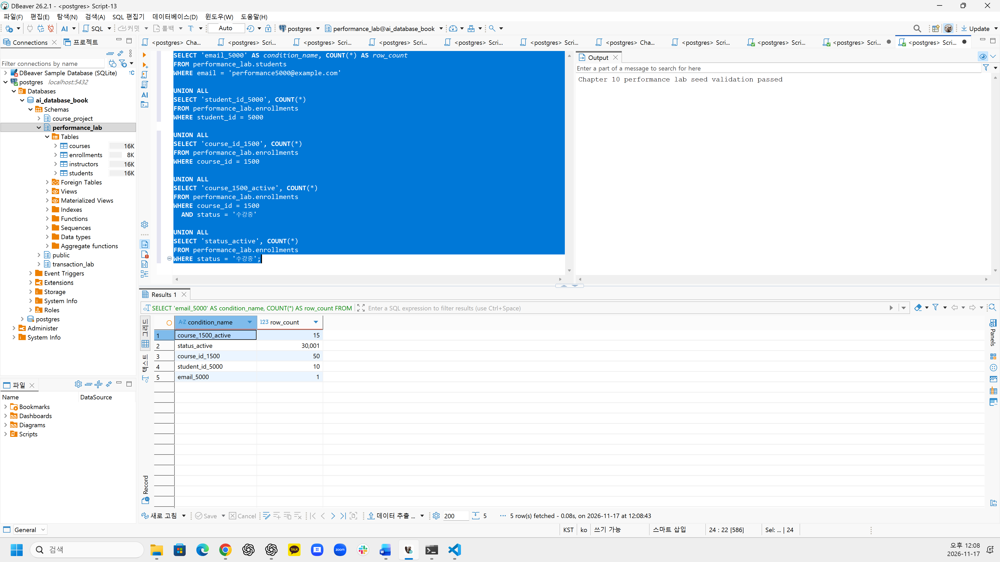
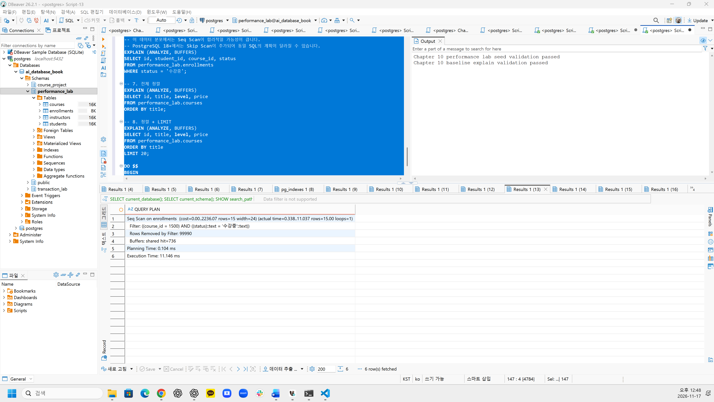
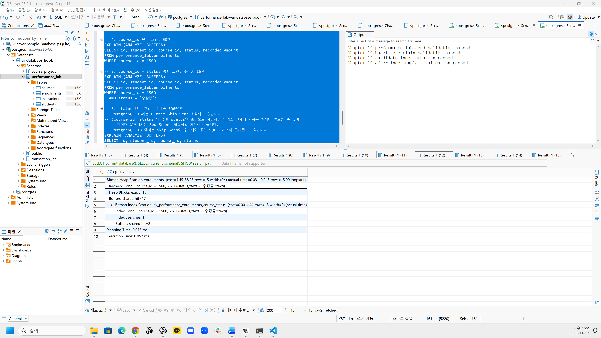

# Chapter 10 확장 실습 답안 템플릿

> **과제:** 실행 계획으로 인덱스 효과 검증하기  
> **사용 방법:** 이 파일을 내려받아 본인의 GitHub 저장소에 `chapter10_answer.md`라는 이름으로 저장한 뒤 실습하면서 바로 작성합니다.  
> **제출 방법:** LMS에는 파일을 직접 업로드하지 않고, **본인 GitHub 저장소의 `chapter10_answer.md` 파일 URL**을 제출합니다.

---

## 제출 전 주의

이 파일과 캡처 화면에는 실제 비밀번호, 전체 DB 접속 URL, API Key, 개인정보를 기록하지 않습니다.

```text
GitHub 계정 또는 별칭:yangguebeom
과제 작성일:2026-11-17
사용한 AI 도구:ChatGPT
```

---

# 1. PostgreSQL 버전과 시작 환경 확인

다음을 실행합니다.

```sql
SELECT version();
SELECT current_database();
SELECT current_user;
SELECT current_schema();
SHOW search_path;
```

| 확인 항목 | 실제 결과 | 의미 |
| --- | --- | --- |
| PostgreSQL 버전 | PostgreSQL 18.6 (64-bit, Windows) | 현재 사용 중인 PostgreSQL 버전으로, 실행 계획과 인덱스 최적화 방식에 영향을 준다. |
| `current_database()` | `ai_database_book` | 현재 연결된 데이터베이스 |
| `current_user` | `postgres` | 현재 SQL을 실행하는 사용자 |
| `current_schema()` | `course_project` | 현재 기본 스키마 |
| `search_path` | `course_project, "$user", public` | 스키마를 생략한 객체 이름을 탐색하는 순서 |

### PostgreSQL 버전을 기록해야 하는 이유

```text
PostgreSQL 버전에 따라 쿼리 최적화 방식과 실행 계획이 달라질 수 있기 때문이다.
이번 실습의 자동 검증 기준은 PostgreSQL 16이지만, 실제 사용 환경은
PostgreSQL 18.6이다. PostgreSQL 18부터 지원하는 B-tree Skip Scan으로 인해
복합 인덱스의 후행 컬럼만 사용하는 조회에서도 실행 계획이 달라질 수 있다.
따라서 실행 계획을 비교할 때 PostgreSQL 버전을 함께 고려해야 한다.
```

> 이 장의 자동 검증 기준은 PostgreSQL 16입니다. PostgreSQL 18 이상에서는 B-tree Skip Scan 등으로 동일 SQL의 실행 계획이 달라질 수 있습니다.

---

# 2. Chapter 07·08 기준 상태 확인

Chapter 10은 기존 `course_project`를 변경하지 않습니다.

확인 기준:

```text
students = 3
instructors = 2
courses = 3
enrollments = 5

전체 recorded_amount = 590000
활성 = 3건 / 340000
취소 제외 = 4건 / 440000
```

```text
1001 = 완료 / 100000
1004 = 취소 / 150000
1005 = 신청 / 120000
```

### 실제 확인 결과

```text
students: 3
instructors: 2
courses: 3
enrollments: 5
전체 recorded_amount: 590000
활성 신청 건수/금액: 3건 / 340000
취소 제외 건수/금액: 4건 / 440000
```

### 성능 실험을 기존 `course_project`에 대량 데이터를 넣지 않고 별도 스키마에서 하는 이유

```text
course_project는 Chapter 07·08에서 검증한 기존 데이터를 유지해야 하므로
대량 데이터를 추가하면 테이블의 행 수와 상태별 집계 결과가 달라질 수 있다.

또한 기존 데이터는 enrollments가 5건에 불과해 PostgreSQL이 인덱스를
사용하는 것보다 전체 테이블을 읽는 Seq Scan을 선택하는 것이
더 효율적일 수 있다.

따라서 기존 데이터의 검증 상태를 보존하면서 충분한 데이터 규모에서
인덱스 생성 전후의 실행 계획, Buffers, 실행 시간을 비교하기 위해
별도의 performance_lab 스키마를 사용한다.
```

---

# 3. `performance_lab` 생성과 대량 데이터 확인

다음 파일을 순서대로 실행합니다.

```text
code/chapter10/01_performance_lab_schema.sql
code/chapter10/02_performance_lab_seed.sql
```

## 3-1. 생성 후 행 수

| 테이블 | 기대 행 수 | 실제 행 수 | 일치? |
| --- | ---: | ---: | --- |
| `performance_lab.students` | 10003 | 10003 | 일치 |
| `performance_lab.instructors` | 2 | 2 | 일치 |
| `performance_lab.courses` | 2003 | 2003 | 일치 |
| `performance_lab.enrollments` | 100005 | 100005 | 일치 |

## 3-2. 데이터 분포 확인

| 조건 | 기대 행 수 | 실제 행 수 | 대략적 비율 |
| --- | ---: | ---: | ---: |
| `performance5000@example.com` | 1 | 1 | 약 0.010% |
| `student_id = 5000` | 10 | 10 | 약 0.010% |
| `course_id = 1500` | 50 | 50 | 약 0.050% |
| `course_id = 1500 AND status='수강중'` | 15 | 15 | 약 0.015% |
| 전체 `status='수강중'` | 30001 | 30001 | 약 30.0% |

### 선택도가 낮은 조건과 많은 행을 반환하는 조건은 인덱스 판단에서 어떻게 다르게 볼 수 있나요?

```text
조회 조건에 해당하는 행이 적을수록 인덱스를 통해 필요한 데이터만 찾는
방식이 유리할 가능성이 높다. 예를 들어 student_id = 5000은
전체 100005건 중 10건(약 0.010%)만 반환하므로 인덱스 활용을
기대할 수 있다.

반면 status = '수강중'은 전체의 약 30%인 30001건을 반환하므로,
인덱스를 통해 많은 행에 접근하는 것보다 Seq Scan이 더 효율적일 수 있다.

따라서 인덱스 효과는 단순히 인덱스 존재 여부가 아니라 조회 비율,
데이터 분포, 실행 계획 및 Buffers를 함께 확인하여 판단해야 한다.
```

### 증거 화면

권장 경로:

```text
assignments/chapter10/images/step03_data_scale.png
```

`여기에 데이터 규모 확인 화면을 삽입하세요.`



`performance_lab`에 students 10003건, instructors 2건, courses 2003건, enrollments 100005건이 생성되었으며, 데이터 분포 검증 결과 5개 조건 모두 기대값과 일치함을 확인하였다.

---

# 4. 인덱스 생성 전 기준 계획 기록

다음 파일을 실행합니다.

```text
code/chapter10/03_baseline_explain.sql
```

> **중요:** `04_create_candidate_indexes.sql`을 먼저 실행하지 않습니다. 기준 계획을 잃으면 같은 조건의 전후 비교가 어려워집니다.

최소 3개 SQL의 실행 계획을 기록합니다.

## Query A

```text
업무 질문: 특정 강의 제목과 정확히 일치하는 강의를 조회한다.
WHERE / JOIN / ORDER BY / LIMIT: WHERE title = '성능 테스트 강의 00500' / JOIN 없음 / ORDER BY 없음 / LIMIT 없음
예상 반환 행 수: 1
실제 반환 행 수: 1
```

```sql
-- 대상 SQL
EXPLAIN (ANALYZE, BUFFERS)
SELECT id, title, level, price
FROM performance_lab.courses
WHERE title = '성능 테스트 강의 00500';
```

| 관찰 항목 | 기록 |
| --- | --- |
| 주요 Scan/계획 노드 | Seq Scan on courses |
| estimated rows | 1 |
| actual rows | 1 |
| Filter | `title = '성능 테스트 강의 00500'` |
| Index Cond | 없음 |
| Buffers hit/read | hit=34 / read=0 |
| Planning Time | 0.066 ms |
| Execution Time | 0.323 ms |

## Query B

```text
업무 질문: 특정 강의에서 현재 수강 중인 신청 내역을 조회한다.
WHERE / JOIN / ORDER BY / LIMIT: WHERE course_id = 1500 AND status = '수강중' / JOIN 없음 / ORDER BY 없음 / LIMIT 없음
예상 반환 행 수: 15
실제 반환 행 수: 15
```

| 관찰 항목 | 기록 |
| --- | --- |
| 주요 Scan/계획 노드 | Seq Scan on enrollments |
| estimated rows | 15 |
| actual rows | 15 |
| Filter | `course_id = 1500 AND status = '수강중'` |
| Index Cond | 없음 |
| Buffers hit/read | hit=736 / read=0 |
| Execution Time | 11.146 ms |

## Query C

```text
업무 질문: 전체 수강 신청 중 현재 수강 중인 내역을 조회한다.
WHERE / JOIN / ORDER BY / LIMIT: WHERE status = '수강중' / JOIN 없음 / ORDER BY 없음 / LIMIT 없음
예상 반환 행 수: 약 30001
실제 반환 행 수: 30001
```

| 관찰 항목 | 기록 |
| --- | --- |
| 주요 Scan/계획 노드 | Seq Scan on enrollments |
| estimated rows | 30125 |
| actual rows | 30001 |
| Filter | `status = '수강중'` |
| Index Cond | 없음 |
| Buffers hit/read | hit=736 / read=0 |
| Execution Time | 19.732 ms |

### `cost`와 실제 실행 시간이 같은 개념이 아닌 이유

```text
cost는 PostgreSQL의 쿼리 최적화기가 실행 계획을 비교하기 위해
계산하는 상대적인 추정 비용이며, 실제 소요 시간을 의미하지 않는다.

반면 Execution Time은 EXPLAIN ANALYZE로 SQL을 실제 실행하여
측정한 시간이다. cost가 낮다고 반드시 실행 시간이 짧은 것은 아니며,
실제 성능을 판단하려면 실행 계획과 Buffers, Execution Time을
함께 확인해야 한다.
```

### `EXPLAIN ANALYZE`는 실제 SQL을 실행한다는 점을 왜 기억해야 하나요?

```text
EXPLAIN은 SQL을 실제 실행하지 않고 예상 실행 계획을 보여주지만,
EXPLAIN ANALYZE는 SQL을 실제로 실행하여 처리 행 수와 실행 시간을
측정한다.

따라서 INSERT, UPDATE, DELETE와 같은 변경 SQL에 사용하면
실제 데이터가 변경될 수 있으므로 주의해야 한다.

이번 실습에서는 SELECT 조회에 적용하여 데이터를 변경하지 않고
인덱스 생성 전 실행 계획을 확인하였다.
```

### 증거 화면

권장 경로:

```text
assignments/chapter10/images/step04_before_plan.png
```

`여기에 대표 기준 실행 계획을 삽입하세요.`



`course_id = 1500 AND status = '수강중'` 조건의 기준 실행 계획에서 Seq Scan이 선택되었으며, 전체 100005건 중 15건을 반환하였다. 인덱스 생성 전 Buffers shared hit=736, Execution Time=11.146 ms로 측정되었고, 해당 결과를 이후 동일 SQL의 인덱스 생성 후 실행 계획과 비교한다.

---

# 5. 후보 인덱스를 만들기 전에 이유 작성

본문 실험 후보는 다음 세 개입니다.

```text
idx_performance_courses_title
idx_performance_enrollments_student_id
idx_performance_enrollments_course_status
```

각 인덱스의 이유를 먼저 작성합니다.

| 후보 인덱스 | 대응 조회 패턴 | 예상 이점 | 컬럼 순서 이유 | 예상 비용/단점 |
| --- | --- | --- | --- | --- |
| `idx_performance_courses_title` | 강의 제목 정확 일치 검색(`WHERE title = ...`), 제목순 정렬(`ORDER BY title LIMIT 20`). 제목 검색 시 1행 반환 | 제목 검색에서 전체 테이블 스캔을 줄이고, 정렬 조회에서 인덱스 순서를 활용할 수 있다. | `title` 단일 컬럼 인덱스로 정확 일치 검색과 제목순 정렬에 대응한다. | 인덱스 저장 공간이 필요하며 강의 추가·삭제 및 제목 변경 시 유지 비용이 발생한다. |
| `idx_performance_enrollments_student_id` | 특정 학생의 수강 신청 JOIN 조회(`WHERE student_id = 5000`). 신청 내역 10행 반환 | 100005건의 신청 내역을 전부 읽지 않고 특정 학생의 신청 내역을 검색하여 JOIN 비용을 줄일 수 있다. | `student_id`가 동등 비교 조건이므로 단일 컬럼 인덱스로 구성한다. | 신청 데이터 추가·삭제 및 학생 ID 변경 시 인덱스 유지 비용이 발생한다. |
| `idx_performance_enrollments_course_status` | 강의별 신청 조회(`WHERE course_id = 1500`, 50행), 강의·상태 복합 조회(`WHERE course_id = 1500 AND status = '수강중'`, 15행) | 특정 강의의 신청 내역과 수강 중인 내역을 효율적으로 검색하여 불필요한 데이터 접근을 줄일 수 있다. | `course_id`를 선두에 배치해 강의 단독 조회와 복합 조건 조회에 대응하고, `status`를 후행 컬럼으로 배치한다. | 두 컬럼을 저장하므로 인덱스 크기가 증가하며 신청 상태 변경 및 데이터 추가·삭제 시 유지 비용이 발생한다. |

### “중요한 컬럼이므로 인덱스를 만든다”는 설명이 부족한 이유

```text
인덱스는 컬럼의 중요도가 아니라 실제 업무 조회 패턴과 데이터 분포를
기준으로 설계해야 한다.

WHERE, JOIN, ORDER BY, LIMIT에 컬럼이 어떻게 사용되는지,
조건에 해당하는 행이 몇 건인지, 기존 인덱스가 있는지를 먼저 확인해야 한다.

예를 들어 student_id = 5000은 전체 100005건 중 10건만 반환하지만,
status = '수강중'은 30001건을 반환한다. 두 조건은 반환 비율이
다르므로 같은 방식의 인덱스 접근이 항상 효율적이라고 볼 수 없다.

또한 인덱스를 생성하면 저장 공간과 쓰기 비용이 증가하므로
실제 실행 계획과 Buffers를 비교해 필요성을 판단해야 한다.
```

### `(course_id, status)`와 `(status, course_id)`가 항상 같은 효과가 아닌 이유

```text
복합 B-tree 인덱스는 컬럼 순서에 따라 효율적으로 처리할 수 있는
조회 조건과 탐색 범위가 달라진다.

(course_id, status) 인덱스는 course_id 단독 조건과
course_id + status 복합 조건에 적합하다.
특히 course_id = 1500은 50건, 여기에 status = '수강중'을
추가하면 15건으로 줄어들어 효율적인 탐색을 기대할 수 있다.

반면 (status, course_id) 인덱스는 status를 선두 컬럼으로
사용하므로 status 단독 조회에도 대응할 수 있다.
그러나 status = '수강중'은 전체의 약 30%를 반환하기 때문에
인덱스보다 Seq Scan이 유리할 수 있다.

또한 PostgreSQL 16에서는 선두 컬럼 조건 없이 후행 컬럼만
사용하는 조회의 탐색 범위를 효율적으로 줄이기 어렵다.
현재 사용하는 PostgreSQL 18.6에서는 B-tree Skip Scan이
지원되므로 후행 컬럼 조건만으로도 인덱스가 활용될 가능성이 있다.

따라서 두 인덱스가 항상 같은 효과를 내는 것은 아니며,
실제 실행 계획의 Scan 방식, Index Cond, Buffers를 확인하여
컬럼 순서의 적절성을 판단해야 한다.
```

---

# 6. 후보 인덱스 생성

다음을 실행합니다.

```text
code/chapter10/04_create_candidate_indexes.sql
```

생성 후 확인:

```text
후보 인덱스 수: 3
전체 인덱스 수: 9
```

본문 기준:

```text
자동 인덱스 = 6
후보 인덱스 = 3
전체 인덱스 = 9
```

### PRIMARY KEY나 UNIQUE가 이미 인덱스를 만들 수 있는데 같은 목적의 인덱스를 또 만들면 어떤 문제가 생기나요?

```text
PostgreSQL에서는 PRIMARY KEY와 UNIQUE 제약조건을 설정하면
이를 검사하기 위한 고유 인덱스가 자동으로 생성된다.

이미 동일한 컬럼과 목적의 인덱스가 존재하는데 중복으로 생성하면
조회 성능 개선 없이 저장 공간만 추가로 사용할 수 있다.

또한 INSERT, UPDATE, DELETE가 발생할 때 중복 인덱스까지
관리해야 하므로 쓰기 성능이 저하되고 유지 관리 비용이 증가한다.

따라서 새 인덱스를 만들기 전에 pg_indexes를 통해 기존 인덱스의
구성과 용도를 확인하고 중복 생성 여부를 검토해야 한다.
```

---

# 7. 같은 SQL로 인덱스 후 재측정

다음 파일을 실행합니다.

```text
code/chapter10/05_after_index_explain.sql
```

Chapter 4에서 기록한 **동일 SQL**을 비교합니다.

## Query A 전후 비교

| 항목 | Before | After | 해석 |
| --- | --- | --- | --- |
| 주요 계획 노드 | Seq Scan on courses | Index Scan using idx_performance_courses_title | 제목 인덱스를 이용하는 계획으로 변경되었다. |
| actual rows | 1 | 1 | 반환 행 수가 동일하다. |
| Buffers hit/read | hit=34 / read=0 | hit=3 / read=0 | 접근한 공유 버퍼가 34개에서 3개로 감소했다. |
| Execution Time | 0.323 ms | 0.031 ms | 이번 측정에서는 실행 시간이 감소했다. |
| Index Cond | 없음 | `title = '성능 테스트 강의 00500'` | 제목 조건이 인덱스 탐색에 사용되었다. |

```text
결과 행이 동일했는가: 예. 인덱스 생성 전후 모두 1행을 반환하였다.
읽은 버퍼가 줄었는가: 예. shared hit이 34개에서 3개로 감소했고, read는 모두 0이었다.
계획이 바뀌었는가: 예. Seq Scan에서 Index Scan으로 변경되었다.
실행 시간 한 번만으로 결론낼 수 있는가: 아니오. 캐시 상태와 시스템 부하에 따라 실행 시간이 달라질 수 있으므로 반복 측정과 Buffers, 실행 계획을 함께 확인해야 한다.
```

## Query B 전후 비교

| 항목 | Before | After | 해석 |
| --- | --- | --- | --- |
| 주요 계획 노드 | Seq Scan on enrollments | Bitmap Heap Scan + Bitmap Index Scan | 복합 인덱스를 사용하는 계획으로 변경되었다. |
| actual rows | 15 | 15 | 반환 행 수가 동일하다. |
| Buffers hit/read | hit=736 / read=0 | hit=19 / read=0 | 접근한 공유 버퍼가 크게 감소했다. |
| Execution Time | 11.146 ms | 0.057 ms | 이번 측정에서는 실행 시간이 크게 감소했다. |
| Index Cond | 없음 | `course_id = 1500 AND status = '수강중'` | 복합 조건이 인덱스 탐색에 사용되었다. |


## Query C 전후 비교

| 항목 | Before | After | 해석 |
| --- | --- | --- | --- |
| 주요 계획 노드 | Seq Scan on enrollments | Seq Scan on enrollments | 인덱스 생성 후에도 Seq Scan이 유지되었다. |
| actual rows | 30001 | 30001 | 반환 행 수가 동일하다. |
| Buffers hit/read | hit=736 / read=0 | hit=736 / read=0 | 접근한 공유 버퍼 수가 동일하다. |
| Execution Time | 19.732 ms | 21.051 ms | 이번 측정에서는 실행 시간이 소폭 증가했다. |
| Index Cond | 없음 | 없음 | 인덱스 탐색 조건이 사용되지 않았다. |


### `Index Scan`으로 바뀌었다는 사실만으로 성공이라고 할 수 없는 이유

```text
Index Scan이 선택되었다는 사실만으로 실제 성능 개선을 확정할 수는 없다.

인덱스를 사용하더라도 많은 데이터 블록에 접근하거나 추가적인
테이블 조회가 발생하면 Seq Scan보다 비효율적일 수 있다.

따라서 같은 SQL의 반환 행 수가 유지되는지 확인하고,
Buffers hit/read, Filter, Index Cond, Execution Time 등을
함께 비교해야 한다.

이번 실습에서 Query A는 Index Scan으로 변경되면서 공유 버퍼 접근이
34개에서 3개로 감소하였다. Query B는 Bitmap Index Scan과
Bitmap Heap Scan을 사용하면서 736개에서 19개로 감소하였다.

반면 Query C는 인덱스 생성 후에도 Seq Scan을 유지하였다.
이러한 결과를 통해 인덱스 효과는 계획 노드의 이름보다
실제 데이터 접근량과 실행 결과를 근거로 판단해야 함을 확인하였다.
```

### 증거 화면

권장 경로:

```text
assignments/chapter10/images/step07_after_plan.png
```

`여기에 동일 SQL의 사후 실행 계획을 삽입하세요.`



`course_id = 1500 AND status = '수강중'` 조건의 인덱스 생성 후 실행 계획이다. `idx_performance_enrollments_course_status`를 이용한 Bitmap Index Scan과 Bitmap Heap Scan이 선택되었으며, 반환 행 수는 15건으로 유지되었다. Buffers shared hit=19, Execution Time=0.057 ms로 측정되어 인덱스 생성 전의 736개, 11.146 ms와 비교할 수 있다.

---

# 8. `status` 단독 조회와 Seq Scan 해석

전체 `status = '수강중'`은 약 30%의 행을 반환합니다.

```text
예상 행 수 = 30001
실제 행 수 = 30001
주요 계획 노드 = Seq Scan on enrollments
```

### 인덱스가 존재해도 PostgreSQL이 Seq Scan을 선택할 수 있는 이유

```text
status = '수강중' 조건은 전체 100005건 중 30001건인 약 30%를
반환하므로 선택성이 높지 않다.

이처럼 많은 행을 조회할 때는 인덱스를 이용해 여러 데이터 위치에
접근하는 것보다 테이블을 순차적으로 읽는 것이 효율적일 수 있다.

실제로 인덱스 생성 후에도 Seq Scan이 선택되었으며,
Buffers shared hit은 736개로 확인되었다.
```

### “Seq Scan = 나쁜 계획”이라고 단정하면 안 되는 이유

```text
Seq Scan은 테이블 전체를 순차적으로 읽는 방식으로,
많은 행을 조회하거나 테이블 규모가 작을 때 효율적일 수 있다.

인덱스가 존재하더라도 인덱스 탐색과 테이블 접근에 드는 비용이
전체 스캔보다 크다면 PostgreSQL은 Seq Scan을 선택할 수 있다.

따라서 Seq Scan 자체를 실패로 판단하지 않고,
실제 반환 행 수와 데이터 분포, Buffers, 실행 시간을
함께 확인해야 한다.
```

### PostgreSQL 16과 18 이상에서 복합 B-tree 후행 컬럼 조건의 계획이 다를 수 있는 이유

```text
PostgreSQL 16에서는 복합 B-tree 인덱스의 선두 컬럼 조건이 없으면
후행 컬럼만으로 효율적인 탐색 범위를 줄이기 어렵다.

반면 PostgreSQL 18 이상에서는 B-tree Skip Scan을 지원하므로
선두 컬럼 조건이 없어도 후행 컬럼 조건을 활용해 인덱스를
탐색할 수 있는 경우가 있다.

따라서 동일한 SQL과 인덱스라도 PostgreSQL 버전에 따라
실행 계획이 달라질 수 있다.

다만 이번 PostgreSQL 18.6 환경의 status 단독 조회에서는
전체 데이터의 약 30%를 반환하므로 Seq Scan이 선택되었다.
```

---

# 9. `ORDER BY`와 `LIMIT`에서 인덱스 관찰

`ORDER BY title`과 `ORDER BY title LIMIT 20` 계획을 비교합니다.

```text
ORDER BY title 계획:
- Index Scan using idx_performance_courses_title on courses
- Sort 노드 없음
- actual rows = 2003
- Buffers shared hit=37 / read=12
- Execution Time = 1.646 ms

ORDER BY title LIMIT 20 계획:
- Limit + Index Scan using idx_performance_courses_title on courses
- Sort 노드 없음
- actual rows = 20
- Buffers shared hit=3 / read=0
- Execution Time = 0.041 ms
```

### LIMIT이 있을 때 PostgreSQL이 전체 정렬보다 인덱스 순서를 활용하는 것이 유리할 수 있는 이유

```text
B-tree 인덱스는 키 값을 정렬된 순서로 관리하므로 ORDER BY 컬럼과
인덱스 순서가 일치하면 별도의 Sort 없이 데이터를 조회할 수 있다.

특히 LIMIT 20처럼 일부 행만 필요한 경우 전체 데이터를 정렬하지 않고
인덱스 순서대로 앞의 20건만 읽으면 되므로 불필요한 데이터 접근과
정렬 비용을 줄일 수 있다.
```

### 실제 계획에서 Sort 노드 또는 Index Scan을 어떻게 확인했나요?

```text
EXPLAIN (ANALYZE, BUFFERS) 결과의 주요 실행 계획 노드를 확인하였다.

ORDER BY title 조회에서는 idx_performance_courses_title을 사용하는
Index Scan이 나타났고, 별도의 Sort 노드는 없었다.

ORDER BY title LIMIT 20 조회에서는 Limit 노드 아래에
동일한 인덱스를 사용하는 Index Scan이 나타났으며,
Sort 노드는 없었다.

전체 정렬 조회는 2003건을 반환하고 Buffers hit=37, read=12였지만,
LIMIT 20 조회는 20건만 반환하고 Buffers hit=3, read=0이었다.

따라서 LIMIT 조건이 있을 때 인덱스 순서를 활용하여 필요한
일부 행만 효율적으로 조회한 것을 확인하였다.
```

---

# 10. 인덱스 검토

다음을 실행합니다.

```text
code/chapter10/06_index_review.sql
```

## 10-1. 인덱스별 판단

| 인덱스 | 크기/사용 관찰 | 유지 / 보류 / 제거 | 판단 근거 |
| --- | --- | --- | --- |
| `idx_performance_courses_title` | 120 kB, idx_scan=4, valid/ready=true | 유지 | 제목 정확 일치 조회에서 Seq Scan이 Index Scan으로 변경되었으며, Buffers hit이 34에서 3으로 감소하였다. ORDER BY title 조회에도 사용되었다. |
| `idx_performance_enrollments_student_id` | 936 kB, idx_scan=2, valid/ready=true | 유지 | 학생별 신청 JOIN에서 기존 Seq Scan 대신 Index Scan이 사용되었으며, 10건의 신청 내역을 효율적으로 조회하였다. |
| `idx_performance_enrollments_course_status` | 960 kB, idx_scan=7, valid/ready=true | 유지 | 강의·상태 복합 조건 조회에서 Bitmap Index Scan이 사용되었으며, Buffers hit이 736에서 19로 감소하였다. |

### `idx_scan = 0`이라는 이유 하나만으로 인덱스를 삭제하면 안 되는 이유

```text
idx_scan은 통계 수집 이후 인덱스가 사용된 횟수를 나타내지만,
통계가 초기화되었거나 관찰 기간이 짧으면 0으로 표시될 수 있다.

또한 특정 업무 조회가 아직 실행되지 않았을 수 있으며,
PRIMARY KEY나 UNIQUE 인덱스는 제약조건 유지에도 필요하다.

따라서 idx_scan 값만으로 삭제를 결정하지 않고,
실제 조회 패턴과 실행 계획, 인덱스 크기 및 역할을 함께 검토해야 한다.
```

### 외래키 자식 컬럼 인덱스가 무결성 자체의 필수 조건은 아니지만 성능상 필요할 수 있는 이유

```text
PostgreSQL은 외래키를 생성할 때 자식 테이블의 참조 컬럼에
인덱스를 자동으로 생성하지 않는다.

외래키 제약조건은 인덱스가 없어도 무결성을 보장하지만,
부모 행 삭제나 참조 키 변경 시 관련 자식 행을 확인해야 하므로
인덱스가 없으면 조회 비용이 증가할 수 있다.

또한 외래키 컬럼을 사용하는 JOIN이나 WHERE 조건에서도
인덱스가 성능 개선에 도움이 될 수 있다.
```

### 인덱스를 많이 만들었을 때 생기는 쓰기·저장 비용

```text
인덱스를 추가하면 별도의 저장 공간이 필요하며,
INSERT, UPDATE, DELETE 시 관련 인덱스도 함께 갱신해야 한다.

따라서 인덱스 수가 증가할수록 쓰기 작업의 처리 비용과
저장 공간 사용량, 유지 관리 부담이 커질 수 있다.

그러므로 실제 조회 성능 개선 효과와 쓰기·저장 비용을 비교하여
필요한 인덱스만 유지해야 한다.
```

---

# 11. 자동 완료 게이트

다음을 실행합니다.

```text
code/chapter10/07_result_validation.sql
```

```text
최종 검증 결과: Chapter 10 performance result validation passed
```

검증할 핵심 내용:

```text
performance_lab 기준 행 수 유지
- students = 10003
- instructors = 2
- courses = 2003
- enrollments = 100005

조회 결과 행 수 유지
- 학생 이메일 정확 조회 = 1건
- 강의 제목 정확 조회 = 1건
- student_id = 5000 = 10건
- course_id = 1500 = 50건
- course_id = 1500 AND status = '수강중' = 15건
- status = '수강중' = 30001건
- 활성 학생·강의 중복 = 0건

후보 인덱스 3개 존재
- idx_performance_courses_title
- idx_performance_enrollments_student_id
- idx_performance_enrollments_course_status
- 모두 valid / ready 상태

course_project 기준 상태 유지
- Chapter 07·08 기준 데이터 및 집계 상태 보존
- 자동 검증 PASS
```

### 실행 계획 비교와 별도로 결과 행 동일성을 검증해야 하는 이유

```text
인덱스 생성 전후 실행 계획이나 실행 시간이 개선되더라도
조회 결과가 달라진다면 올바른 성능 개선이라고 할 수 없다.

따라서 동일 SQL의 반환 행 수가 유지되는지 확인하고,
테이블 행 수와 데이터 분포, 기존 프로젝트 상태도 함께 검증해야 한다.

성능 개선은 조회 결과의 정확성이 보장된 상태에서 판단해야 한다.
```

---

# 12. 인덱스 만능론 반박

다음 주장 중 **두 개**를 골라 본문과 실제 실행 계획을 근거로 반박합니다.

```text
A. 인덱스는 많을수록 좋다.
B. 인덱스를 만들었는데 Seq Scan이면 실패다.
C. 모든 FK에는 무조건 같은 방식의 인덱스를 만든다.
D. 실행 시간이 한 번이라도 빨라졌으면 효과가 입증됐다.
E. 선택도가 낮으면 무조건 Index Scan이 나온다.
```

## 주장 1

```text
선택한 주장: B. 인덱스를 만들었는데 Seq Scan이면 실패다.

나의 반박:
인덱스가 존재하더라도 조회 결과가 전체 데이터에서 차지하는
비율이 높으면 Seq Scan이 더 효율적일 수 있다.
따라서 Seq Scan이 선택되었다는 이유만으로
인덱스 생성이 실패했다고 판단할 수 없다.

실행 계획에서 확인한 근거:
status = '수강중' 조회는 전체 100005건 중 30001건을 반환하였다.
복합 인덱스 생성 후에도 Seq Scan이 선택되었으며,
Buffers shared hit=736, Execution Time=21.051 ms로 측정되었다.
이는 많은 행을 반환하는 조회에서 PostgreSQL이 전체 스캔을
선택할 수 있음을 보여준다.
```

## 주장 2

```text
선택한 주장: D. 실행 시간이 한 번이라도 빨라졌으면 효과가 입증됐다.

나의 반박:
실행 시간은 캐시 상태, 시스템 부하, 실행 환경 등에 영향을 받으므로
한 번의 측정 결과만으로 성능 개선을 확정할 수 없다.
동일 SQL을 반복 측정하고 실행 계획과 Buffers,
반환 행 수 등을 함께 비교해야 한다.

실행 계획에서 확인한 근거:
course_id = 1500 AND status = '수강중' 조회는
인덱스 생성 전 Seq Scan, Execution Time=11.146 ms였지만,
생성 후에는 Bitmap Heap Scan과 Bitmap Index Scan이 선택되어
Execution Time=0.057 ms로 감소하였다.

또한 Buffers shared hit도 736에서 19로 감소하고
실제 반환 행 수는 15건으로 유지되었다.

따라서 이번 측정에서는 인덱스의 효과가 관찰되었지만,
실행 시간 한 번만으로 일반적인 성능 개선을 확정하지 않고
반복 측정과 실행 계획을 함께 확인해야 한다.
```

---

# 13. 개인 프로젝트 조회 패턴과 인덱스 후보

Chapter 07~09에서 발전시킨 개인 프로젝트를 사용합니다.

최소 2개의 **실제 반복 조회 질문**을 먼저 만듭니다.

| ID | 반복 조회 질문 | WHERE | JOIN | ORDER BY/LIMIT | 예상 반환 비율 | 후보 인덱스 |
| --- | --- | --- | --- | --- | --- | --- |
| P10-Q01 | 특정 회원의 스터디 가입 신청 내역을 최신순으로 조회 | `applications.member_id = ?` | `applications.study_id = studies.study_id` | `ORDER BY applied_at DESC LIMIT 20` | 전체 신청 중 특정 회원의 신청만 반환하므로 낮을 것으로 예상 | `idx_applications_member_applied` |
| P10-Q02 | 특정 스터디의 승인 대기 신청 목록을 오래된 순서대로 조회 | `applications.study_id = ? AND applications.status = '대기'` | `applications.member_id = members.member_id` | `ORDER BY applied_at ASC LIMIT 20` | 전체 신청 중 특정 스터디의 대기 신청만 반환하므로 낮을 것으로 예상 | `idx_applications_study_status_applied` |

## 후보 1

```text
후보 인덱스: idx_applications_member_applied

컬럼 순서: (member_id, applied_at DESC)

이 조회에 도움이 될 것으로 예상한 이유:
특정 회원의 신청 내역을 조회할 때 member_id로 검색 범위를
좁히고, applied_at DESC를 이용하여 최신순으로 조회할 수 있다.
LIMIT 20과 함께 사용하면 전체 신청 내역을 정렬하지 않고
필요한 일부 행을 효율적으로 가져올 가능성이 있다.

쓰기/저장 비용:
가입 신청이 INSERT될 때 인덱스도 갱신해야 하며,
별도의 인덱스 저장 공간과 유지 관리 비용이 발생한다.

현재 바로 적용 / 후보로 보류: 후보로 보류
```

## 후보 2

```text
후보 인덱스: idx_applications_study_status_applied

컬럼 순서: (study_id, status, applied_at ASC)

이 조회에 도움이 될 것으로 예상한 이유:
스터디장이 특정 스터디의 승인 대기 신청을 확인할 때
study_id와 status 조건으로 검색 범위를 좁힐 수 있다.
또한 applied_at 순서로 오래된 신청부터 조회할 수 있어
정렬 비용을 줄일 가능성이 있다.

쓰기/저장 비용:
가입 신청 INSERT 및 승인·거절에 따른 status UPDATE 시
인덱스 유지 비용이 발생하며 저장 공간도 추가로 필요하다.

현재 바로 적용 / 후보로 보류: 후보로 보류
```

### 개인 프로젝트 데이터가 너무 적어 성능 검증이 어렵다면

```text
필요한 데이터 규모:
인덱스 적용 전후의 실행 계획을 비교할 수 있도록
applications 테이블에 수만 건 이상의 실험 데이터를 준비한다.

필요한 데이터 분포:
회원별·스터디별 신청 건수를 다르게 구성하고,
대기·승인·거절 상태도 실제 서비스와 유사하게 분포시킨다.

비교할 SQL:
1. 특정 회원의 가입 신청 내역 최신 20건 조회
2. 특정 스터디의 승인 대기 신청 20건 조회

비교할 지표:
주요 실행 계획 노드, estimated rows, actual rows,
Buffers hit/read, Sort 여부, Execution Time,
조회 결과 행 수의 동일성

현재 판단 상태: 후보로 보류
```

> 작은 데이터에서 Index Scan이 나오지 않는다고 억지로 설정을 바꾸어 특정 계획을 강제하지 않습니다.

---

# 14. AI를 실행 계획 리뷰어로 활용

AI에게 인덱스를 바로 추천하게 하지 않고 실제 실행 계획과 조회 문맥을 제공합니다.

## 14-1. AI에게 전달한 정보

```text
업무 질문:
특정 강의(course_id = 1500)에서 수강 중인 학생의 신청 내역을 조회한다.

PostgreSQL 버전:
PostgreSQL 18.6

테이블 행 수:
performance_lab.enrollments = 100005건

데이터 분포:
- course_id = 1500: 50건
- course_id = 1500 AND status = '수강중': 15건
- status = '수강중': 30001건
- 전체 100005건 중 복합 조건에 해당하는 행은 약 0.015%

기존 인덱스:
- enrollments_pkey (id, PRIMARY KEY)
- idx_performance_enrollments_student_id (student_id)
- idx_performance_enrollments_course_status (course_id, status)

SQL:
EXPLAIN (ANALYZE, BUFFERS)
SELECT id, student_id, course_id, status, recorded_amount
FROM performance_lab.enrollments
WHERE course_id = 1500
  AND status = '수강중';

EXPLAIN (ANALYZE, BUFFERS) 핵심 결과:
[인덱스 생성 전]
- Seq Scan on enrollments
- actual rows = 15
- Rows Removed by Filter = 99990
- Buffers shared hit = 736
- Execution Time = 11.146 ms

[인덱스 생성 후]
- Bitmap Heap Scan on enrollments
- Bitmap Index Scan using idx_performance_enrollments_course_status
- Index Cond: course_id = 1500 AND status = '수강중'
- actual rows = 15
- Heap Blocks exact = 15
- Buffers shared hit = 19
- Execution Time = 0.057 ms
```

## 14-2. AI 제안 검토

| AI 제안 | 수용 / 수정 / 보류 / 거절 | 실제 계획/데이터 근거 | 최종 판단 |
| --- | --- | --- | --- |
| `(course_id, status)` 복합 인덱스 유지 | 수용 | Bitmap Index Scan이 사용되었고 Buffers shared hit이 736에서 19로 감소했으며 반환 행 수 15건이 유지되었다. | 기존 복합 인덱스를 유지한다. |
| `status` 단독 조회 개선을 위해 별도 인덱스 추가 | 보류 | `status = '수강중'`은 전체의 약 30%인 30001건을 반환하며, 기존 실행 계획에서는 Seq Scan이 선택되었다. | 별도 인덱스를 즉시 생성하지 않고 실제 조회 빈도와 추가 측정 결과를 확인한다. |
| 실행 시간이 감소했으므로 인덱스 효과가 확정되었다고 판단 | 수정 | 실행 시간은 11.146 ms에서 0.057 ms로 감소했지만 단일 측정값이며, Buffers도 736에서 19로 감소하였다. | 성능 개선이 관찰되었다고 판단하되, 반복 측정과 실행 환경 확인 후 최종 평가한다. |

### AI가 제안한 인덱스 중 만들지 않기로 한 것이 있다면 이유

```text
status 단독 조회를 위한 별도 인덱스는 생성하지 않고 보류하였다.

해당 조건은 전체 100005건 중 30001건인 약 30%를 반환하므로
선택성이 낮고, 기존 실행 계획에서도 Seq Scan이 선택되었다.

인덱스를 추가하면 저장 공간과 쓰기 유지 비용이 발생하므로
실제 조회 빈도와 성능 개선 효과를 추가로 확인한 뒤 결정한다.
```

### AI가 PostgreSQL 버전이나 데이터 분포를 무시하고 단정한 내용이 있었나요?

```text
이번 AI 리뷰에서는 PostgreSQL 18.6과 실제 데이터 분포를
함께 고려하였으므로 버전이나 분포를 무시한 단정은 없었다.

PostgreSQL 18 이상에서는 B-tree Skip Scan을 사용할 수 있지만,
실제 적용 여부는 데이터 분포와 실행 비용에 따라 달라진다.

따라서 인덱스가 존재하면 반드시 Index Scan이 선택된다고
단정하지 않고 실제 실행 계획을 기준으로 판단하였다.
```

### AI가 만든 인덱스 제안을 실제 계획 없이 채택하면 위험한 이유

```text
AI의 인덱스 제안은 실제 데이터 분포와 실행 비용을
정확히 반영하지 못할 수 있다.

불필요한 인덱스를 생성하면 저장 공간이 증가하고
INSERT, UPDATE, DELETE 시 유지 비용이 발생한다.

따라서 실제 SQL의 EXPLAIN (ANALYZE, BUFFERS) 결과를 확인하고,
반환 행 수와 실행 계획, Buffers, 실행 시간을 비교한 뒤
인덱스 채택 여부를 결정해야 한다.
```

---

# 15. 최종 성찰

아래 문장은 본인의 말로 작성합니다.

```text
1. 인덱스가 필요한지 판단할 때 가장 먼저 확인할 것은
   실제로 자주 실행되는 조회의 조건과 데이터 분포이다.

2. 같은 SQL의 인덱스 전후를 비교할 때 통제해야 할 조건은
   데이터 규모와 분포, SQL, 통계 정보 및 실행 환경이다.

3. Seq Scan이 항상 나쁜 것이 아닌 이유는
   조회할 행이 많거나 테이블이 작을 때 전체를 순차적으로 읽는 것이 더 효율적일 수 있기 때문이다.

4. 실행 시간 한 번보다 계획과 Buffers를 함께 보는 이유는
   실행 시간은 환경에 따라 달라질 수 있지만, 실행 계획과 Buffers를 통해 실제 데이터 접근 방식과 비용을 확인할 수 있기 때문이다.

5. 내 개인 프로젝트에서 아직 인덱스를 보류한 후보가 있다면 그 이유는
   스터디 가입 신청 조회를 위한 후보 인덱스 2개가 있지만, 아직 데이터가 적어 실제 성능 개선 효과를 충분히 검증하지 못했기 때문이다.
```

---

# 16. 제출 체크리스트

- [x] `chapter10_answer.md`를 본인 저장소에 만들었다.
- [x] PostgreSQL 버전을 기록했다.
- [x] Chapter 07·08 기준 상태를 확인했다.
- [x] `performance_lab`의 10003 / 2 / 2003 / 100005 기준을 확인했다.
- [x] `03_baseline_explain.sql`을 후보 인덱스 생성 전에 실행했다.
- [x] 기준 실행 계획을 최소 3개 기록했다.
- [x] 후보 인덱스 3개의 근거를 먼저 작성했다.
- [x] 동일 SQL의 인덱스 전후 계획을 비교했다.
- [x] 실행 시간뿐 아니라 Scan, actual rows, Buffers, Index Cond를 확인했다.
- [x] `status` 단독 조건의 계획을 해석했다.
- [x] `ORDER BY`와 `LIMIT` 계획을 확인했다.
- [x] 인덱스 만능론 주장 2개를 반박했다.
- [x] `07_result_validation.sql`로 최종 상태를 확인했다.
- [x] 개인 프로젝트의 반복 조회 2개와 인덱스 후보를 작성했다.
- [x] AI 제안을 실제 실행 계획과 비교했다.
- [x] 핵심 캡처 3~4장만 넣었다.
- [x] 캡처에 비밀번호·개인정보가 없다.
- [x] GitHub 웹에서 Markdown과 이미지가 정상적으로 보인다.
- [x] 최종 답안을 commit/push했다.

---

# 17. LMS 제출 URL

아래 형식의 **본인 GitHub 파일 URL**을 LMS에 제출합니다.

```text
https://github.com/<본인-GitHub-ID>/<본인-저장소>/blob/main/assignments/chapter10/chapter10_answer.md
```

내 제출 URL:

```text
https://github.com/yangguebeom/snu-database-2026-2/blob/main/assignments/chapter10/chapter10_answer.md
```

> 저장소 메인 URL, 교수자 템플릿 URL, Raw URL이 아니라 **작성 완료된 본인 `chapter10_answer.md` 파일 화면 URL**을 제출합니다.
